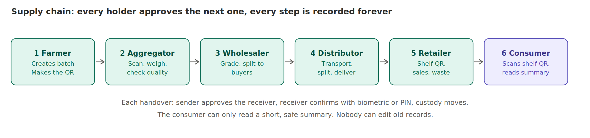

# 00. Master brief (read this first)

**Audience:** the AI coding agent (Google Antigravity) and the human reviewer.
**Status:** design complete, no code written yet. Date of this package: 10 October 2026.

## 1. What AnnaSutra is, in one paragraph

AnnaSutra is an app (Android and Web from one Flutter codebase, iOS possible later) plus a small backend that records the journey of agricultural produce, starting with tomatoes, from farmer to consumer. A farmer creates a batch and binds a printed QR sticker to it. Every later holder (aggregator, wholesaler, distributor, retailer) scans the same QR on their own phone, weighs and inspects, records what they received, and hands the batch on. Each holder approves the next one. Every step is appended to a history that nobody can edit or delete. A consumer scans the shelf QR in an ordinary phone camera and sees a short, safe summary on a tiny public web page.

## 2. What the system can and cannot prove (never claim more)

| Can prove | Cannot prove |
|---|---|
| Who recorded an event, and when (server time) | That the crates really contain what the record says |
| That history was not silently changed | That a weight or photo is honest |
| That quantities add up, with losses documented | That two cooperating parties are telling the truth |
| That custody passed in an unbroken chain | That a copied QR sticker is on the right produce |

Real-world assurance comes from audits, trusted weighing, lab tests and incentives. The public page must always say: *"This record is based on information entered by supply-chain participants. It does not prove the contents of this package."*

## 3. Decisions already made (do not re-decide without asking the human)

| Topic | Decision | Why |
|---|---|---|
| App | **Flutter** (Dart), one codebase for **Android and Web** (iOS later if needed) | One team, good speed on low-end phones, mature camera, local DB and passkey plugins. Web differences are in `docs/16` |
| Consumer view | **Tiny server-rendered web page** (no app, no login) | A shopper's phone camera opens a link. Forcing an app install would kill adoption |
| Admin | **Hardened Django admin** behind Cloudflare Access | Fastest safe way to verify businesses and review alerts. Not a custom web app |
| Backend | **Django + Django REST Framework**, modular monolith | One deployable, real DB transactions for custody and quantity rules |
| Database | **PostgreSQL**, append-only events, row-level security | Integrity rules live in the database, not only in code |
| Files | S3-compatible object storage, private, versioned | Photos and certificates |
| Edge | **Cloudflare** (WAF, rate limits, bot challenge, Access) | Cheap strong first layer. Treat as trusted vendor with an exit plan |
| Offline | Local encrypted DB + outbox, idempotent sync | Mandis and farms have weak coverage |
| Login | SMS code, then **passkey** where supported, **device key** fallback | Passkeys need Android 9+ and iOS 16+. Many cheap phones are older |
| Audit | Hash chain per lot + daily external anchor + signatures on handovers | Minimum defensible tamper evidence. No blockchain |
| Not in v1 | Payments, blockchain, IoT or GPS trackers, government API integrations | No justified need yet, or no documented interface |

## 4. Non-negotiable rules for the build

1. **The server is the authority.** The phone proposes events. The server validates and decides.
2. **Events are append-only.** Never update or delete an event. A mistake is fixed by a new correction event that points to the old one.
3. **Custody moves only when the receiver confirms.** A scan alone never grants permission.
4. **Idempotency everywhere.** Every write carries a client-made UUID. Sending twice stores once.
5. **No secrets in the repo.** No keys, passwords, tokens or real farmer data.
6. **The public page can read only a pre-built summary table.** Never private tables.
7. **Never invent an API, field, standard or legal duty.** If the contract is missing something, stop and ask the human.
8. **Ask before adding a dependency**, and say what it costs (size, licence, maintenance, risk).
9. **Plan first, then code.** Produce a plan for each phase and wait for approval.
10. **Tests are part of every feature.** No phase is done without them.

## 5. How the agent should work

Follow `docs/14_phases_and_prompts.md`. For each phase: (1) read the relevant docs, (2) write a plan and list questions, (3) stop for human approval, (4) implement in small commits, (5) run tests and linters, (6) write a short report: what changed, what was tested, what is uncertain, (7) stop for human review.

When something in these docs is marked **[verify]**, check the current official documentation yourself before using it, and record what you found in `docs/VERIFIED_FACTS.md` with the source link and date.

## 6. Definition of done (any feature)

- Matches the flow diagrams and rules in these docs.
- Unit and integration tests pass. Property tests pass for quantity rules.
- Authorisation tests prove one business cannot read or write another's data.
- Works offline, then syncs correctly.
- Text is in Bengali, Hindi and English resource files.
- No personal data in logs.
- A human reviewed the diff.

## 7. Glossary (plain words)

- **Lot / batch:** a quantity of produce that shares one origin and history. The QR points to it.
- **Custody:** who physically holds the lot right now. The system enforces this.
- **Handover:** sender dispatches, receiver confirms. Custody moves on confirmation.
- **Event:** one recorded fact (received, split, inspected). Append-only.
- **Outbox:** local list of events waiting to be sent to the server.
- **Anchor:** a daily copy of hash values stored somewhere the platform operator cannot change.
- **Trusted partner:** a verified business that another business has chosen to send produce to.

## 8. Reading order

`01_product_and_scope` → `02_architecture` → `03_user_flows` → `04_data_model` + `db/schema.sql` → `05_events_custody_quantity` → `06_qr_identity` → `07_security_privacy_compliance` → `08_offline_sync` → `09_api` + `api/openapi.yaml` → `10_mobile_app_spec` → `11_backend_spec` → `12_infra_deployment` → `13_testing` → `14_phases_and_prompts` → `15_risks_open_questions` → `16_platform_web_android`.
