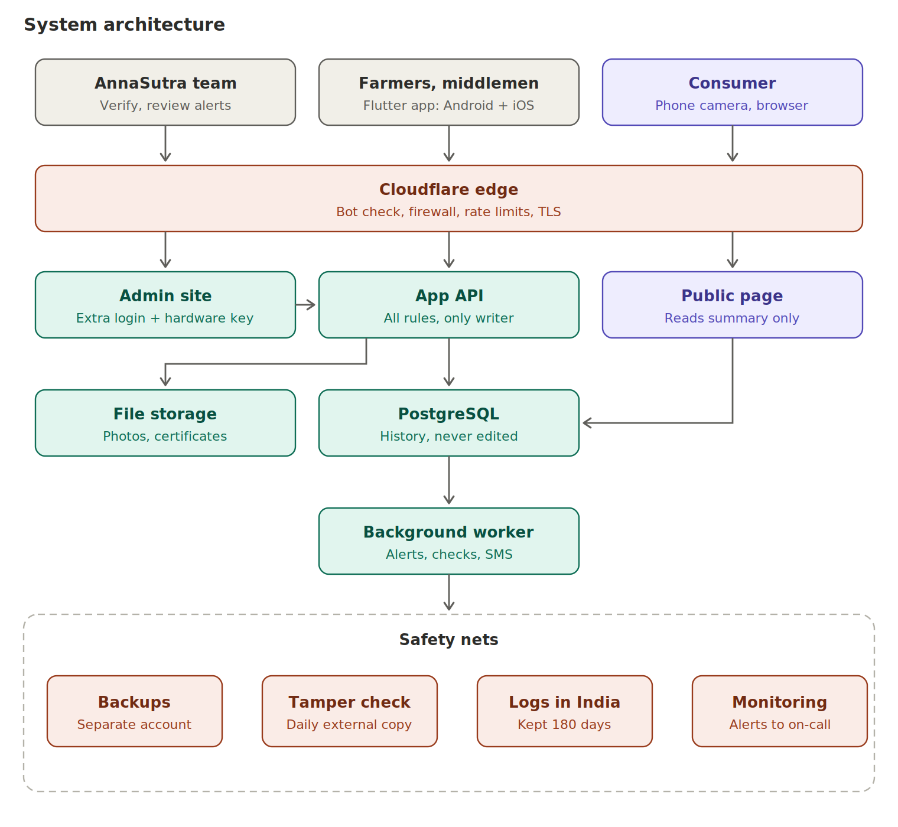

# 02. Architecture

## Components and responsibilities

| Component | Responsibility |
|---|---|
| Flutter app | Capture, offline storage, QR scanning, device signing, sync. One app, role-based screens |
| Cloudflare edge | TLS, DDoS protection, firewall rules, rate limits, bot challenge on risky routes, Access in front of admin. Origin accepts only Cloudflare or tunnel traffic |
| App API (Django + DRF) | The only writer. Validates every command against state and rules inside one database transaction |
| Admin site | Hardened Django admin: verify businesses, issue QR blocks, review alerts, recalls. Event tables are read-only |
| Public page | Separate small read-only service. Reads only the `public_view` table |
| PostgreSQL | System of record. Append-only events, constraints, row-level security |
| File storage | Private, versioned, encrypted. Photos and certificates via short-lived signed links |
| Background worker | Post-sync processing, alerts, public view refresh, hash verification, daily anchoring, SMS |
| Safety nets | Immutable backups in a separate account, daily external hash copy, logs kept in India, monitoring |

## Why a modular monolith

One deployable unit, real database transactions (essential for custody and quantity rules), easy debugging, low cost for a small team. Do not split into microservices until a trigger below is hit. Modules inside the backend: identity, organisations, labels, lots, custody, quality, inventory, ledger, public, alerts, reporting.

## Mobile app layers

## Why Flutter (and what was rejected)

| Option | For | Against | Verdict |
|---|---|---|---|
| **Flutter** (Android + Web, iOS later) | One codebase, smooth on low-end phones, mature camera and local DB plugins, passkey plugins exist | Dart is a smaller talent pool than JavaScript. Native features sometimes need a small platform channel | **Chosen** |
| React Native | Large JavaScript talent pool | More native-module friction for camera, encryption and background work | Reasonable alternative |
| Kotlin Multiplatform | Best native feel, shares business logic | Smaller ecosystem for sharing UI, more native work on iOS | Reasonable if the team is Kotlin-strong |
| Separate native apps | Maximum control | Two codebases, double cost | Rejected for a small team |

There is no evidence in this package about which framework Antigravity handles best. Build the Phase 0 scaffold first and judge the result.

## Why not blockchain, Kafka, Kubernetes

None addresses the main risk, which is false input. Hash chain plus external anchor gives most of the tamper-evidence benefit at far lower cost. Kafka and Kubernetes add operations work without a current need.

## Data flow

**Write:** the app saves an event and an outbox row locally in one transaction, then the sync worker sends it with its event ID. The server validates inside one transaction: appends the event, updates the lot state, updates the balance, extends the hash chain. It returns accepted, rejected or conflict.

**Read (private):** the app asks the API for lots the organisation has touched. Row-level security enforces the boundary a second time.

**Read (public):** the worker builds a curated row per lot in `public_view`. The public page serves only that row, cached at the edge.

## Triggers to change the architecture

- Public page traffic needs independent scaling: add CDN caching and a read replica first.
- Hot batches cause write contention: review locking before splitting services.
- Team outgrows one codebase: split along the existing module boundaries.
- A regulator or partner requires an external ledger: add one as an extra, not a replacement.
- Partners need standard data exchange: add a GS1 EPCIS 2.0 export adapter.

## Standards position

- **GS1 EPCIS 2.0:** internal events are EPCIS-shaped. An export adapter comes later. Direct EPCIS needs GS1 identifiers that smallholders do not have.
- **GS1 Digital Link:** not used at launch. The resolver must be able to accept it later.
- **ISO 22005:2007:** used as a design principle (one step back, one step forward). No newer edition was found in the research. Not certified.
- **OWASP ASVS 5.0.0 and MASVS:** used as checklists. See `07_security_privacy_compliance.md`.
