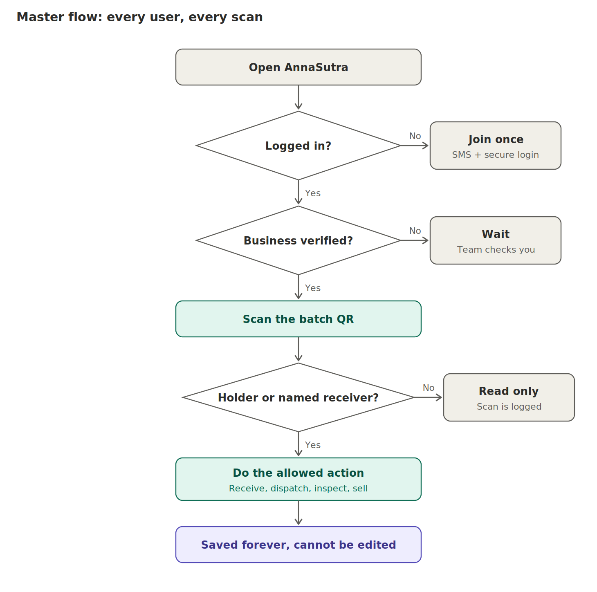
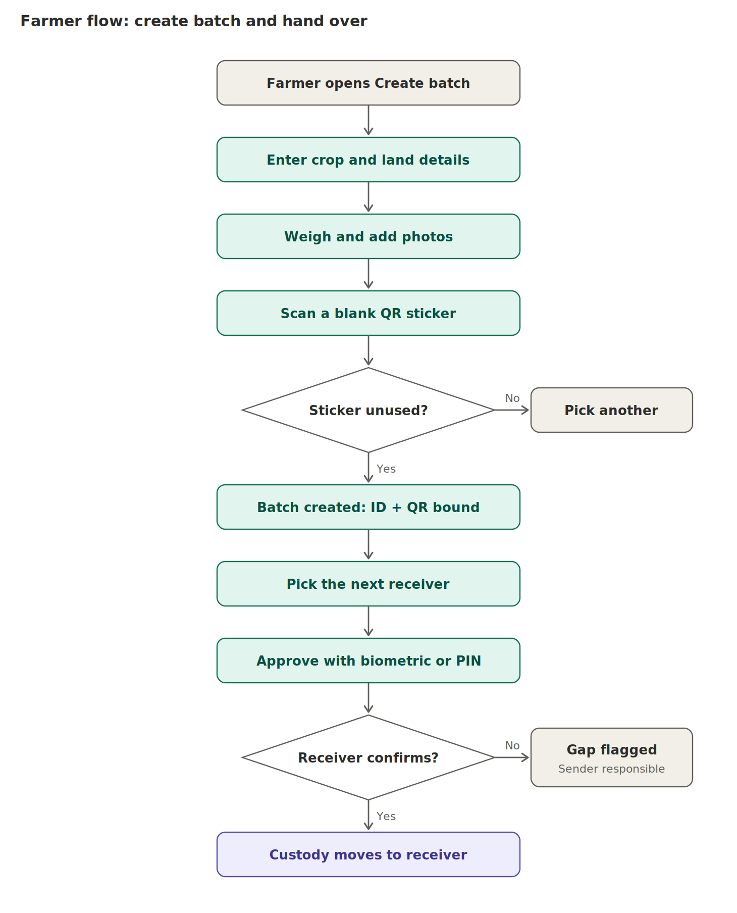
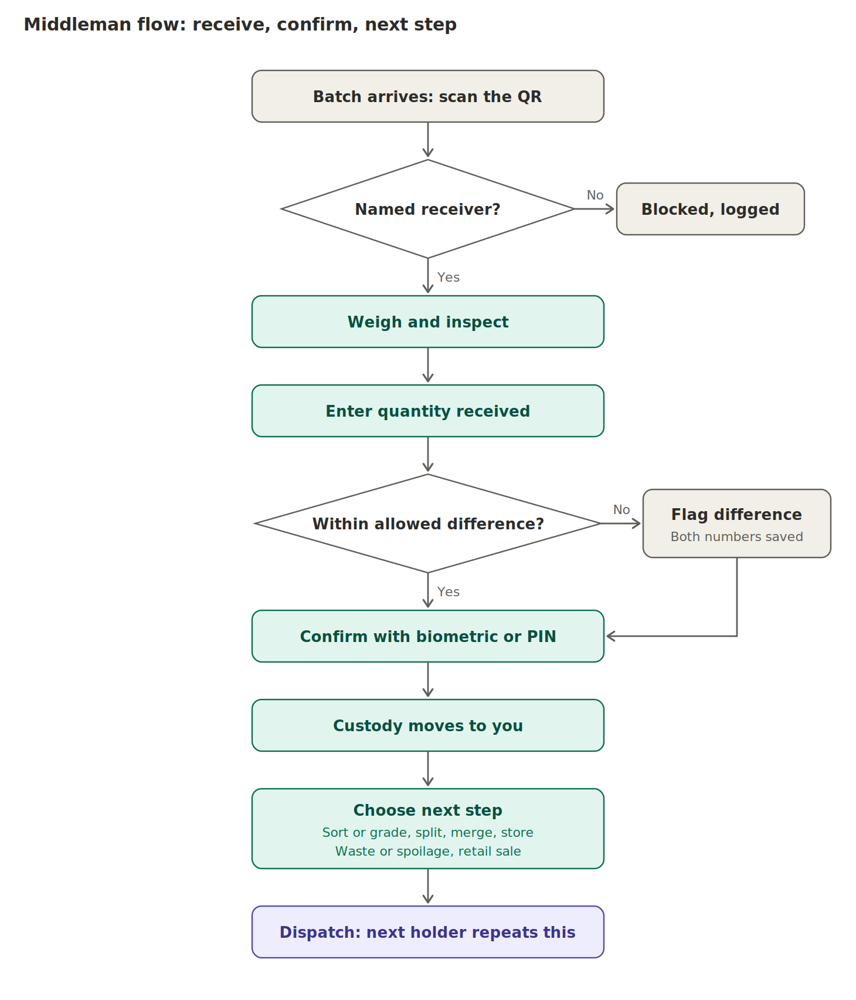
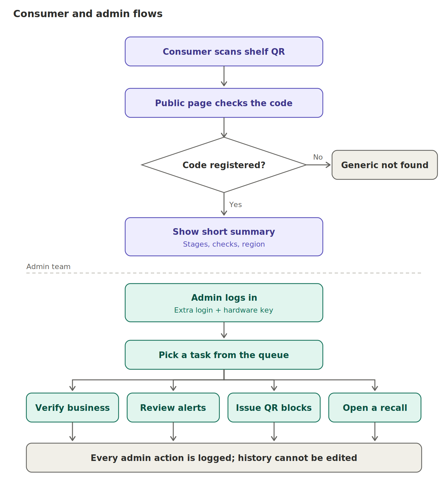
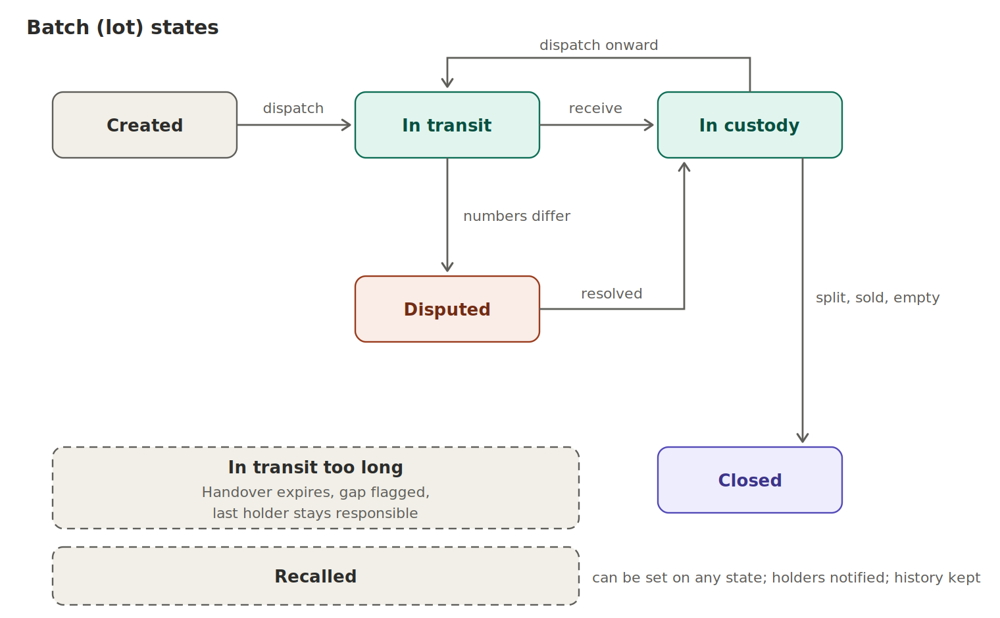

# 03. User flows

Every flow is shown as an image **and** as numbered steps so an agent can follow either.

## Master flow (every user, every scan)

1. Open the app. If not logged in, join once (SMS code, then passkey or device key).
2. If the business is not yet verified, wait. Nothing can be received or sent.
3. Scan the batch QR (or type the short code).
4. The server checks: is this user's organisation the current holder or the named pending receiver?
5. No: read-only view, and the scan is logged.
6. Yes: show only the actions allowed now.
7. Every action is saved forever and cannot be edited.

## Join and login (for every entity)

1. Enter phone number. The server sends an SMS code (rate-limited, India numbers only at launch).
2. Enter the 6-digit code.
3. The app creates a **device key** in secure hardware. If the phone supports passkeys (Android 9+, iOS 16+), also create a passkey. Older phones use the device key only.
4. Choose who you are (farmer, aggregator, wholesaler, distributor, retailer). Enter business name and, if any, FSSAI number.
5. The platform verifier approves the business. The user sees "waiting for approval" until then.
6. Next time: biometric or PIN only.

Account recovery (lost phone): SMS code plus a second proof (approval from an existing device, or in-person check by a cooperative agent), a 24-hour delay, and alerts to the old contact.

## Farmer flow

1. Open Create batch.
2. Enter crop, variety, sowing date, land size and plot.
3. Weigh the harvest, enter weight and crate count, add photos (include a photo of the scale display).
4. Scan a blank QR sticker. If already used, pick another.
5. Batch is created. The server issues the lot and binds the sticker.
6. Pick the next receiver from trusted partners.
7. Approve with biometric or PIN. The handover opens.
8. If the receiver does not confirm within the window, the handover expires, a gap is flagged, and the farmer stays responsible.
9. On confirmation, custody moves to the receiver.

An agent can do steps 1 to 7 for a farmer who has no smartphone. Those events are stamped "recorded on behalf of".

## Middleman flow (aggregator, wholesaler, distributor, retailer)

1. Batch arrives. Scan the QR.
2. Only the named receiver may continue. Anyone else is blocked and the attempt is logged.
3. Weigh and inspect. Record weight, condition, rejected quantity, photos.
4. Enter the quantity received.
5. If the difference from the declared quantity is within tolerance, continue. If not, the app flags a discrepancy and saves both numbers.
6. Confirm with biometric or PIN. Custody moves to you.
7. Choose the next step: sort or grade, split, merge, store, record waste or spoilage, or (retailer) record sales and create the shelf QR.
8. Dispatch onward. The next holder repeats this flow.

### Differences by role

| Role | Extra things they do |
|---|---|
| Aggregator | First receiver. Often consolidates many farmers. Weighs and checks quality |
| Wholesaler | Grades, rejects, splits one lot into several buyers (new lots, new QR stickers, linked to the parent) |
| Distributor | Records vehicle number and destination. May split for retailers |
| Retailer | Creates the shelf QR, records daily sales and waste in kilograms. No consumer identity is stored |

## Consumer and admin flows

**Consumer:** scan the shelf QR with any phone camera. The public page checks the code. Unknown code: generic not-found page. Known code: short summary (crop, harvest date, state and district, stages confirmed, quality checks, certificates if any, scan count, honest disclaimer). Never shown: names, prices, quantities, coordinates, business names unless a business opts in.

**Admin:** log in through Cloudflare Access with SSO and a hardware key. Pick a task: verify business, review alerts, issue QR blocks, open a recall. Every admin action is logged. No screen can edit or delete an event.

## Batch states

See `05_events_custody_quantity.md` for the exact rules.

## Screens (mobile app)

Join and login · Home (Incoming, My stock, Waiting for others) · Create batch · Scan and open · Receive · Dispatch · Sort, split, merge, repack, waste, sell · Disputes · History · Alerts and sync status · Partners · Settings (devices, language) · Recall notice.
