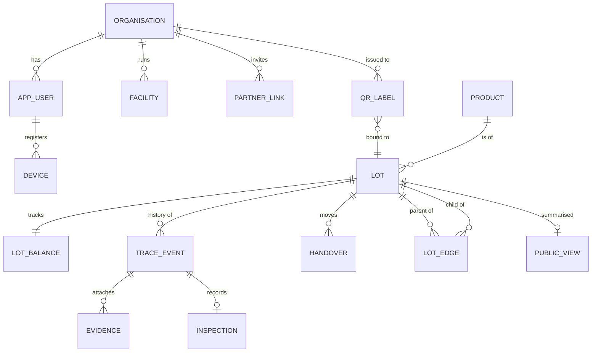

# 04. Data model

The runnable schema is `db/schema.sql` (PostgreSQL). This page explains the ideas.

## Five identities that must never be mixed

| Concept | Meaning | Persistence |
|---|---|---|
| Product | Catalogue item, e.g. "Tomato, hybrid X" | Permanent |
| **Lot** | A quantity sharing one origin and history. **The QR identifies this.** | Persists through dispatch, receipt, storage, repack. **New lot** on split, merge, or sort into separate lots |
| Container | Crate or sack inside a lot | Numbered within the lot |
| Shipment | One movement of a lot between parties | New per dispatch |
| Commercial order | Sale or invoice record | Separate, linked by reference only |

## Main tables

organisation · app_user · device (public key) · passkey_credential · facility · farmer_profile · plot · consent_record · partner_link · product · qr_block · qr_label · lot · lot_edge (genealogy) · lot_balance · handover · trace_event (append-only) · inspection · evidence · lab_certificate · scan_log · alert · recall · public_view · audit_access_log.

## Relationships (summary)

## Critical database rules

- `trace_event`: no UPDATE or DELETE (permissions removed plus a trigger that raises an error).
- Unique `(lot_id, lot_seq)`: each lot has a gapless event order assigned by the server.
- Partial unique index: at most one open (PENDING) handover per lot.
- Check: on-hand quantity never negative.
- Check: `state = IN_TRANSIT` if and only if `pending_receiver_org` is set.
- A lot cannot be its own parent. Genealogy must stay acyclic (verified inside the transaction).
- Row-level security on every table holding organisation data.
- The public page database role can `SELECT` only from `public_view`.

## Ownership, custody, responsibility

Three separate ideas. Version 1 stores `custodian_org` (enforced). Ownership is an optional recorded claim. Responsibility follows custody.

## Quantity fields

All quantities are stored in kilograms (original unit kept in the event payload). Each quantity has a basis: MEASURED, ESTIMATED or DECLARED. Gross, tare and net weights are stored for weighed events.
