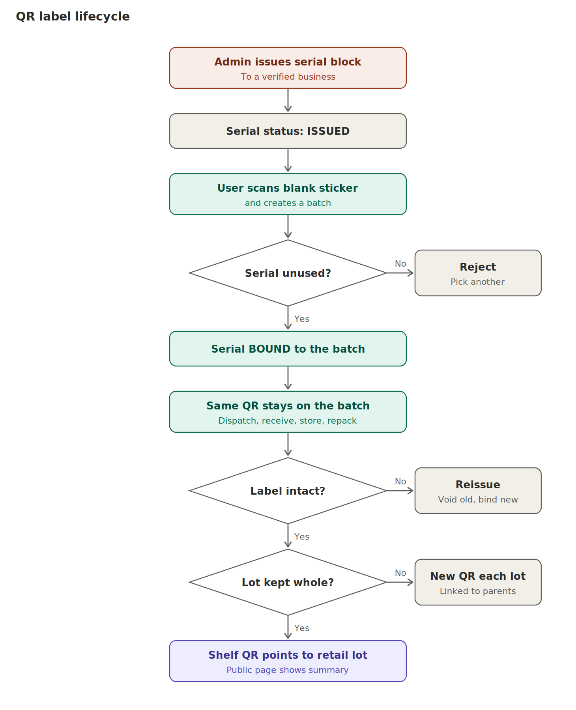

# 06. QR and identity lifecycle

## Rules

- **Who creates the first ID:** the server. Admin issues serial **blocks** to a verified business. The app downloads a block so it can create batches offline. The server rejects duplicates by primary key.
- **What the QR holds:** only a web link, for example `https://t.example.in/L/7K3Q9XMD4T2B`. The code is 12 random base32 characters (about 60 bits) plus a check character. No name, weight or price. It is not GS1 Digital Link at launch. The resolver must be able to accept `/01/{gtin}/10/{lot}` later.
- **Short code:** print the code (for example `7K3Q-9XMD`) beside the QR for manual entry.
- **A scan never grants authority.** Permission comes from being the current holder or the named receiver.

## When a new QR is needed

| Situation | New QR? |
|---|---|
| Dispatch, receipt, storage, inspection, repack of the same lot | No |
| Split into several buyers | Yes, one per child lot. Parent QR stays valid and shows "split" |
| Merge | Yes, for the merged lot |
| Sort into separate grades | Yes, if outputs are separate lots |
| Damaged or lost label | Reissue: void the old serial and bind a new serial **to the same lot** (signed LABEL_REISSUE event) |

## Label options

| Option | Cost | Pros | Cons | Fit |
|---|---|---|---|---|
| Printed synthetic (polypropylene) serial sticker, pre-numbered in books | Low | No printer needed, survives moisture | Copyable | **Default** |
| Tamper-evident label | Medium | Shows removal | Costlier, still no proof of contents | High-value or export lots |
| Reusable crate tag | Medium up front | Cheap per trip | Crate ID is not lot ID; needs crate-to-lot binding | Later |

Do not require RFID or IoT. They are optional future extensions.

## Multiple containers per lot

Quantity and crate count live on the lot, with optional crate sub-numbers `/01` to `/20`. Receivers must at least count crates.

## Clone detection

Every scan is logged (user, time, coarse area, result). Alert on:

1. A scan by a non-custodian after handover.
2. Two distant scans in an impossible time.
3. The same serial bound twice.
4. A closed lot scanned for RECEIVE.
5. Crate count mismatch.
6. A consumer-scan spike on one code.

## A copied QR is not proof of authenticity

The public page says: "This code is registered. It does not prove the contents of this package." Real assurance comes from the custody trail, scan history and audits. Optionally add a scratch-off PIN under the label for high-value lots.

## What consumers see

A curated allow-list only: crop, harvest date, state and district, number of stages confirmed, number of quality checks, certificates if any, scan count, disclaimer. Never: names, coordinates, prices, quantities, business names (unless a business opts in).
