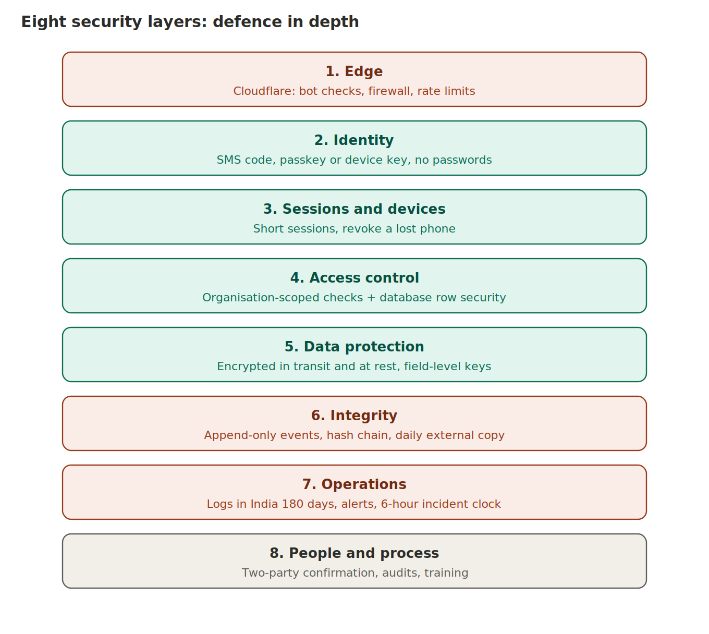

# 07. Security, privacy and compliance

**No software is flawless.** The design is defence in depth: several independent layers so one failure does not cause a breach, and so failures are visible, contained and recoverable. Residual risks are listed at the end.

## Layer 1: Cloudflare edge [verify plan features and limits]

DDoS protection, managed firewall (WAF) rules plus custom rules, rate limits on login, code request, sync and public routes, Turnstile (bot challenge) on risky actions only, Cloudflare Access in front of the admin site, origin locked so only Cloudflare or a private tunnel can reach it. Keep personal data out of URLs and headers. Cloudflare sees traffic at the edge, so treat it as a trusted vendor, sign its data-processing terms, and keep an exit plan. Mobile apps send API traffic too, so bot rules must not block the app: use app attestation and API tokens, not browser challenges, on API routes [verify].

## Layer 2: Identity

- SMS code for first registration. Cap per number, per device and per day. India numbers only at launch. Short expiry, 5 attempts, then lockout with back-off. Never reveal whether a number is registered.
- **Passkeys** where the phone supports them. A passkey plugin for Flutter exists, and the research found Android 9 (API 28) and iOS 16 as the minimum for native passkeys. Passkeys also need your app tied to a web domain you control (Android Digital Asset Links and Apple App Site Association files), so you need a domain and a tiny web endpoint for those files [verify with current plugin docs].
- **Device key fallback** for older phones: a key pair created in secure hardware (Android Keystore, iOS Secure Enclave), unlocked by biometric or PIN. The server stores the public key at registration.
- SMS stays as a fallback and recovery path only, with delays and alerts, because of SIM-swap risk.
- Re-authenticate (biometric or PIN) for dispatch, receive, correction, label reissue, device change.
- **Account recovery** is the weakest point of any system: SMS code plus a second proof (approval from an existing device, or in-person check by a cooperative agent), a 24-hour delay, alert to the old contact. Never recover through support chat alone.

## Layer 3: Sessions and devices

Short-lived access token (about 15 minutes) kept in platform secure storage, rotating refresh token revoked on reuse, a device list the user can review, remote revoke of a lost phone. Optionally check app and device integrity (Play Integrity on Android, App Attest on iOS) [verify].

## Layer 4: Access control

Organisation-scoped checks in code **and** PostgreSQL row-level security. Separation of duties: the person who corrects cannot approve the correction. Automated tests for broken object-level access on every endpoint.

## Layer 5: Data protection

| Data | Protection |
|---|---|
| Phone, name, address | Field-level encryption (envelope keys in a managed key service) |
| Farm coordinates | Encrypted. Visible only to the farmer's own org and, under logged access, auditors. Never public |
| Prices, buyer links | Never in the public projection. Visible only to the two parties of a deal |
| Photos, certificates | Private storage, short-lived signed links, access logged. Strip location metadata, re-encode, malware scan |
| Public page | Separate pre-built table, field allow-list, no private-table access |
| On the phone | SQLCipher-encrypted database, key in Keystore/Keychain, no secrets in code, backups disabled, screenshots blocked on sensitive screens, wipe on logout |

Encryption in transit TLS 1.2+ (prefer 1.3). At rest AES-256. Keys in a managed key service, rotated, never in Git.

## Layer 6: Integrity (tamper evidence)

| Control | What it adds | Limit |
|---|---|---|
| Append-only table (permissions + trigger) | Stops application-level edits | A database superuser can bypass it |
| Per-lot hash chain | Any edit to history breaks the chain | Only helps if head hashes are stored elsewhere |
| **Daily external anchor** in a write-once bucket in a **separate cloud account** | Rewriting history becomes detectable | Collusion with the anchor owner defeats it |
| Device signatures on handovers and corrections | Shows which device key approved the event | Does not prove the data is true. A stolen unlocked phone is a valid signer |
| Restricted DBA role with break-glass access (approval, time limit, full logging) | Limits insider risk | Some insider risk remains |
| Nightly hash-verification job with alert | Early detection | Needs someone to respond |

Blockchain is not used. It does not make input true and adds cost. Minimum defensible audit for version 1: DB-enforced append-only + per-lot hash chain + daily external anchor + device signatures on handovers + access logs + restricted logged DBA role. An optional trusted timestamp (RFC 3161) can come later.

## Layer 7: Operations

Central tamper-resistant logs for auth events, access denials, admin actions, sync rejections, hash checks. Alerts on login failures, access denials, sync-reject spikes, hash mismatch, clone alerts. Never log OTPs, tokens or full personal data. Immutable backups in a separate account. Quarterly restore drill with hash-chain verification. Written incident runbooks (account takeover, data leak, ransomware, key compromise, fake-label wave) and a tabletop exercise before the pilot.

## Layer 8: People and process

Two-party confirmation, sampling audits, calibrated scales, lab checks, field training, incentives for honest data. Software cannot replace these.

## Indian obligations to design in (researched 11 October 2026)

**CERT-In directions (in force since 2022):** covered entities must report listed cyber incidents to CERT-In within 6 hours of noticing them and keep logs of ICT systems for 180 days within India. Source: https://khaitanco.com/thought-leaderships/Indian-Computer-Emergency-Response-Team-Direction-Paradigm-Shift-in-Cyber-Incident-Reporting and https://mondaq.co.uk/india/it-and-internet/1270332/6-hours-to-report-cyber-incidents-to-cert-in. Do: Indian-region log store (at least 180 days), incident runbook with a 6-hour clock and a named person who files. [verify current text and whether AnnaSutra counts as a covered entity, with counsel]

**DPDP Act 2023 and DPDP Rules 2025:** the Rules were notified in November 2025. Core duties (notice, security safeguards, breach intimation, data principal rights) apply from about 13 May 2027 (one source says 14 May). Source: https://www.jsalaw.com/?p=55573 . Do: consent notice in Bengali, Hindi and English, consent records, purpose limitation, retention schedule, erasure and correction process, grievance contact, breach process. [verify exact dates and your classification with counsel]

**Trade and location information** (prices, supplier links, farm coordinates) can be confidential even where it is not personal data. Same access controls apply.

**Not verified in this research:** FSSAI record formats or retention periods for tomato traders, state mandi rules, evidentiary value of electronic records in Indian courts, cross-border transfer rules for edge vendors. Ask counsel.

**Standards used as checklists:** OWASP ASVS 5.0.0 (released May 2025, https://owasp.org/www-project-ASVS/), OWASP MASVS for the mobile app, ISO 22005:2007 for the traceability principle (https://www.iso.org/news/2007/07/Ref1063.html).

## Threat table

| Threat | Controls | Residual risk |
|---|---|---|
| Account takeover | Passkey or device key, device approval, alerts, re-auth for sensitive actions | SIM-swap on fallback path |
| Cross-business data leak (IDOR) | Server authorisation, row-level security, automated tests | Logic bugs found by pen test |
| Stolen or rooted phone | Remote revoke, secure hardware keys, encrypted local DB | Malware on an unlocked phone |
| Bot scraping, SMS abuse | Rate limits, caps, Turnstile on web routes, attestation | Paid human farms |
| Database administrator tampering | Hash chain, external anchor, locked DBA role | Collusion with anchor owner |
| Fake or cloned QR | Server-issued codes, scan history, alerts, audits | Physical copying cannot be fully stopped |
| False weights, fake inspections | Two-party confirmation, scale photos, sampling | **High**: software cannot verify physical truth |
| Sender-receiver collusion | Pattern analytics, lab checks, audits | **High** |
| Ransomware | Immutable off-account backups, restore drills | Short downtime |
| Insider misuse | Separation of duties, logged access, break-glass | Medium |
| Vendor outage (Cloudflare or cloud) | Exit plan, tested disaster recovery | Medium |

## Fraud and anomaly rules (start simple, no AI)

Scans by non-custodians or on closed lots; impossible travel between scans; unusual loss percentages for a pair of businesses or one scale; receivers who always confirm "matches" instantly; repeated backdated events or bursts of corrections; many new accounts from one device; consumer scan spikes. Each alert goes to a review queue with an owner and a response time. Unreviewed alerts are worthless.

## What stays unsolved

Physical truth (two parties agree on a false number), a compromised unlocked phone, human-factor weaknesses in recovery, platform-operator insiders and collusion, zero-day flaws, legal interpretation. The goal is fast detection, containment and recovery with evidence.

## Launch gate (all must be true before the pilot)

- [ ] Threat model reviewed and signed off
- [ ] Row-level security and cross-business tests pass
- [ ] Public-page leakage test passes (zero forbidden fields)
- [ ] Hash chain and external anchor running, alert on verification failure
- [ ] Passkey or device key login works on the real target phones; OTP abuse caps tested
- [ ] Cloudflare WAF, rate limits, Access for admin and origin lock live
- [ ] Immutable backup restored successfully at least once
- [ ] External penetration test; critical and high findings fixed and retested
- [ ] Incident runbooks and tabletop exercise done; 6-hour reporting path defined
- [ ] DPDP notice, consent, grievance contact and breach process reviewed by counsel
