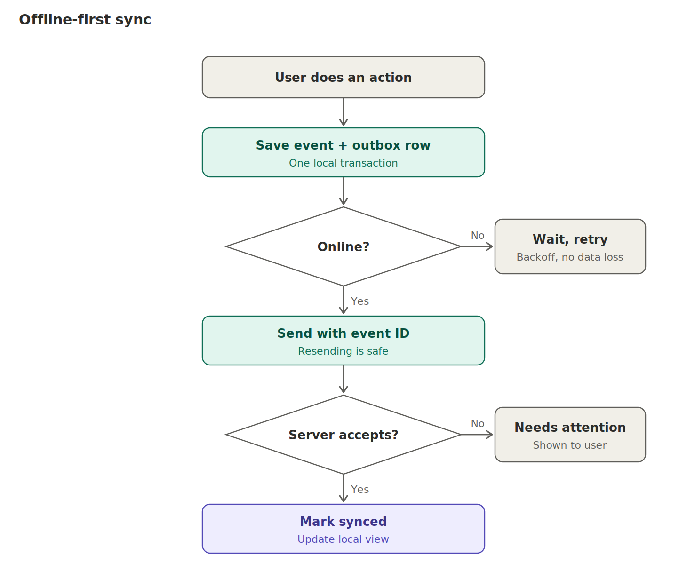

# 08. Offline-first design

## Assumptions

Many users have limited digital literacy and mid- or low-end Android phones; coverage is patchy; mandis are busy; some farmers have no smartphone; agents serve many farmers; reusable crates; multiple languages.

## Rules

1. Every action is saved locally as an **event + outbox row in one local database transaction**. Then the UI updates from local data.
2. The sync worker sends outbox items in order per lot. The event ID (client UUIDv7) is the idempotency key. Resending is safe.
3. The server answers each item: ACCEPTED, REJECTED (with reason) or CONFLICT. Rejected items appear in a "Needs attention" list. **Nothing is silently dropped.**
4. Retry with exponential back-off and jitter. A manual "Sync now" button exists.
5. Show a visible counter of unsynced items and warn if the oldest is older than 24 hours.
6. The server is the arbiter. Conflicts (for example, two receivers claiming one batch, or a receive arriving before its dispatch) are decided by custody and `lot_seq`, not by device time.
7. Device time is a claim. The server stamps its own time and flags large gaps.

## What works offline

Create batch (using a serial block downloaded earlier), inspect, dispatch, receive, split, sort, waste, sell, view history already downloaded.

## What needs the server

Registration, device and passkey setup, partner invitations, downloading serial blocks, recall, label void and reissue, admin actions, and **final acceptance of any queued event** (the server can still reject it).

## Signing offline

Device-key signatures are created locally with the secure-hardware key after biometric or PIN, so they work offline. The signature covers a hash of the event itself. The server verifies on sync against the device's registered public key. Passkey (WebAuthn) is used for login, not for event signing.

## Durability and recovery

- Local database in write-ahead-log mode with durable commits, encrypted with SQLCipher. Database key held in Keystore/Keychain.
- Lost phone: log in on a new phone (SMS plus second proof), revoke the old device key. Events already synced are safe. Unsynced events on the lost phone are lost, so sync often and consider an encrypted outbox backup when online (decide in Phase 2).
- Background sync: Android background work is reliable with WorkManager. iOS limits background work, so sync on app open and on a foreground timer, and tell users to open the app after a long offline period [verify current platform behaviour].
- Assisted registration: an agent registers a farmer. Consent is captured by SMS code to the farmer's phone or recorded verbal consent evidence. Flag `registered_by_user`.

## Low-literacy interface rules

Icons with words, local-language voice prompts (later), numeric keypad for weights, big buttons, one task per screen, at most three taps for a normal "matches" receipt. Test with real users in Bengali.
