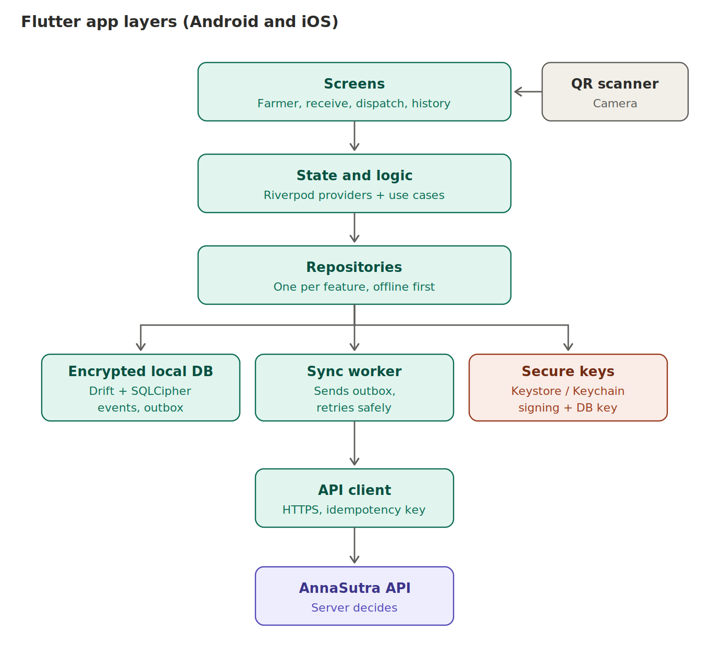

# 10. Mobile app specification (Flutter)



## Targets

This spec covers the Android target. The same codebase also builds for Web. Platform differences, and the interfaces that isolate them, are in `docs/16_platform_web_android.md`.

- Android: support Android 8 (API 26) and above, so older low-cost phones work. Passkeys need API 28+. Below that, use the device-key fallback.
- iOS: iOS 16 and above for passkeys. Lower versions use the device-key fallback [verify the minimum supported by the current Flutter release].
- Test on a cheap phone with 2 to 3 GB RAM and a slow network, not only on a flagship.

## Suggested project structure

```
lib/
  main.dart
  app/            router, theme, localisation, app-wide providers
  core/           api client, error types, time, ids (UUIDv7), crypto, logging (no PII)
  data/           drift database, DAOs, outbox, sync worker, repositories
  domain/         entities, use cases (dispatch, receive, split ...), rules mirrored from the server
  features/
    auth/         join, otp, passkey, device key, recovery
    home/         incoming, my stock, waiting
    batch_create/ crop details, weigh, photos, bind sticker
    scan/         camera scanner, manual short code
    receive/      weigh, inspect, quantity, confirm
    dispatch/     choose partner, confirm
    transform/    sort, split, merge, repack, waste, sale
    disputes/
    history/
    alerts_sync/  needs attention, unsynced counter
    partners/
    settings/     devices, language
l10n/             app_bn.arb, app_hi.arb, app_en.arb
test/             unit, widget, integration
```

## Packages (verify current maintained versions on pub.dev before choosing; ask before adding)

| Need | Suggested | Notes |
|---|---|---|
| State | Riverpod | |
| Routing | go_router | |
| Local database | Drift with SQLCipher | Encrypted at rest. Check current SQLCipher support for Drift [verify] |
| HTTP | Dio | With interceptors for tokens, idempotency, retries |
| QR scanning | mobile_scanner | Camera permission handling, manual fallback |
| Secure storage | flutter_secure_storage | Tokens only. Not for large data |
| Biometric or PIN gate | local_auth | |
| Passkeys | a maintained passkey plugin | Needs domain association files. Android API 28+, iOS 16+ [verify] |
| Hardware-backed signing key | A vetted package, or a small Kotlin and Swift platform channel written and reviewed by a human | Flutter has no first-party API for Keystore or Secure Enclave signing. This is the most security-sensitive code in the app |
| Background sync | workmanager (Android) plus foreground sync | iOS background limits apply |
| Connectivity | connectivity_plus | |
| Camera and photos | camera or image_picker | Strip location metadata, compress, hash (SHA-256) |
| IDs | uuid package | Check UUIDv7 support, otherwise implement and test |
| Localisation | flutter_localizations + ARB | Bengali, Hindi, English |

## Authentication on the phone

1. First run: phone number, SMS code (`/v1/auth/otp/*`).
2. Create a device key in secure hardware (non-exportable, requires biometric or PIN). Send the public key to `/v1/auth/devices`.
3. If supported, also register a passkey for login.
4. Later logins: biometric or PIN unlocks the stored refresh token or the passkey.
5. Sensitive actions (dispatch, receive, dispute, resolve, correct, label reissue) require a fresh biometric or PIN and are signed with the device key over a hash of the event.

## Local database tables (mirror the server concepts)

`local_lot`, `local_event`, `outbox`, `serial_block`, `partner`, `evidence_pending`, `sync_state`. The outbox row holds: event ID, endpoint, body, signature, attempt count, last error, status. Never delete an outbox row until the server answers ACCEPTED, and keep rejected rows visible.

## Screen requirements

Every screen: large touch targets, local-language text from ARB files, one task, a visible sync state, no jargon.

| Screen | Key fields and rules |
|---|---|
| Join | Phone, code, role choice, business name, FSSAI optional, consent notice in chosen language |
| Home | Three lists: Incoming (named as receiver), My stock, Waiting for others |
| Create batch | Crop, variety, sowing date, plot, harvest date, gross, tare, net, crates, photos (include scale display). Sticker scan binds the serial |
| Scan | Camera, manual short code, shows only allowed actions |
| Receive | Declared quantity shown, one-tap Matches, otherwise received, rejected, gross, tare, condition, photos |
| Dispatch | Choose trusted partner, quantity, vehicle, confirm |
| Transform | Sort (outputs add up to input), split (children plus remainder), merge, repack, waste (reason code), sale (kg) |
| Disputes | Both numbers side by side, accept or dispute with reason |
| History | Timeline for lots this business touched |
| Needs attention | Rejected or conflicting outbox items with plain-language reasons |
| Settings | Language, devices, revoke a device |

## Mobile security checklist (from OWASP MASVS ideas, verify against the current MASVS)

- Local database encrypted, key in Keystore or Keychain.
- Backups disabled (Android `allowBackup` off, iOS excluded from backup for sensitive data).
- No secrets in code. Release builds obfuscated where supported.
- Certificate pinning optional, with a safe update plan.
- Screenshots and screen recording blocked on sensitive screens.
- Root or jailbreak signals reduce trust and raise alerts, they do not silently block.
- Clear local data on logout and after repeated failures.
- No third-party analytics or ad SDKs.

## Release

Use Google Play App Signing and Apple signing managed by the human. **Never place signing keys in the project or give them to the agent.** Check current store requirements (target version, data-safety and privacy forms) before submission [verify].
