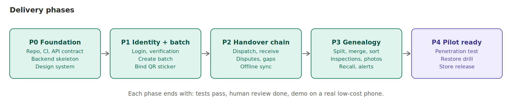

# 14. Delivery phases and prompts for the agent



Prefer running one phase at a time. For a continuous run, use the **one-go prompt** in `HANDOVER_GUIDE.md` (Step 4B), which keeps four mandatory stops.

Rules for every phase: read `AGENTS.md` and `docs/00_MASTER_BRIEF.md`. **Step 1 is always a plan. Stop and wait for approval.** After implementing, run all tests and write the report in the format from `AGENTS.md`. Work in small commits on a branch.

Suggested repo layout: `backend/`, `mobile/`, `docs/`, `db/`, `api/`, `tools/`, `infra/`.

---

## Phase 0: Foundation

**Scope:** monorepo, CI, backend skeleton, Flutter scaffold, API contract tests, design system and localisation.
**Exclusions:** any feature logic.
**Exit criteria:** CI green on both projects; `GET /health` works; the app builds for Android and for Web from one codebase, with the platform interfaces from `docs/16` (Signer, SecureStore, LocalDatabase, SyncScheduler, QrScanner) defined and implemented for both (iOS later needs a Mac or a macOS CI runner); Bengali, Hindi and English strings load; contract test compares the backend to `api/openapi.yaml`; the schema migrates on a real PostgreSQL and the constraint tests in `docs/13_testing.md` pass.

**Prompt:**
```
Read AGENTS.md and every file in docs/. Do NOT write code yet.
Produce a Phase 0 plan: repo structure, backend skeleton (Django + DRF),
Flutter scaffold for Android and Web (Riverpod, go_router, Drift with SQLCipher on Android and encrypted web storage on web, Dio, l10n for bn/hi/en) with the platform interfaces from docs/16,
CI pipeline, lint and test setup, contract test against api/openapi.yaml,
and a migration that reproduces db/schema.sql including every constraint.
List every dependency with reason, size, licence and risk.
List any [verify] items you will check and how. List risks and questions.
Stop and wait for my approval.
```

---

## Phase 1: Identity and batch creation

**Scope:** OTP login, device key, passkey where supported, business registration, admin verification, partner links, QR serial blocks, create batch and bind sticker, scan screen, farmer flow without the handover.
**Exit criteria:** a farmer (and an agent acting for a farmer) can create a batch offline and see it after sync; unverified businesses cannot act; cross-business access tests pass; OTP abuse caps tested.

**Prompt:**
```
Phase 1 per docs/14 and docs/03 (join, farmer flow), docs/06, docs/07 layer 2,
docs/10. Plan first and wait for approval.
The device-key signing code is security-sensitive: propose the design (package or
platform channel), explain the risks, and wait for approval before writing it.
After approval implement backend then mobile. Include tests for: idempotent create,
serial already used, unverified org blocked, cross-org access denied.
```

---

## Phase 2: Handover chain, offline sync, hash chain, public page

**Scope:** dispatch, receive, dispute, resolve; outbox and sync; discrepancy rules and tolerance setting; hash chain and daily anchor job; public consumer page; scan log and clone alerts.
**Exit criteria:** a batch travels farmer to retailer on real phones; offline for an hour then sync works; two receivers race test passes; public page leak test passes; editing a stored event is impossible and a forced change is detected by the nightly check.

**Prompt:**
```
Phase 2 per docs/05, docs/08, docs/03 (middleman flow), docs/11 (single write path,
hash chain). Plan first and wait for approval.
Mirror the server rules in the app only for fast feedback; the server decides.
Write race, replay, out-of-order and offline tests. Build the public page as a
separate read-only service that can select only from public_view.
```

---

## Phase 3: Genealogy, quality, recall, alerts

**Scope:** split, merge, sort, repack, waste, sale; inspections and photo evidence; correction events; recall and forward trace; alert rules and admin review queue.
**Exit criteria:** property tests for mass balance pass; recall trace on a 200-lot seeded graph returns 100% of descendants; corrections never mutate; admin cannot edit events.

**Prompt:**
```
Phase 3 per docs/05 (rules, invariants, recall query), docs/06 (new QR on split/merge),
docs/09. Plan first and wait for approval.
Write property-based tests proving no valid sequence breaks the quantity invariants.
```

---

## Phase 4: Pilot readiness

**Scope:** security review, performance on low-end phones, accessibility, translation review, monitoring and alerts, backup and restore drill, incident runbooks, store release, field training material.
**Exit criteria:** the launch gate in `docs/07` is fully ticked; external penetration test findings fixed; a restore drill passed; pilot metrics dashboard works.

**Prompt:**
```
Phase 4. Run the /security-review workflow over the whole repo against docs/07 and
OWASP ASVS 5.0 and MASVS. Report findings by severity. Do not fix anything until I approve.
Then prepare the release checklist per the /release-checklist workflow.
```

---

## Team roles (human side)

Product owner; backend engineer reviewer; mobile engineer reviewer; security reviewer (part-time at first); designer and field researcher; field operations lead (training, support); a lawyer for DPDP, CERT-In and consent text. The agent writes most code, humans review, test on real phones and own the decisions in `docs/15`.

## Phase gate checklist (human)

- [ ] I read the plan and answered the questions.
- [ ] I read the diff, especially anything touching login, keys, permissions, sync, hashes.
- [ ] I ran it on a real low-cost phone.
- [ ] Tests pass in CI.
- [ ] Nothing secret is in the repo.
