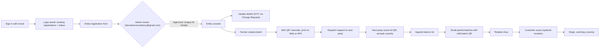
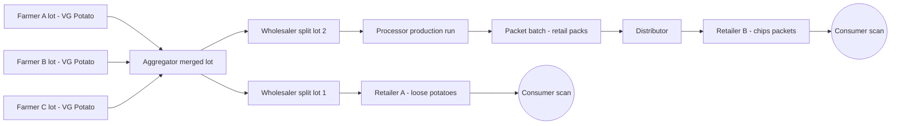
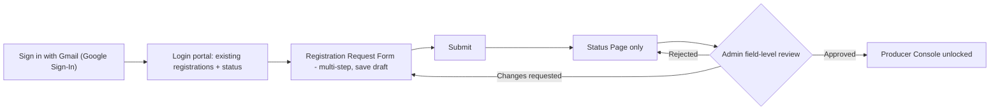
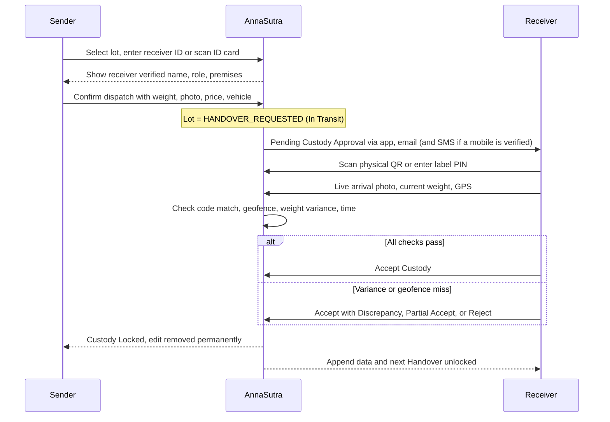
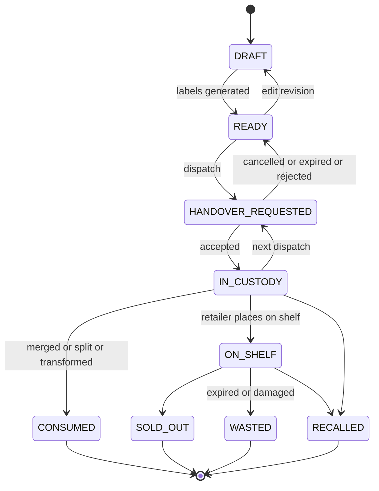
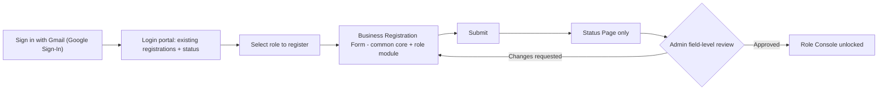
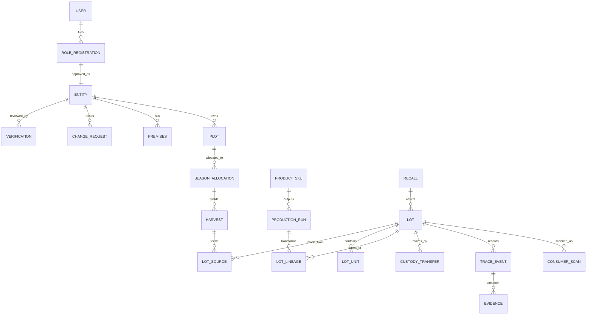

# AnnaSutra: Core Entity Console Architecture (Gold Standard — Locked)

> [!IMPORTANT]
> **Core Architecture Specification:** This is the locked source-of-truth blueprint from which all AnnaSutra entity consoles (Farmer, Aggregator, Processor/Manufacturer, Wholesaler, Distributor, Retailer, Consumer Scan, and Admin) and the Android application are built. All 36 architectural decisions in Section 15 are finalized and synchronized between Web UI/UX and Android APK.
>
> This file is the **only** document under `/docs`. Every other spec has been retired into it.

---

## Core of AnnaSutra (Locked)

> [!CAUTION]
> **LOCKED CORE LOGIC — DO NOT CHANGE.** This chain is the immutable core of AnnaSutra (Decision 36). No step may be removed, reordered, merged, bypassed or reworded by any agent, on Web, backend or Android. Every other section of this blueprint must serve this chain. A change is allowed only on an explicit written instruction from the product owner that says "unlock the core".

"Sign in with Gmail > the login portal shows every registration this Gmail already has, with its status > the entity registers with their details > Admin approves (only now is the Unique ID created) > the entity gets its console > the entity can update more details, except KYC (KYC changes need an Admin change request) > the farmer creates a batch with all required details > mints the batch QR / barcode > prints it on Web or APK and sticks it on the delivery lot > sends a dispatch request to the next party > the next party accepts by scanning the lot QR (live photo, weight, GPS), and the farmer's record is locked > the next party adds more data to the lot > the relevant entity makes small packet batches, each with a child QR > the packets reach the retailer shop > a customer scans with the AnnaSutra APK (optional location, recorded for Admin) > the customer sees the product's origin, a short summary and its journey."

| # | Locked step | Blueprint detail |
|---|---|---|
| C1 | Sign in with Gmail | 2.5 |
| C2 | Login portal: every registration of this Gmail + status | 2.5 |
| C3 | Entity registers with details | 4.1, 4.2, 6.1 to 6.3 |
| C4 | Admin (`devnetraconsultancy@gmail.com`) approves; Unique ID minted only now | 3.1, 4.2.1, 9 |
| C5 | Entity gets its console | 4.7, 6.6 |
| C6 | Entity updates details except KYC (KYC via Admin Change Request) | 4.3 |
| C7 | Farmer creates batch with all required details | 4.4 to 4.6 |
| C8 | Mint batch QR / barcode | 3.2, 3.4 |
| C9 | Print on Web or APK, stick on delivery lot | 3.6 |
| C10 | Dispatch request to next party | 4.6, 5 |
| C11 | Next party scan-accepts (live photo, weight, GPS); farmer record locked | 5 |
| C12 | Next party appends data | 6.7 |
| C13 | Relevant entity makes small packet batches with child QR | 3.7, 6.8 |
| C14 | Packets reach retailer shop | 6.8 |
| C15 | Customer scans with APK (optional location, recorded for Admin) | 7, 8 |
| C16 | Customer sees origin, short summary, journey | 7 |

---

## 0. The Concept in One Paragraph

AnnaSutra is a farm-to-fork trust ledger. Every person signs in with their Gmail account, which is their permanent identity (mobile number is optional). A farmer logs in, sends one registration request, and gets the console only after the admin checks every document. Inside the console the farmer maps each plot on a map, splits land between crops season by season, records every harvest from a plot, and turns harvests into lots. Each lot gets a unique QR and barcode label. Every time a lot moves, both sides do a handshake: the sender dispatches, and the receiver must prove they physically have the lot (label scan, live photo, weight, GPS) before custody passes to them. Once that happens, the sender's record is locked forever. Lots can be merged (aggregator), split (wholesaler) or turned into new products (manufacturer, for example potatoes into chip packets), and each new lot always keeps a link back to the lots it came from. Quantities must balance at every step, so nobody can quietly add produce that has no traceable source. Nothing is ever deleted. Changes are only added on top, and each record is hash-chained so tampering shows. At the shop, the customer scans one code and sees a true story that protects everyone's privacy: where the food came from, who handled it, how fresh it is, and whether it is genuine. The admin sees the whole chain, all flagged problems, recalls, and scan analytics collected with consent.

---

## 1. Diamond Rules (non-negotiable design principles)

| # | Rule | What it means in the product |
|---|------|------------------------------|
| 1 | Verify before access | No console access, and no lot creation, until the admin approves the entity. |
| 2 | Append-only | Records are never deleted. An edit before handover saves a new revision, and the admin sees the full history. |
| 3 | Proof of possession | Custody changes only after a physical label scan or PIN, a live photo, the weight and GPS. |
| 4 | Mass balance | Total lot quantity cannot exceed the harvest. Processor output cannot exceed input × the conversion ratio. |
| 5 | Lineage is a graph | Lots can merge, split and transform, and parent links are never lost. |
| 6 | One step up, one step back | Every party can see where a lot came from and where it went (ISO 22005 principle). |
| 7 | Privacy by design | Data collection follows India's DPDP Act 2023. Public pages never show mobile numbers, exact plot boundaries or KYC data. |
| 8 | Standards-aligned | The event model follows GS1 EPCIS 2.0. Retail QR codes follow GS1 Digital Link. Lot labels use a Code128 barcode. |
| 9 | Rural-first | Works offline, supports multiple languages, runs on low-end Android, and uses large touch targets. |
| 10 | Premium UI | Uses one icon system (Lucide) and colour + icon + text status chips. No emojis anywhere: UI, labels, SMS or exports. |
| 11 | Truthful telemetry & zero mock data | All scan metrics, telemetry, distances, and quantities reflect genuine database records. No hardcoded or synthetic data. |
| 12 | Instant responsiveness & root modals | All modals pre-hydrate in 0ms from local cache, mount to root body/viewport level, and dismiss reliably via backdrop tap or Back/Escape key. |
| 13 | Web-First Master & Android Platform Parity | Web UI/UX is built and verified first as the master design benchmark. Android mirrors every Web feature, button, and function 100% in its own native, idiomatic mobile UX (e.g. Bottom Sheets, native CameraX ML Kit scanning, Material 3, swipe actions). Android continuously follows and stays strictly synchronized with Web capabilities. |
| 14 | 100% Pure Native Flutter/Dart (Zero-WebView) & Universal APK | The Android application is 100% written in native Flutter/Dart widgets (Material 3). It must NEVER be an Android WebView wrapper or hybrid iframe shell. A single universal fat APK (`AnnaSutra_latest.apk`) serves all 7 entity roles dynamically with multi-ABI binary support for Indian smartphones. |
| 15 | Gmail is the identity | A Gmail address is the primary key of every user account. Gmail is mandatory, mobile is optional. One Gmail can file several entity registrations (Producer, Aggregator, Processor, Wholesaler, Distributor, Retailer), and each one is approved separately. |
| 16 | Single Admin identity | Only `devnetraconsultancy@gmail.com` can sign in to the Admin Console. Any other Gmail is refused, on Web and Android. |
| 17 | Print anywhere | Lot / batch QR and barcode labels can be printed from both the Web console and the Android APK. |

### 1.1 End-to-End Flow (canonical, how AnnaSutra is always explained)

**See the top of this file (`Core of AnnaSutra (Locked)`, steps C1 to C16).** The diagram below maps those 16 locked steps:



---

## 2. Entities and Roles

### 2.1 Role list

| Role | Who | Status |
|------|-----|--------|
| Producer / Farmer | Individual farmer, dairy farmer, beekeeper, fish farmer | Existing |
| Aggregator / Collector | FPO, co-operative, village collection centre, commission agent | Existing |
| **Processor / Manufacturer** | Rice mill, dal mill, oil mill, dairy plant, chips or snack maker, packer | **New (approved)** |
| Wholesaler | Mandi trader, bulk buyer | Existing |
| Distributor | Regional or brand distributor, warehouse, cold storage operator | Existing |
| Retailer | Kirana, supermarket, online store | Existing |
| Consumer | Public user who scans a code. No login. | Existing (public page) |
| Admin | Single account: `devnetraconsultancy@gmail.com` only. No sub-roles. | Existing (locked to one Gmail) |

### 2.2 Your Manufacturer doubt: my answer

**Yes, add a Processor / Manufacturer role. Do not merge it into Wholesaler or Distributor.** A wholesaler moves the *same* product. A manufacturer turns it into a *new* product with its own name, brand, pack size, manufacturing date, expiry date, FSSAI licence and often a GTIN barcode. That is a different kind of event (a Transformation), it carries different legal duties, and it needs different permissions.

**The Lay's example in AnnaSutra terms:** 40 farmer potato lots (12 tonnes) arrive at the plant. The processor creates a *Production Run* that uses those 40 lots and produces *Production Batch PB-xxxx*, which is 48,000 packets of 52 g. Packets carry a **batch-level QR** (one QR printed on every packet of that batch, not a unique QR per packet; this is cheap and is the industry norm). A customer who scans a packet sees: "Made from potatoes grown on 40 verified farms in Hooghly and Agra, harvested 12 to 18 Oct, processed 22 Oct." The system also checks mass balance: 12 t of potato at roughly a 4:1 ratio gives about 3 t of chips, so it can flag a batch that claims more output than its inputs allow.

### 2.3 Capability matrix

| Capability | Farmer | Aggregator | Processor | Wholesaler | Distributor | Retailer | Admin |
|---|---|---|---|---|---|---|---|
| Land, harvest, create lot from harvest | Yes | - | - | - | - | - | View |
| Dispatch / handover | Yes | Yes | Yes | Yes | Yes | - (sells to consumer) | View |
| Accept custody | - | Yes | Yes | Yes | Yes | Yes | View |
| Append data (after acceptance) | Before handover only (edit) | Yes | Yes | Yes | Yes | Yes | View |
| Merge lots | - | Yes | Yes | Yes | Yes | - | View |
| Split lots | Yes (before handover) | Yes | Yes | Yes | Yes | Yes | View |
| Transform (new product) | - | - | Yes | - | - | - | View |
| Place on shelf / mark sold out | - | - | - | - | - | Yes | View |
| Recall | - | - | Raise request | Raise request | Raise request | Raise request | Initiate |
| Request account deletion | Yes (Admin review) | Yes (Admin review) | Yes (Admin review) | Yes (Admin review) | Yes (Admin review) | Yes (Admin review) | Review & approve/reject |

### 2.4 Lineage example (why the chain is a graph, not a straight line)



### 2.5 Gmail Identity, Multi-Registration and Login Portal (Approved)

**Identity rules**

| Rule | Detail |
|---|---|
| Primary key | The **Gmail address** (verified through Google Sign-In) is the primary key of the user account (`AppUser.email`, unique, lower-cased). It can never be changed after the first sign-in. |
| Gmail | **Mandatory** for every entity and for Admin. |
| Mobile number | **Optional.** If added, it is verified by OTP. It is used for SMS alerts and as a second way to sign in. |
| First sign-in | Always **Google Sign-In** (Web: Google button, Android: native Google Sign-In). |
| Later sign-ins | Google Sign-In, or mobile OTP **only if** a verified mobile is already linked to that Gmail account. A mobile OTP can never create a new account. |
| Verification codes | Codes for consent e-sign, account deletion and sensitive actions go to the **Gmail address** by default, and to the verified mobile as well if one exists. |
| Admin | Only `devnetraconsultancy@gmail.com`. The server checks the Gmail against this single allow-listed address on every Admin API call. Any other Gmail gets HTTP 403 and the Admin Console is hidden. |

**One Gmail, many registrations**
- One Gmail = one person / account. Under it, the user can file a separate registration for each role: Producer, Aggregator, Processor, Wholesaler, Distributor, Retailer.
- Each role registration has **its own form, its own status, its own Admin review** and, once approved, **its own Unique Role ID** (Section 3.1). Approval of one role never approves another.
- The console **role switcher** in the top bar lists **only APPROVED roles**. Roles that are pending, changes-requested or rejected are shown in the login portal, not in the switcher.
- A Gmail can hold only one registration per role. A second Producer registration from the same Gmail is blocked, and the portal points to the existing one.

**Login portal (shown after Google Sign-In, before any registration form)**

| Role | Status chip | Action |
|---|---|---|
| Producer / Farmer | `BadgeCheck` Approved (ID shown) | Open Console |
| Aggregator | `Clock` Under Review (Application Ref `APP-XXXXXXXX`) | View Status |
| Retailer | `TriangleAlert` Changes Requested | Fix and Resubmit |
| Processor | `XCircle` Rejected (Admin remark) | View Remark |
| Wholesaler / Distributor | Not registered | Register |

- The portal always lists **every role**, with the current status of this Gmail for each one: `Not registered`, `DRAFT`, `SUBMITTED`, `UNDER_REVIEW`, `CHANGES_REQUESTED`, `APPROVED`, `REJECTED`, `SUSPENDED`, `DELETION_REQUESTED`, `DEACTIVATED`.
- Starting a new registration from any "Register as..." button first shows this summary, so the user always knows what their Gmail has already filed.
- Android shows the same portal as a native Material 3 list of role cards (Rule 13).

---

## 3. Identity and Code System

### 3.1 Entity ID / Role ID (Farmer ID, also used for every entity role)

**Your format:** `YYYYMMHHMMSS + CountryCode + MobileNumber`

| Issue I found | Why it matters | Suggestion |
|---|---|---|
| The **day (DD)** is missing | `YYYYMM` jumps straight to the hour, which reads oddly and is not a sortable date | **Approved:** Use `YYYYMMDDHHMMSS + CC + Mobile` |
| The mobile number sits inside the ID | The ID appears on ID cards, labels and screenshots, so the farmer's phone number leaks (DPDP risk, spam and fraud calls) | Keep the full ID internal and on the admin side. Show a **masked** form in public views, for example `20261028-155226-91-98XXXXX210` |
| Mobile numbers change | The ID would then show the wrong number | **The ID is frozen at registration.** It never changes. The current mobile is stored separately. |

Example (registered 28 Oct 2026, 15:52:26, India, 9876543210):
- As written by you: `202610155226919876543210` (24 digits)
- With day added: `20261028155226919876543210` (26 digits)

**Identity segment when no mobile is given (Approved, Decision 29):** because mobile is optional, the last 10 digits are the **Identity Segment**:
- If the user has a verified mobile at the moment of approval: the 10-digit mobile (as above).
- If not: a **10-digit system serial** issued by the server (unique, never reused, never a phone number), for example `20261028155226` + `91` + `0000004817`.
- Both forms are 26 digits, so every screen, label and parser handles one length. The ID is minted only at Admin approval and is **frozen forever**. Adding or changing a mobile later never changes the ID.
- Each approved role registration gets its own Role ID in this format (Section 2.5).

### 3.2 Batch / Lot Code

**Your format:** `YYYYMMHHMMSS + CountryCode + MobileNumber + CropClassInitials`

| Issue | Suggestion |
|---|---|
| Two lots made in the same second (bulk generation) would get the same code | Add a **3-digit sequence**: `001` to `999` per second |
| A typing mistake when someone enters the code by hand is not caught | Add **1 check character** (ISO 7064 Mod 37,2) |
| Missing day | Same fix as the Entity ID |

**Proposed:** `YYYYMMDDHHMMSS + CC + IdentitySegment(10) + CropClass(2) + Seq(3) + Check(1)`
Printed as: `20261028160510-91-9876543210-FG-001-K` (32 characters)

The Identity Segment is the same 10 digits used in the creator's Role ID (mobile or system serial, Section 3.1). The same pattern is used for lots that next parties create (merged, split or processed lots). The code carries *that* entity's Identity Segment, and the system stores the parent links.

### 3.3 Product Code Taxonomy (your 10 categories, kept exactly)

| # | Category | Code | Representative commodities |
|---|---|---|---|
| 1 | Food Grains & Cereals | FG | Paddy/Rice, Wheat, Maize, Barley, Jowar, Bajra, Ragi (Millets / Shree Anna) |
| 2 | Pulses | PU | Tur (Arhar), Chana, Moong, Urad, Masoor, Rajma, Kabuli Chana |
| 3 | Oilseeds | OI | Mustard, Groundnut, Soybean, Sunflower, Sesame, Safflower, Castor |
| 4 | Fruits | FR | Mango, Banana, Apple, Guava, Pomegranate, Papaya, Citrus, Grapes, Litchi |
| 5 | Vegetables | VG | Potato, Onion, Tomato, Brinjal, Cauliflower, Cabbage, Okra, Green Peas |
| 6 | Spices | SP | Turmeric, Red Chilli, Cumin, Coriander, Cardamom, Black Pepper, Ginger, Garlic |
| 7 | Commercial Crops | CC | Sugarcane, Cotton, Jute, Tea, Coffee, Rubber, Coconut, Arecanut |
| 8 | Livestock, Dairy & Apiculture | LS | Raw Milk, Desi Ghee, Eggs, Raw Honey, Fish/Aquaculture, Wool |
| 9 | Special Crops | SC | Ashwagandha, Tulsi, Mushrooms, Saffron, Floriculture, Bamboo |
| 10 | Others | OT | Jaggery, Cold-Pressed Oils, Fodder, Vermicompost, Mixed Multi-Crop Lots |

**Below the category, as data (not part of the code):** Commodity (for example Potato), Variety (for example Kufri Jyoti), Grade. Admin maintains these in Master Data, so codes stay short while records stay rich.

### 3.4 What goes on the label

| Element | Purpose |
|---|---|
| **QR code** encoding a URL: `https://annasutra.in/l/{opaque-token}` | Customer and party scans. An opaque token means a photo of the label leaks no mobile number and codes cannot be guessed. |
| **Code128 barcode** of the lot code | For warehouse and POS barcode guns |
| Human-readable lot code | Manual entry fallback |
| **6-digit Verification PIN** | Proof-of-possession entry when a scan fails |
| Crop, variety, net weight, unit no. (for example 3/20), harvest date | Physical identification |
| AnnaSutra mark + Verified Farmer mark | Brand trust |

**Retail packets from processors:** use GS1 Digital Link `https://annasutra.in/01/{GTIN}/10/{BatchCode}` when the brand has a GTIN, otherwise `/l/{token}`.

> [!TIP]
> If the PIN is printed openly, anyone with a photo of the label can type it. Place the PIN on the inner fold of the tag or under a peel strip. A geofence check plus a live photo plus the weight then makes spoofing very hard.

### 3.5 Unit serialization (approved, Phase 2)
A lot is the parent, and each bag or crate is a child unit: `...-FG-001-K/U0001`. This allows partial handover (say 12 of 20 bags), per-bag scan counts and per-bag damage reports. Labels: one QR per unit plus one master label for the lot.

### 3.6 Label print formats
Thermal 50×25 mm, thermal 75×50 mm, A4 sticker sheet (24 per sheet), and PDF download. Bulk print by lot or by a range of units.

**Print on both platforms (Approved, Decision 33):**
- **Web:** `Printer` Print Label opens a print-ready view (browser print dialog) plus PDF download.
- **Android APK:** native `Printer` Print Label using the Android print framework (system print / PDF), share-as-PDF, and Bluetooth thermal printers. No WebView is used for printing (Rule 14).
- The printed label is the one the farmer **sticks on the delivery lot** before dispatch.

### 3.7 Small Packet Batches with Child Batch QR (Approved, Decision 34)
- After accepting custody, the relevant downstream entity (**Aggregator, Processor, Wholesaler, Distributor or Retailer**, matching the Split / Transform rows of the capability matrix) can turn a lot into one or more **small packet batches** (for example 1,000 kg of rice into 2,000 packets of 500 g).
- Each packet batch is a **child lot** with its own code (Section 3.2) and **one batch-level child QR**. The same QR is printed on every packet of that batch (one QR per packet batch, not one per packet).
- The child batch always keeps its **parent link** to the source lot(s) (Rule 5), and mass balance applies: total packet weight cannot exceed the parent lot's remaining quantity.
- The customer who scans any packet sees the child batch story **plus** the full upstream journey back to the farm.

---

## 4. Producer / Farmer

### 4.1 Onboarding flow



**Registration statuses:** `DRAFT`, `SUBMITTED`, `UNDER_REVIEW`, `CHANGES_REQUESTED`, `APPROVED`, `REJECTED`, `SUSPENDED`

**Status page:** a vertical stepper with a badge for each form section (Approved / Needs fix / Pending), the admin's remark on each rejected field, a "Fix and Resubmit" button and a support contact. Nothing else is visible.

> [!IMPORTANT]
> The admin approves **section by section and field by field**, not as all-or-nothing. A farmer with one blurry document fixes just that document instead of filling the whole form again.

### 4.2 Registration form fields

| Section | Fields | Required |
|---|---|---|
| A. Personal | Full name (as on ID), Father/Spouse name, Gender, DOB, Live selfie photo, **Gmail (from Google Sign-In, primary key, read-only)**, Mobile (optional, OTP-verified), Alternate mobile, Preferred language | Name, DOB, Gender, Photo, Gmail |
| B. KYC | ID type (Aadhaar via DigiLocker, Voter ID, PAN, Kisan card), ID number (stored masked), Front/back upload | One ID |
| C. Address | State, District, Sub-district/Tehsil, Block, Village (LGD codes), Pincode, Home pin on map | All except map pin |
| D. Farmer registries | **AgriStack Farmer ID**, PM-KISAN ID, Kisan Credit Card no., Soil Health Card no. | Optional (AgriStack strongly recommended) |
| E. Land summary | Total land + unit (Acre / Hectare / Bigha / Guntha, auto-converted), Ownership (Owned / Leased / Shared / Community), Land record no. (Khasra / Survey / Khatauni), Land document upload | Total land, ownership |
| F. Farming profile | Practice (Conventional / Organic / Natural / In-conversion), Certifications (NPOP, PGS-India, GlobalG.A.P., others: number, validity, upload), Irrigation source, Years of farming, Main crops | Practice |
| G. Group membership | FPO / Co-op name, Member ID | Optional |
| H. Bank (future payments) | Account holder, Account no., IFSC, Passbook / cancelled cheque | Optional now |
| I. Consents | Terms, DPDP data consent, **Consumer visibility toggles** (show my first name / village / photo), e-sign with a verification code (sent to Gmail, and to the mobile if verified) | Required |

### 4.2.1 Unique Farmer ID Issuance Policy (First-Time Registration)

- **Strict Pre-Approval Policy:** First-time producer registrations in status `DRAFT`, `SUBMITTED`, `UNDER_REVIEW`, or `CHANGES_REQUESTED` **MUST NOT** receive or display a Unique Farmer ID.
- **Application Reference:** While review is pending, the producer interface and admin review displays an Application Reference code (`APP-XXXXXXXX`).
- **Minting Exclusively Upon Admin Approval:** The 26-digit Unique Farmer ID (`YYYYMMDDHHMMSS` + `91` + 10-digit Identity Segment: verified mobile if present, otherwise system serial, Section 3.1) is minted and sealed into `EntityRoleDetails` exclusively at the moment of Admin approval (`approve_entity_registration`).
- **UI Guard:** Producer console headers, badges, and ID cards must strictly check for `farmer_uid`. If the entity is unverified or in draft status, the UI displays `Code: PR-PENDING` or `Application Ref` rather than a valid Farmer ID.

### 4.3 A. Profile (Unified 5-Step Registration Dataset & Self-Service Management)

The original 5-step registration dataset remains permanently accessible under **A. Profile** in the Producer Console for continuous inspection, self-service updates, and formal change requests:

- **Instant 0ms Cache Hydration:** The profile view mounts and renders immediately using local storage cache (`annasutra_cached_profile`), performing non-blocking background server sync (`/api/v1/me/profile` and `/api/v1/me/sensitive`) without UI delay or spinners.
- **Header:** Photo, applicant name, organisation name, `BadgeCheck` Verified badge, Unique Farmer ID (monospace, with copy button), and verified location summary.
- **Digital ID Card:** Downloadable or printable card with verified QR code. Buyers scan this card to initiate handover.
- **The Unified 5 Registration Tabs Under Profile:**
  1. **Step 1: Basic Info**
     - First Name, Last Name, Registered Enterprise/Farm Name, Alternate Phone, Contact Email, Address Line 1, Village/Town, District, State, Pincode.
     - *Fully Self-Editable:* All personal, organisation, and geographical contact fields are directly editable and saved via `PUT /api/v1/me/profile` without requiring Admin approval.
     - *Locked (Account ID Handle):* Primary Gmail (`email`) is frozen at first sign-in and can never change. Mobile is optional: adding a first mobile is self-service with OTP; changing an already verified mobile needs an Admin Change Request.
  2. **Step 2: Farm Plots & Land Holdings**
     - Registered farm parcels, survey/khasra numbers, acreage, and GeoJSON boundary geometry.
     - *Fully Self-Editable:* Direct self-service addition, modification, and removal of farm parcels and acreages via `PUT /api/v1/me/plots`. Total land updates automatically. Satellite boundary mapping via Modal B.
  3. **Step 3: Cultivation Profile**
     - Primary registered crops (10-category taxonomy), custom produce/fruits/spices, agricultural practice (Conventional, Organic NPOP, Natural Farming / PGS-India, In-Conversion), and irrigation infrastructure.
     - *Fully Self-Editable:* Directly selectable and updated via `PUT /api/v1/me/profile`.
  4. **Step 4: KYC (Statutory Identity & Bank Verification)**
     - Masked PAN (`•••• ••••`), voluntary Aadhaar last-4 digits, Bank name, masked Account number, IFSC, UPI handle.
     - *Strictly Locked (Admin Approval Mandatory):* All financial settlement details and statutory KYC credentials are locked upon initial verification. Any update strictly requires an administrative Change Request (`POST /api/v1/me/change-requests`) with documentary proof (e.g. cancelled cheque, PAN card copy).
  5. **Step 5: Consent, Review & Operations**
     - *Symmetric / Unified 5-Step Model between Onboarding and Console:*
       - *During 1st-Time Registration:* Comprehensive review of declared parameters across all 4 prior steps, statutory DPDP Act 2023 consent, and submission to Admin Verifier.
       - *In Operational Profile Modal:* Clean profile review summary, self-service consumer transparency toggles (show/hide first name, village, profile photo on retail scan pages), KYC update request submission (focused strictly on locked KYC/bank changes), and clean Account Deletion with zero-custody checks. Redundant change requests for basic info, plots, or cultivation are omitted since they are directly editable in Tabs 1, 2, and 3.

- **Field Lock & Change Request Rules:**

| Change type | Fields | Flow |
|---|---|---|
| **Self-editable** | First Name, Last Name, Enterprise Name, Alternate mobile, Contact details, Address, Village, District, State, Pincode, Farm Plots, Acreage, Commodities/Crops, Farming Practice, Irrigation, Consumer transparency toggles, first mobile number (OTP-verified) | Directly saved via `PUT /api/v1/me/profile` and `PUT /api/v1/me/plots` with `override_lock: true` |
| **Locked (Admin Approval)** | KYC (PAN, Voluntary Aadhaar), Bank settlement account, IFSC, change of an already verified mobile | Creates an Admin Change Request (`POST /api/v1/me/change-requests`) with old value, new value, reason, and document proof. The old value stays active until Admin approves. |
| **Never changeable** | Primary Gmail, Unique Role ID | Permanent account identity |

#### 4.3.1 Entity Account Deletion & Deactivation Workflow (Approved)

- **UI Location & Style:** Located at the bottom of the Profile modal under a clean container titled **"Account & Profile Deletion"** with a **"Permanent Action"** badge (`UserX` / `Trash2`, outline in `#fecaca`, text in `#dc2626`).
- **Initiation Flow:**
  1. The Producer taps **"Request Account Deletion"**.
  2. An interactive **Request Account Deletion Modal** opens (mounted to `document.body` root level, dismissible via backdrop click or Escape).
  3. **Pre-flight Check (`GET /api/v1/me/profile/delete-request`):**
     - Audits active custody. If the entity has lots in `HANDOVER_REQUESTED` (in transit, pending recipient physical handshake) or open custody balances, deletion is blocked:
       > *"Entities with active dispatches or lots in transit cannot be deleted. Please complete or settle the following active transactions first:"* (followed by itemized blocking reasons).
     - **Draft / Unregistered Users:** If a user without an approved profile requests deletion, `can_request_deletion=True` is returned immediately without blocking.
     - **Session Timeout / Unauthenticated Fallback:** If the session is expired (HTTP 401/403), the UI displays a clean "Session Not Authenticated" card with a direct **Clear Local Profile & Exit** option (`window.clearLocalEntityAccount`) to cleanly wipe local storage and return to home.
  4. **Mandatory Structured Reason:** Selected from dropdown:
     - *Ceasing agricultural / business operations*
     - *Sale, transfer, or lease termination of land/premises*
     - *Account deletion and data privacy request*
     - *Duplicate or accidental registration*
     - *Other (mandatory explanation required)*
  5. **Verification Code:**
     - A 6-digit confirmation code is sent to the account **Gmail** (and to the verified mobile, if one exists) via `POST /api/v1/me/profile/delete-request` with `{ action: 'request_otp' }`.
     - Entering the OTP digitally signs the deletion request.
  6. **Submission & Execution (`POST /api/v1/me/profile/delete-request`):**
     - **Immediate Deletion for Draft / Unregistered Users:** If the user has no approved profile, the backend immediately deactivates the `AppUser` (`status="DISABLED"`), returns `{ status: "DELETED" }`, and the client purges all local storage keys (`annasutra_*`) and redirects to `/`.
     - **Active Approved Entities:** Transitions status to `DELETION_REQUESTED`. All operational capabilities (new lots, plot allocations, handovers) are frozen immediately. The user may withdraw or cancel the request at any time prior to Admin approval via `POST /api/v1/me/profile/delete-request/cancel`.
  7. **Admin Review & Erasure Execution:**
     - The request routes to **Admin Console > Tab 5: Entity Deletion Requests**.
     - Upon Admin approval, the entity transitions to `DEACTIVATED`. Personal identifying data (photos, phone number, bank details, KYC documents) is purged and anonymized from active operational storage.
     - Under **Diamond Rule 2 (Append-Only Ledger)**, historical transaction blocks, custody handshakes, hash chains, and consumer provenance timelines are preserved immutably using masked, cryptographically sealed references (e.g. `[Deactivated Producer #20261028-155226-91-98XXXXX210]`). Downstream batches and consumer scan integrity are never broken.

### 4.4 B. Land Management

**Structure:** Land Holding (total declared area), then Plots (polygons), then Season Allocations (crop on part of a plot)

**Plots**
- Draw a polygon on a satellite map, or use **walk-the-boundary** mode (the phone records GPS while the farmer walks the field edge).
- Area is calculated automatically from the polygon. If the declared area and the measured area differ by more than 10%, a **mismatch flag** is raised.
- **Overlap detection:** the system flags any polygon that overlaps another farmer's plot (stops double registration and fraud).
- Per plot: name, land record no., ownership, soil type, irrigation, plot photo.
- Plot statuses: `PENDING_VERIFICATION`, `VERIFIED`, `REJECTED`.

**Season Allocation** (your "5 acres split across crops")
- Choose Season (Kharif / Rabi / Zaid + year), then Plot, then acres, then Crop Class, Commodity and Variety. Also record sowing date, expected harvest date, seed source / seed lot, and an optional sub-polygon.
- **Rule:** the sum of allocations cannot exceed the plot area in that season. The total across plots cannot exceed the total land.
- **Visual:** a donut chart, for example "5.0 ac total: FG 2.0, VG 1.5, PU 1.0, Unallocated 0.5".
- Allocations are stored per season, so history is never overwritten.

> [!TIP]
> Plot polygons also make AnnaSutra ready for the **EU Deforestation Regulation (EUDR)**, which requires plot geolocation for coffee, rubber, soy and cattle exports. That is a premium selling point later.

### 4.5 C. Harvest Records

| Field | Notes |
|---|---|
| Plot + Season Allocation | Crop fills in automatically from the allocation |
| Harvest date (or date range) | |
| Quantity + unit | kg / quintal / tonne / litre / dozen / count |
| Grade, Moisture % | Optional, varies by crop |
| Live photos | Camera only. GPS and time are added by the server. |
| Remarks | |

- **Yield sanity check:** quantity per acre is compared with the admin benchmark for that commodity. Outliers are flagged (stops "laundering" of untraceable produce).
- **Unlotted balance:** each harvest shows "42 q harvested, 36 q lotted, 6 q remaining". You cannot create more lots than you harvested.
- **Forms change by category:** LS (dairy, honey, eggs, fish) uses a *Production Record* (herd or hive or pond, collection date, shift AM/PM, fat/SNF for milk) instead of plot harvest.

### 4.6 D. Batch / Lot Creation

**Create Lot**

| Field | Notes |
|---|---|
| Source harvest(s) | One or more harvest records of the same commodity (OT allows mixed) |
| Category, Commodity, Variety, Grade | Filled from the harvest, editable |
| Net weight, Gross weight | |
| No. of units, Unit type, Weight per unit | Bag / crate / drum / can / box |
| Packaging material | Jute, PP, plastic crate, etc. |
| Asking price per kg | Visible only to the farmer, the buyer and the admin |
| Harvest date, On-farm storage | |
| Certifications, Lab report | Attach from profile or upload |
| Photos | Live camera |

- **Unlimited lots**, plus **Bulk Generate** (for example 10 lots of 50 kg each from one harvest).
- **Generate Labels:** QR + Code128 + PIN in the formats from 3.6. **Print Label** is available on both Web and the Android APK; the label is stuck on the delivery lot.

**Handover (Dispatch)**
1. Select the lot (or some units).
2. Enter the next party's Gmail / Role ID, **or scan their Digital ID Card**.
3. The system shows the receiver's **verified name, role and premises** so the farmer can confirm the right buyer.
4. Capture the dispatch weight, a dispatch photo, the agreed price per kg, and optionally vehicle no., driver mobile and invoice / e-way bill no.
5. Dispatch. The lot becomes `HANDOVER_REQUESTED` (In Transit).
6. The request expires after a set time (default 48 h, set by admin). On expiry it goes back to `READY` and the farmer is notified.

**Edit rules**

| Lot state | Farmer can |
|---|---|
| `DRAFT`, `READY` | Edit (a new revision is saved), split, print labels, dispatch |
| `HANDOVER_REQUESTED` | Cancel the request only. Editing is frozen while in transit. |
| After acceptance | Nothing. The `Pencil` icon is permanently replaced by a `Lock` "Custody Locked" badge. |

**Buyer-initiated request:** the buyer scans the lot QR and sends "Request Custody". The farmer gets an Approve/Decline prompt. On approval the normal handshake runs.

### 4.7 Producer Console layout (compact)

```
+----------------------------------------------------------------------------------+
| [Logo]  Ramesh Kumar [BadgeCheck Verified]  ID 20261028-...-98XXXXX210  [Lang] [Bell] |
+--------------------------------------------------------------+-------------------+
| STATS (compact KPI tiles, left)                              | ACTION RAIL       |
| Total Land 5.0 ac | Allocated 4.5 ac | Active Crops 3        | [UserRound]       |
| Harvest (season) 42 q | Unlotted 6 q | Lots 18               |  Profile          |
| In Transit 2 | Custody Locked 14 | Pending Requests 1        | [LandPlot]        |
| Avg Farm-to-Shelf 6.2 d | Consumer Scans 1,284               |  Land Management  |
|                                                              | [Wheat]           |
|                                                              |  Harvest Records  |
|                                                              | [PackagePlus]     |
|                                                              |  Batch / Lot      |
+--------------------------------------------------------------+-------------------+
| LOT LEDGER  [Search] [Status] [Crop] [Season] [Export CSV/PDF]                    |
| Lot Code | Crop | Units | Net Wt | Price/kg | Status | Custodian | Days | Actions  |
+----------------------------------------------------------------------------------+
```

- Four **action rail buttons** on the right (A. Profile & Farmer ID, B. Land Management, C. Harvest Records, D. Batch / Lot Creation), each opening an interactive modal.
- **Instant Modal Hydration & Dismissal:** All modals pre-hydrate in 0ms from local storage (`annasutra_cached_profile`), mount directly to `document.body` root level, and dismiss cleanly on backdrop click or Back/Escape key.
- **Single Unified Sign-Out:** Authentication and Logout are handled strictly in the top navigation bar user menu across all roles. No redundant in-card logout buttons appear inside console headers.
- Stats are tiles about 72 px tall. A click on a tile filters the ledger (for example a click on "In Transit" filters to in-transit lots).
- **Mobile:** the action rail becomes a 2×2 grid at the top, stats scroll horizontally, and the ledger becomes cards.
- The **Lot Ledger is one shared component**, used on both the Console Home and the Batch/Lot page, as you asked.

### 4.8 Lot Ledger (shared component)

| Column | Content |
|---|---|
| Lot Code | Grouped code + copy button + small QR preview on hover |
| Crop | Category chip (FG/VG...) + commodity + variety |
| Units / Size | for example 20 bags |
| Net Weight | Current weight (latest custodian's reading) |
| Price / kg | Farmer's sale price |
| Status | Chip: icon + text + colour |
| Current Custodian | Entity name + role chip |
| Days in Chain | Live counter. **Frozen at "Farm-to-Shelf X days" once a retailer accepts.** |
| Last Update | Relative time |
| Actions | Icons below |

**Row actions (icons only, tooltips on hover):** `Route` Track Lot, `Pencil` Edit / `Lock` Custody Locked, `Printer` Print Labels, `Send` Handover, `XCircle` Cancel Request, `MoreHorizontal` (Split, Duplicate, Revision History, Download Lot Certificate PDF)

**Status chips**

| Status | Icon | Colour |
|---|---|---|
| Draft | `FileEdit` | Slate |
| Ready | `QrCode` | Blue |
| In Transit (Handover Requested) | `Truck` | Amber |
| In Custody (next party) | `PackageCheck` | Teal |
| On Shelf | `Store` | Green |
| Sold Out | `CircleCheckBig` | Dark green |
| Discrepancy | `TriangleAlert` | Orange |
| Rejected / Returned | `Undo2` | Red |
| Recalled | `OctagonAlert` | Crimson |
| Consumed (merged / split / processed) | `GitMerge` | Violet |

### 4.9 Track Lot window

Opens as a full-screen modal with tabs:

1. **Journey:** a map (farm plot as the origin area, then each hop as a pin, joined by lines; solid for completed legs and dashed for in transit) next to a **vertical hop timeline**.
2. **Lineage:** a graph of merges, splits and transformations (upstream and downstream).
3. **Quantities:** a weight-at-each-hop chart with loss % per hop and overall.
4. **Evidence:** all photos, documents, lab reports and certificates.
5. **Consumer Scans:** count and city-level map (the farmer sees city level only).

**Hop card fields**

| Field | Example |
|---|---|
| Hop # + Role + Entity name + Verified badge | Hop 2, Wholesaler, Sharma Traders |
| Location | Azadpur Mandi, Delhi |
| Received at / Handed over at | 21 Oct 10:14 / 23 Oct 06:30 |
| Dwell time / Transit time from previous hop | 1 d 20 h / 9 h |
| Weight in / Weight out / Loss % | 1000 kg / 985 kg / 1.5% |
| Condition | Good, minor damage 2% |
| Storage | Cold room, 4 °C |
| Photos | Arrival + condition thumbnails |
| Proof Score | QR scan, live photo, geofence match, weight within tolerance (4/4) |
| Price / kg at this hop | Admin only. The farmer sees only their own sale price (approved). |

---

## 5. Custody Handshake Protocol



**Anti-spoofing checks**

| Check | Rule | On failure |
|---|---|---|
| Code match | Scanned QR / PIN must equal the lot (or units) in the request | Block |
| Live capture | Camera only, no gallery upload; server adds time + GPS | Block |
| Geofence | Receiver GPS within the radius of their registered premises (default 500 m, set by admin) | Allow + flag |
| Weight variance | Must be within commodity tolerance (for example 1 to 3%, set by admin) | Requires "Accept with Discrepancy" + reason; both sides notified |
| Time sanity | Device time vs server time, transit duration plausible | Flag |

**Outcomes:** Accept, Accept with Discrepancy, Partial Accept (some units; the rest go back to the sender), Reject (reason + photo; the lot goes back to the sender as `READY`).

**Offline mode:** a scan made without network is saved on the device with device time, GPS and a local signature, then synced later. It is marked "Captured offline at T1, synced at T2".

### 5.1 Multi-Lot Truck Dispatch & Rapid-Scan Acceptance (Approved)

When a sender dispatches many lots together on one vehicle (for example, an Aggregator sending 40 farmer lots on 1 truck to a Wholesaler or Processor), the operator must be able to complete the custody handshake in **under 2 minutes** without opening 40 separate forms:

1. **Single Truck Gate-Pass QR (Dispatch Manifest):**
   - The sender selects multiple lots in their Lot Ledger and clicks `Truck` **Dispatch Together on 1 Truck**.
   - They enter the receiver ID, vehicle number, driver mobile, e-way bill/invoice number, and total dispatch weight once.
   - AnnaSutra creates a **Shipment Manifest (`SHP-YYYYMMDDHHMMSS-xxx`)** and prints a single **Master Truck Gate-Pass QR** linking all selected lots.
2. **Rapid-Scan Camera Mode (Continuous Checkout Loop):**
   - At arrival, the receiver opens their **Pending Custody Inbox** and scans the **Truck Gate-Pass QR** (or taps `ScanLine` **Rapid Scan Arrival**).
   - The phone camera stays open continuously in a loop: as bags/crates are unloaded, the operator points the camera at each lot label (`Beep — 1/40 verified`, `Beep — 2/40 verified`...) without closing the camera screen.
   - Any missing or damaged lot can be unchecked on the spot (automatically triggering a **Partial Accept** for the verified lots while returning missing lots to the sender's custody).
   - Once scanning is complete, the receiver captures **1 live arrival photo** of the unloaded stack, enters the **total weighbridge/scale weight**, and taps **Accept All Verified Lots** in a single action.

**Lot state machine**



A discrepancy is a **flag** on the lot, not a separate state. Custody still moves, and the flag stays visible until the admin resolves it.

---

## 6. Next Party Consoles (Aggregator, Processor, Wholesaler, Distributor, Retailer)

> [!IMPORTANT]
> **Every business entity gets its own console**: Aggregator, Processor / Manufacturer, Wholesaler, Distributor and Retailer. They follow the same rule as farmers: Gmail sign-in, then the login portal (existing registrations + status), then one Registration Request Form, then a Status Page only, then admin field-level approval, then the Console. The only parties without a console are the **Consumer** (public scan page) and the **Admin** (separate Admin Console).

### 6.1 Registration flow for business entities



**Role ID:** the same format as farmers, `YYYYMMDDHHMMSS + CC + IdentitySegment(10)` (the signatory's verified mobile if present at approval, otherwise a system serial, Section 3.1). It is minted only at Admin approval and is **frozen forever**, even if the owner or the mobile changes later.

**Multi-role (approved, updated by Decision 31):** one Gmail account can register several roles (for example an FPO that is both Aggregator and Processor). Each role registration is filled, reviewed and approved separately, and each approved role gets its own Role ID. The console **role switcher** in the top bar shows **only approved roles**. Approved roles of the same Gmail share one team and one set of premises.

**Team users (approved):** the Owner adds staff by their **Gmail** (mobile optional) with permissions: Owner, Manager, Receiving Operator, Dispatch Operator, QC Inspector, Viewer. Staff sign in with Google Sign-In. Every event records *which staff member* did it.

### 6.2 Common Core Form (every business role fills this)

| Section | Fields | Required |
|---|---|---|
| **A. Authorised Signatory** | Full name, Designation, **Gmail (from Google Sign-In, read-only)**, Mobile (optional, OTP-verified), Live selfie, ID proof (PAN / Aadhaar via DigiLocker, masked / Voter ID), **Authorisation letter or board resolution** (if not the proprietor) | All except mobile, and except the letter for proprietors |
| **B. Business Identity** | Legal name, Trade / brand name, Constitution (Proprietorship / Partnership / LLP / Pvt Ltd / Public Ltd / Co-operative / FPO-FPC / Trust / Govt body), Registration no. (CIN / LLPIN / Co-op / FPC no.), Date of establishment, Business PAN, Logo (shown to consumers), Website | Legal name, Constitution, PAN |
| **C. Tax** | GSTIN + GST certificate (the state code must match the premises state), Udyam (MSME) no. | GSTIN (see Basic tier, 6.5) |
| **D. Food Licensing** | **FSSAI licence / registration no.**, type (Basic / State / Central), licensed categories, validity, upload. *FSSAI is issued per premises, so it is captured per premises in section E.* | Yes, for every food business |
| **E. Premises (one or more)** | Premises type (Collection centre / Warehouse / Cold storage / Factory / Mandi shop / Retail store / Office), Address with LGD codes, Pincode, **map pin + geofence radius**, photos (**front with signboard**, inside), ownership or rent proof, operating hours, contact person, FSSAI no. for this premises | At least 1 |
| **F. Facilities and Capacity** | Storage type (Ambient / Cold / Frozen / Controlled-atmosphere), capacity (MT), temperature range, grading or sorting equipment | Storage type, capacity |
| **G. Weighing Scale** | Scale type, capacity, **Legal Metrology verification / stamping certificate** + validity | Per 6.4 |
| **H. Commodities Handled** | Categories (FG, PU, OI...) + commodities, typical monthly volume, sourcing regions. Used for profile and analytics only; **receiving other categories is not restricted** (approved). | Yes |
| **I. Logistics** | Own vehicles (registration no., type, refrigerated yes/no) or transport partners | Optional |
| **J. Certifications** | ISO 22000 / FSSC 22000 / HACCP / BRCGS / NPOP organic (trader or processor) / APEDA RCMC / Halal / Kosher / GlobalG.A.P. CoC: number, validity, upload | Optional, **expiry reminders** |
| **K. Bank** | Account holder (must match the legal name), Account no., IFSC, cancelled cheque | Optional now, required before payments |
| **L. Team (Staff Users)** | Add members by Gmail (mobile optional): Owner, Manager, Receiving Operator, Dispatch Operator, QC Inspector, Viewer | Optional at registration |
| **M. Consents and Declarations** | Terms, DPDP consent, public visibility (business name, city and logo are shown on the consumer page), data-accuracy declaration, e-sign with a verification code (Gmail, plus mobile if verified) | Yes |

### 6.3 Role-specific Modules (added after the common core)

| Role | Extra fields captured |
|---|---|
| **Aggregator / Collector** (FPO, Co-op, collection centre, commission agent) | FPO / FPC registration no., no. of member farmers, member list upload (links to assisted onboarding), field agents (name + mobile), villages or catchment served, APMC / mandi licence, collection centres (as premises) |
| **Processor / Manufacturer** | Factory licence, **FSSAI manufacturing licence** (State / Central) with product categories, Pollution Control Board consent to operate (optional), **Product catalogue** (SKU name, brand, pack sizes, **GTIN + GS1 India membership no.**), **standard conversion ratio per product** (for example 4 kg potato to 1 kg chips, used for mass balance), production lines and capacity, QC lab (in-house or NABL-accredited partner), pack printing method (QR printed on the pack or as a sticker label), contract manufacturing (brand owner details if making for another brand) |
| **Wholesaler** | APMC / mandi licence, mandi name + shop no., e-NAM ID, commodities, typical buyer types |
| **Distributor** | Brands / principals distributed + **authorisation letters**, territory (districts / pincodes), warehouses (as premises), fleet |
| **Retailer (End Seller)** | Store type (Kirana / Supermarket / Hypermarket / Online / **HoReCa** / **Exporter**), Shop and Establishment licence, no. of stores (each store is a premises), store-front photo with signboard, sells loose produce (yes/no, enables shelf QR printing), POS system name (future integration). *Exporter adds: IEC no., APEDA RCMC, destination countries. HoReCa adds: outlet type.* |

### 6.4 What the admin verifies (field-level)

| Check | How |
|---|---|
| PAN matches the legal name | Document + name match |
| GSTIN is active, state matches the premises | GST portal lookup |
| FSSAI licence is valid for the premises and category | FoSCoS lookup |
| Premises is real | Map pin vs address, signboard photo, optional video call |
| Signatory is authorised | Authorisation letter / board resolution |
| Weighing scale is legal | Legal Metrology certificate (required for Aggregator, Processor, Wholesaler, Distributor; optional for Retailer) |
| Bank account matches the legal name | Penny-drop (when payments are enabled) |
| Distributor's brand rights | Authorisation letters |

Statuses are the same as farmers: `DRAFT`, `SUBMITTED`, `UNDER_REVIEW`, `CHANGES_REQUESTED`, `APPROVED`, `REJECTED`, `SUSPENDED`. **Expiring licences** (FSSAI, scale certificate, certifications) send reminders 30 days ahead. If a licence expires, the console goes to **read-only** until it is renewed.

### 6.5 Verification tiers (approved)

| Tier | Who | Requirements | Badge |
|---|---|---|---|
| **Basic Verified** | Small kirana, small village collector without GSTIN (below the GST threshold) | Signatory KYC + FSSAI basic registration + Shop licence or Udyam + premises photo + pin | `BadgeCheck` Basic |
| **Fully Verified** | Everyone else | Full common core + role module | `ShieldCheck` Verified Business |

### 6.6 Console per role (same layout: stats left, big buttons right, Lot Ledger below)

| Role | Stats (left) | Big Buttons (right) |
|---|---|---|
| **Aggregator** | Pending inbound, Stock in custody (kg by crop), Farmers sourced (month), Avg dwell days, Shrinkage %, Open discrepancies | `Inbox` Custody Inbox, `ScanLine` Scan QR, `GitMerge` Merge / Grade, `Send` Handover, `UsersRound` Farmer Network (assisted onboarding), `Building2` Profile and Premises |
| **Processor / Manufacturer** | Input stock (kg), Production runs (month), Avg conversion ratio vs standard, Output packs, Mass-balance alerts, Pending outbound | `Inbox` Custody Inbox, `ScanLine` Scan QR, `Factory` Production Run, `Boxes` Product Catalogue (SKU), `Send` Handover, `Building2` Profile and Premises |
| **Wholesaler** | Pending inbound, Stock in custody, Avg dwell days, Shrinkage %, Lots dispatched, Open discrepancies | `Inbox` Custody Inbox, `ScanLine` Scan QR, `Split` Split, `Send` Handover, `Building2` Profile and Premises |
| **Distributor** | Stock by brand / SKU, Pending outbound, Cold-chain alerts, Avg transit days, Retailers served | `Inbox` Custody Inbox, `ScanLine` Scan QR, `Split` Split, `Send` Handover, `Thermometer` Cold-chain Log, `Building2` Profile and Premises |
| **Retailer** | Pending inbound, On shelf, Avg Farm-to-Shelf days, Sold out / wasted (month), Consumer scans at my store | `Inbox` Custody Inbox, `ScanLine` Scan QR, `Store` Shelf and Sales, `Printer` Shelf QR, `Building2` Profile and Premises |

**Common stats (all roles):** Pending Inbound, In-Custody Stock, Pending Outbound, Avg Dwell Days, Shrinkage %, Open Discrepancies.

### 6.7 Append Data (your rule, enforced)

- Only the **current custodian**, only **after acceptance**, and only **by scanning the physical label** (or typing the PIN). This proves the person is standing next to the lot.
- Append types:

| Append type | Fields |
|---|---|
| Weight Check | Current weight, scale photo |
| Condition / Grade | Good / Minor damage / Major damage / Unfit, damage %, photos |
| Storage Event | Moved to (room / rack), temperature, humidity |
| Quality Test | Parameters, lab name, report upload |
| Repack | New packaging, new unit count |
| Note | Free text |

- Every append is an **unchangeable event**. A correction is a new event that points to the old one.

### 6.8 Role-specific functions

| Role | Special functions |
|---|---|
| **Aggregator** | Merge many farmer lots into one aggregated lot (new code, all parents linked). Grade or sort into grade lots (split). Make small packet batches with a child batch QR (Section 3.7). |
| **Processor** | **Production Run:** choose input lots and the quantity used from each, add non-farm ingredients (salt, oil: supplier + batch), recipe, expected vs actual conversion ratio (mass balance), output product (name, brand, pack size, GTIN optional), production batch code, mfg date, best-before, output count, print packet QR (batch level, Web or APK). |
| **Wholesaler / Distributor** | Split and dispatch to many buyers, make small packet batches with a child batch QR (Section 3.7), cold-chain readings, transport details |
| **Retailer** | Accept, **Place on Shelf** (freezes the Farm-to-Shelf days), repack loose produce into small packet batches with a child batch QR or print a shelf QR, mark Sold Out / Wasted / Returned with quantity |

### 6.9 Account & Entity Deletion Option for All Business Entities (Approved)

Every downstream business entity console (**Aggregator / FPO, Processor / Manufacturer, Wholesaler, Distributor, and Retailer**) provides an identical **"Delete Entity Profile / Request Account Deletion"** option under **Profile and Premises** (`Building2`):

- **Role Authorization:** Only users with the `OWNER` sub-role (Section 15 Decision 15) may trigger a deletion request. Staff/sub-users (`MANAGER`, `RECEIVING`, `DISPATCH`, `QC`, `VIEWER`) cannot access this action.
- **Strict Zero-Active-Custody Pre-flight Checks (`GET /api/v1/me/profile/delete-request`):**
  - **Aggregator / Wholesaler / Distributor:** Must possess 0 active lots in custody. All inbound stock must either be fully dispatched, transferred, split/merged into zero residual balance, or marked closed.
  - **Processor / Manufacturer:** Must have no open or in-progress Production Runs. All produced batch lots must be handed over or marked closed.
  - **Retailer:** All shelf stock must be accounted for (marked `SOLD_OUT`, `WASTED`, or returned).
  - **Zero In-Transit Handovers:** No outgoing or incoming lots in `HANDOVER_REQUESTED` state.
  - If any active inventory or transit remains, the deletion modal is blocked with a detailed itemized breakdown of transactions that must be settled first.
  - **Session Timeout Fallback:** Unauthenticated or expired sessions offer a **Clear Local Profile & Exit** option to wipe local state cleanly.
- **Verification Code:** A 6-digit confirmation code (`action: 'request_otp'`) is sent to the owner's Gmail (and verified mobile, if any) to authenticate the request.
- **Entity Freezing:** Upon submission, the entity transitions to `DELETION_REQUESTED`. All operational capabilities (accepting inbound handovers, initiating dispatches, starting production runs, or printing retail QRs) are frozen. Can be cancelled by the owner at any time before Admin review.
- **Admin Review & Anonymization:** Admin examines the request in the **Admin Console > Tab 5: Entity Deletion Requests Queue**. Upon approval, business credentials and user accounts are deactivated, commercial contact PII is expunged under DPDP Act 2023, while historical custody handovers and product transformation records remain cryptographically sealed and permanently intact.

---

## 7. Consumer Scan Page (public, no login, mobile-first)

**How the customer scans:** with the **AnnaSutra Android APK** (native scanner, Consumer mode, no login) or with any phone camera that opens the public web page. The page shows the product origin, a short summary and the journey in short bites.

| Block | Content |
|---|---|
| Authenticity banner | `ShieldCheck` Verified Genuine / `TriangleAlert` Unusual scan pattern / `OctagonAlert` Recalled, do not consume |
| Product | Name, variety, grade, category, pack size, harvest or mfg date, best-before |
| Origin | **Masked farmer card (approved):** farmer photo (only if the farmer consented), first name only + masked surname (for example "Ramesh K."), village / district, farming practice, certificates with "verify" links, origin map at **district level** (never the exact polygon). No surname, no Entity ID, no mobile, no address, no prices, no plot size or yield (business secrecy). |
| Journey | Timeline of hops: role, business name, city, date. **Farm-to-Shelf: 6 days.** Distance travelled. |
| Made From (processed goods) | "Made from potatoes from 40 verified farms", with a few sample farms |
| Quality and Safety | Lab test, residue test, cold chain maintained (yes/no) |
| Actions | Rate product, Report an issue (with photo), Share. "Thank the farmer" later. |

**Never shown publicly:** mobile numbers, full IDs, KYC, exact plot boundaries, bank details, per-hop prices (unless approved), GPS metadata inside photos (stripped before publishing).

**Counterfeit detection:** scans are counted per code. If the same packet code is scanned in faraway cities within a short time, or after the lot is marked Sold Out, the page shows a warning and the admin gets an alert.

---

## 8. Consumer Location and Scan Analytics (Admin)

> [!WARNING]
> Collecting a customer's exact GPS location silently and selling it breaks India's DPDP Act 2023 and Play Store / browser policies, and it could get the business penalised. The design below still gets you sellable location data, collected legally.

| Level | What | How |
|---|---|---|
| Always (no prompt) | City / pincode (approx. from IP), device type, time, product, lot, retailer | Server-side |
| Opt-in | **Precise GPS** | Browser location prompt (web) or Android runtime location permission (APK), with a clear purpose. Incentive: "See how far this food travelled to reach you." If granted, AnnaSutra records the coordinates against that scan for the Admin Console. If refused, the scan still works. |
| Retention | Raw data for 12 months, then aggregated | Automatic job |
| Monetisation | Sell only **aggregated, anonymised insights**: demand heatmaps, freshness at purchase, regional preferences, scans per retailer | Never raw personal data |

**Admin scan dashboard:** heatmap, scans over time, top products and regions, repeat scans, opt-in rate, counterfeit alerts, distance from retailer to scan location.

### 8.1 Zero Fake Telemetry & Honest Analytics Standard

- **Strict Authenticity:** All consumer telemetry and operational analytics must represent real, verifiable database records.
- **Zero Mock / Hardcoded Data:** Hardcoded placeholder distances (such as "3.8 Km") or simulated scan counts are strictly forbidden in production Web UI and Android builds.
- **Null / Empty State Handling:** If no scans have been recorded for a lot or region, the UI must display:
  - *Total Consumer Scans:* `0 Scans (No Scans Recorded)`
  - *Opt-in GPS Accuracy:* `- (Awaiting Telemetry)`
  - *Avg Distance to Shelf:* `- (Awaiting Telemetry)`
  - *Counterfeit Alerts:* `0 Anomalies Detected`
- **Haversine Distance Computation:** Distances are computed mathematically using the Haversine formula between the physical coordinates of the dispensing retail premises and the GPS coordinates provided by the consenting consumer.

---

## 9. Admin Console

> [!IMPORTANT]
> **Access:** only `devnetraconsultancy@gmail.com` can sign in (Google Sign-In). The backend checks this single allow-listed Gmail on every Admin API call and returns HTTP 403 for anyone else. There are no admin sub-roles.

| Module | Function |
|---|---|
| **1. Verification Queue** | Field-level approve/reject per role registration (one Gmail can have several), document viewer, polygon review on satellite map, overlap alerts, SLA timer. Approval mints the Role ID. |
| **2. Profile Change Requests** | Old vs new values, approve/reject, document verification, audit history |
| **3. Chain Explorer & Recall** | Search any batch code for full graph upstream and downstream; initiate multi-hop recall alerts |
| **4. Consumer Scan GPS Analytics** | Verified consumer scan telemetry, opt-in GPS coordinates, calculated haversine distances, counterfeit alerts |
| **5. Entity Deletion Requests** | Review submitted account deletion requests across all entity roles. Audits zero-custody compliance, reason, and verification code audit before final deactivation / PII erasure. |
| Entity Directory | All Gmail accounts and their role registrations, filter by role / region / status, suspend / reactivate |
| **Anomaly Center** | All system flags (table below), assign, resolve, add notes |
| Master Data | Taxonomy, commodities, varieties, units, weight tolerance per commodity, conversion ratios, yield benchmarks, geofence radius, handover expiry |
| Audit Log | Unchangeable log of who did what, when, from which device |
| Reports | CSV, PDF lot certificates, EPCIS 2.0 export |

**Anomaly rules**

| Rule | Trigger |
|---|---|
| Yield outlier | Harvest per acre above benchmark × 1.5 |
| Polygon overlap | Plot overlaps another entity's plot |
| Area mismatch | Declared vs measured area differs by more than 10% |
| Weight loss | Hop loss above commodity tolerance |
| Geofence miss | Acceptance away from registered premises |
| Long dwell | Perishable lot idle longer than X days |
| Mass balance breach | Lots exceed harvest, or processor output exceeds input × ratio |
| Duplicate scans | Pattern from section 7 |
| Shared device | Same device used by many entities (possible collusion) |
| Expired handovers | Repeated by the same pair of parties |

---

## 10. Data Model (event-sourced, EPCIS-aligned)

**Two layers:** *Master data* (who and what: entities, plots, products) and *Events* (what happened: append-only and hash-chained).



**USER (identity):** email (Gmail, unique primary key, immutable), phone_e164 (optional, verified), status.
**ROLE_REGISTRATION:** user_id, role, status, application_ref, role_id (null until Admin approval), unique on (user_id, role).

**TRACE_EVENT (core record):** id, lot_id, unit_ids, event_type, actor_entity_id, actor_user_id, device_id, gps, captured_at (device), received_at (server), offline_flag, payload (JSON), evidence_ids, **prev_hash, hash**

**EPCIS mapping (indicative)**

| AnnaSutra action | EPCIS event type | bizStep (indicative) |
|---|---|---|
| Lot created / labels generated | ObjectEvent (ADD) | commissioning |
| Dispatch | ObjectEvent | shipping |
| Accept custody | ObjectEvent | receiving |
| Append condition / weight | ObjectEvent | inspecting |
| Storage move | ObjectEvent | storing |
| Merge | AggregationEvent / TransformationEvent | packing |
| Split | TransformationEvent | - |
| Production run | TransformationEvent | commissioning (outputs) |
| Place on shelf | ObjectEvent | stocking / retail_selling |

**Tamper evidence:** each event stores the hash of the previous event for the same lot (a hash chain). Every day, a single root hash of all events is calculated and stored internally.

### 10.1 Aiven Cloud MySQL 8.0+ Physical Schema & Technology Stack (Approved)

- **Primary Database Engine:** **Aiven Cloud MySQL 8.0+** (`InnoDB`, `utf8mb4_unicode_ci`) connected via pure-Python `PyMySQL` (`DATABASE_URL=mysql://...`). All legacy PostgreSQL / PLpgSQL files have been permanently retired.
- **Physical Schema File Location:** [`db/schema_mysql.sql`](file:///c:/Users/Dr_Nee/Videos/@CDAC/Traciability/annasutra/db/schema_mysql.sql) and [`backend/apps/organisations/migrations/0001_initial.py`](file:///c:/Users/Dr_Nee/Videos/@CDAC/Traciability/annasutra/backend/apps/organisations/migrations/0001_initial.py).
- **20 Core MySQL 8.0+ Tables & Kernel Constraints:**
  1. **Identity & Access:** `organisation` (with `CHECK` on `org_type` and `verification`), `app_user` (`email` Gmail primary identity, optional `phone_e164`), `device` (`ES256` public key), `passkey_credential`, `consent_record`, `partner_link`.
  2. **Land & Origin:** `facility`, `farmer_profile`, `plot` (`DECIMAL(8,3)` area with `CHECK (area_ha > 0)`, `lat`/`lon` coordinates, GeoJSON boundary).
  3. **Lots, Labels & Lineage Graph (DAG):** `product`, `lot` (`head_seq`, `head_hash`, custodian & transit checks), `qr_block`, `qr_label` (`ISSUED`, `BOUND`, `VOID`), `lot_edge` (`parent_lot`, `child_lot`, `qty_kg` with `CHECK (parent_lot <> child_lot)`).
  4. **Kernel-Level Mass Balance (`lot_balance`):** Enforces the `on_hand_nonnegative` check constraint at the MySQL engine level:
     `CHECK (qty_in_kg + 0.001 >= qty_out_transferred_kg + qty_split_out_kg + qty_rejected_kg + qty_waste_kg + qty_sold_kg + qty_variance_kg)`
  5. **Immutable Hash-Chained Event Ledger (`trace_event`):** Stores `lot_seq`, `payload` (`JSON`), `prev_hash` (`VARBINARY(255)`), `event_hash` (`VARBINARY(255)`), and `device_signature` (`LONGBLOB`). Protected by MySQL `BEFORE UPDATE` and `BEFORE DELETE` triggers (`trace_event_no_update`, `trace_event_no_delete`) that fire `SIGNAL SQLSTATE '45000' SET MESSAGE_TEXT = 'trace_event is append-only'`.
  6. **Custody Handover (`handover`):** Uses a MySQL 8.0 virtual generated column `pending_lot_id VARCHAR(36) GENERATED ALWAYS AS (IF(state = 'PENDING', lot_id, NULL)) VIRTUAL` with `UNIQUE KEY one_open_handover (pending_lot_id)` so a lot can never have two open handovers at the same time.
  7. **Quality, Public View, Anomalies & Audit:** `inspection`, `evidence`, `lab_certificate`, `scan_log`, `alert`, `recall`, `public_view`, `audit_access_log`, `hash_anchor`.

- **Complete Technology Stack (Web & Android):**

| Layer | Web Application & Backend Stack | Android Application Stack (Universal APK) |
|---|---|---|
| **Runtime & Framework** | Python 3.12, Django 5.1, Django REST Framework 3.15 | 100% Pure Native Flutter 3.24+ / Dart 3.5+ (Material 3, Zero-WebView) |
| **Frontend / State** | Server-rendered HTML5, Vanilla ES6 JS, 0ms `localStorage` cache hydration, Lucide SVG icons | `flutter_riverpod` state management, `go_router` declarative navigation |
| **Database & Storage** | **Aiven Cloud MySQL 8.0+** (`InnoDB`, `PyMySQL`), SQLite in-memory for fast unit tests | `drift` + `sqlcipher` encrypted offline outbox, `flutter_secure_storage` (Android Keystore) |
| **Auth & Security** | Google OAuth 2.0 (Gmail PK), `PyJWT`, `cryptography`, `webauthn`, OWASP ASVS 5.0 middleware | Native Google Sign-In (`google_sign_in`), `local_auth` biometric unlock, OWASP MASVS |
| **Hardware & Media** | Browser MediaDevices camera capture, HTML5 Geolocation, thermal/A4 print CSS | `mobile_scanner` (CameraX + Google ML Kit), Android Print framework + Bluetooth thermal |
| **Deployment & CI** | Vercel Serverless + Docker (`mysql:8.0`), GitHub Actions CI running on `mysql:8.0` | Universal multi-ABI fat binary (`AnnaSutra_latest.apk`: `arm64-v8a`, `armeabi-v7a`, `x86_64`) |

---

## 11. Premium UI System (no emojis)

- **Icons:** Lucide only, 1.75 stroke, sizes 16 / 20 / 24.
- **Status:** always icon + text + colour (accessible; never colour alone).
- **Density:** 40 px table rows, sticky headers, skeleton loaders, toast confirmations, empty-state illustrations (SVG, not emoji).
- **Farmer-friendly:** 48 px touch targets, Hindi + regional languages, numbers shown in the local format, voice hints later.
- **Maps:** satellite basemap, polygon draw / edit / snap tools, walk-the-boundary mode.
- **PWA:** installable, works offline for capture.
- **Accessibility:** WCAG 2.2 AA.

| Concept | Lucide icon |
|---|---|
| Profile | `UserRound` |
| Land | `LandPlot` |
| Harvest | `Wheat` |
| Create Lot | `PackagePlus` |
| Track | `Route` |
| Edit | `Pencil` |
| Custody Locked | `Lock` |
| In Transit | `Truck` |
| Accepted | `PackageCheck` |
| QR / Scan | `QrCode` / `ScanLine` |
| Verified | `BadgeCheck` |
| Pending | `Clock` |
| Discrepancy | `TriangleAlert` |
| Recall | `OctagonAlert` |
| Print | `Printer` |
| Handover | `Send` |
| Merge / Split | `GitMerge` / `Split` |
| Processor | `Factory` |
| Retailer | `Store` |
| Inbox | `Inbox` |
| Weight | `Weight` |
| Temperature | `Thermometer` |
| Photo | `Camera` |

### 11.1 Clean Language & Anti-Buzzword Standard

All user interfaces (Web UI, Android APK, SMS templates, and exports) must adhere to professional, truthful agricultural terminology. Exaggerated legalistic, cryptographic, or fake regulatory slogans are prohibited:

| Prohibited Exaggeration | Approved Standard Terminology |
| :--- | :--- |
| `AnnaSutra • Verified Producer Node` | **AnnaSutra • Verified Producer** |
| `Producer Profile & Identity` | **Farmer Profile** / **Producer Profile** |
| `ACTIVE NODE` / `VERIFIED STATUS` | **ACTIVE** / **VERIFIED** |
| `Step 4: Statutory Identity & Bank Settlement` | **Step 4: KYC Verification** / **4. KYC** |
| `Danger Zone: Account & Profile Deletion` | **Account Deletion** |
| `Right to Erasure • DPDP Act 2023` | **Account Settings** / **Request Account Deletion** |
| `Failed to connect to verification ledger` | **Unable to connect to server. Please check network connection.** |
| `Under the AnnaSutra Diamond Rules...` | **Entities with active dispatches or lots in transit cannot be deleted...** |
| `Checking active dispatches and custody ledger...` | **Checking active dispatches and stock...** |
| `Pre-flight Checks Clear: Zero active in-transit dispatches` | **Verification Check Clear: No active in-transit dispatches** |
| `Statutory DPDP Act 2023 protected credentials` | **Sensitive identity and bank details. Masked for security.** |
| `Cadastral Geo-Mapping • EUDR Ready` | **Farm Plot & Boundary Mapping** |
| `Sovereign Custody Checkpoint` | **Custody Checkpoint & Handover Verification** |
| `NATIONAL SOVEREIGN VALUE CHAIN` | **TRACEABILITY ECOSYSTEM** |
| `C-DAC Sovereign Cloud Node` | **National Cloud Node** |
| `C-DAC Sovereign Digital Mandate` | **Technical Standards & Mandate** |
| `Data Leakage (DPDP)` | **Data Privacy & Security** |
| `3. Owner 2FA OTP Verification` | **3. Verification Code** |
| `SOVEREIGN VERIFIER AUTHORITY` | **Admin Verifier** |

### 11.2 Modal Lifecycle & Universal Dismissal Standard

- **Root Mounting:** All modal dialogs must attach directly to the root document (`document.body` in Web, full-screen Dialog in Android). Modals must never be nested inside components that have `display: none` or overflow clipping.
- **Instant Pre-Hydration (0ms):** When an action modal is invoked, it must instantly render using the cached profile/state stored in local storage (`annasutra_cached_profile`), followed by a non-blocking background server sync.
- **Universal Dismissal:**
  - Tapping anywhere on the semi-transparent backdrop immediately closes the modal.
  - Pressing the keyboard `Escape` key or Android hardware `Back` button immediately closes the modal.
- **Session Expiry & Local Purge:** If a modal pre-flight returns HTTP 401/403, it must display a clean "Session Not Authenticated" state with an option to **Clear Local Profile & Exit**, wiping stored tokens (`localStorage` and `sessionStorage`) and redirecting to the login screen.

### 11.3 Web-First Master & Android Platform-Idiomatic Parity (Continuous Sync)

- **Web UI/UX as the Master Design Benchmark:** The Web interface is developed and verified first as the source of truth for all workflows, entity console screens, action rail buttons, modal dialogs, status badges, and business rules. Whenever a new feature, functional button, tab, or verification rule is introduced on Web, Android must implement its synchronized equivalent.
- **Platform-Idiomatic Parity ("Same feature, native mobile way"):** Android does not mechanically clone desktop web layouts (such as wide desktop data tables, mouse-hover tooltips, or popup browser windows). Instead, Android translates every Web capability into idiomatic, mobile-first Android UX:
  * *Action Rails & Buttons:* Web right-hand action rail buttons (`A. Profile & Farmer ID`, `B. Land Management`, `C. Harvest Records`, `D. Batch / Lot Creation`) map to mobile bottom action bars, floating action cards, or 2×2 grid rails.
  * *Modals:* Web centered modals map to native Android Modal Bottom Sheets (draggable/collapsible) or full-screen dialogs.
  * *Lot Ledger:* Web desktop table rows map to native Material 3 cards with swipe actions, filter chips, and expandable details.
  * *QR / Barcode Scanning:* Web browser camera scanning maps to native CameraX + Google ML Kit with zero-latency auto-focus, continuous rapid-scan loops, torch toggle, and haptic feedback.
  * *Printing:* Web `Printer` Print Label (browser print / PDF) maps to native Android print, share-as-PDF and Bluetooth thermal printing.
  * *Dismissal:* Web backdrop click and `Escape` key map natively to tapping the bottom sheet scrim or pressing the Android hardware/gesture `Back` button.
  * *Data & Cache:* Instant 0ms pre-hydration uses Android Room / SharedPreferences (`annasutra_cached_profile`), followed by silent background network refresh.
- **Zero Feature Drift:** Android must never omit a feature that exists in Web, nor invent unaligned divergence. If a button exists on Web (e.g., Request Account Deletion, Cancel Deletion, Batch Creation, Handover), it MUST exist in the Android APK with matching backend API endpoints, payload contracts, and error handling. Android always follows and stays synchronized with the Web version.

### 11.4 Universal Single APK Architecture & Pure Native Flutter/Dart Mandate

- **100% Pure Native Flutter/Dart (Zero-WebView Mandate):**
  * The AnnaSutra Android application must be compiled entirely from native Flutter/Dart code (`MaterialApp`, `ConsumerStatefulWidget`, Material 3 design system).
  * **Strict Prohibition of WebView Wrappers:** The production APK must NEVER wrap the web application (`https://annasutra.vercel.app/` or local webviews) as its primary UI. Every screen, form, chart, bottom sheet, and action button must be rendered as native Flutter widgets.
  * **Native Hardware Integrations:**
    - Camera & QR: Direct integration via `mobile_scanner` (CameraX + Google ML Kit) with continuous scan loops, torch toggle, and haptic feedback.
    - Label Printing: native print of lot / batch QR and barcode labels (Android print framework, share-as-PDF, Bluetooth thermal printers), matching the Web `Printer` Print Label action.
    - Consumer Location: Android runtime location permission requested at consumer scan time, opt-in only (Section 8).
    - Sign-In: native Google Sign-In (Gmail is the account primary key, Section 2.5).
    - Security & Auth: Encrypted on-device credential storage via `flutter_secure_storage` (Android Keystore / EncryptedSharedPreferences) and biometric unlock via `local_auth`.
    - Networking & Resiliency: High-performance HTTP client via `dio` with automated token refresh interceptors and offline sync queuing via `connectivity_plus`.
- **Universal Single APK (One App for All 7 Roles):**
  * **Single Unified Binary:** Rather than publishing fragmented individual apps for farmers, mandis, processors, and retailers, AnnaSutra delivers **One Single Universal APK** (`AnnaSutra_latest.apk`).
  * **Dynamic Role Adaptation:** After sign-in (native Google Sign-In with the Gmail account on first use, then Google Sign-In or OTP on a verified mobile already linked to that Gmail), the app shows the native login portal (Section 2.5). It then renders the native console for the selected **approved** role:
    1. Producer / Farmer Console (Land allocation, harvest batches, crate QR minting, dispatch).
    2. Aggregator / Mandi Console (Inward receiving, grading, weighing, lot aggregation).
    3. Processor / Mill Console (Transformation, input-to-output conversion, production runs).
    4. Wholesaler Console (Bulk warehousing, split/merge lots, distribution).
    5. Distributor Console (Multi-lot logistics dispatch and custody transfer).
    6. Retailer Console (Shop receipt, shelf display, end-consumer sale).
    7. Verifier / Public Consumer Mode (Unauthenticated camera QR verification and traceability journey).
  * **Universal ABI Packaging:** Built as a standalone universal fat APK (`armeabi-v7a`, `arm64-v8a`, `x86_64`) that installs effortlessly on any Android device (Android 8.0 Oreo / API 26 through Android 15+) without ABI mismatch errors.
  * **Release Packaging & Distribution:** Compiled directly via `flutter build apk --release` to `build_artifacts/AnnaSutra_latest.apk` and distributed through GitHub Releases, direct in-app download (`get_latest_apk.bat`), and Google Play Store track.

---

## 12. Notifications

In-app + email to the account Gmail (always) + SMS only if a verified mobile exists (+ WhatsApp later), plain text only. Triggers: registration status, change request outcome, handover request, accepted / rejected / partial, discrepancy, request expiring, recall, anomaly assigned (admin).

---

## 13. Security and Compliance

- Role-based access + record-level ownership (an entity sees only its own lots plus the lots in its custody chain).
- **Identity:** Gmail (Google Sign-In) is the account primary key. Mobile OTP sign-in works only for a mobile already verified and linked to that Gmail.
- **Admin allow-list:** Admin APIs and the Admin Console accept only `devnetraconsultancy@gmail.com`; every other Gmail gets HTTP 403.
- KYC encrypted at rest. **Aadhaar is never stored in full** (masked, or fetched via DigiLocker).
- Photos are served through short-lived links. GPS metadata is removed from photos shown publicly.
- A consent ledger (who agreed to what, when, which version), for DPDP.
- **Right to Erasure / Account Deletion (DPDP Act 2023):** Entities can submit an account deletion request via their profile. PII (phone, bank, KYC photos) is scrubbed and anonymized from active operational storage upon Admin approval, while cryptographically signed event blocks, custody chains, and downstream lineage are preserved immutably to prevent ledger corruption.
- Rate limiting on the public scan page. Bot protection.
- Unchangeable audit log.

---

## 14. Phased Roadmap

| Phase | Scope |
|---|---|
| **1. Core trust loop** | Onboarding + field-level verification, Profile + change requests, Land (polygons, season allocation), Harvest, Lot + labels, Handshake, Append data, Merge / Split, Ledger + Track Lot, Consumer page, Admin verification + Chain Explorer + Audit log |
| **2. Industrial grade** | Processor role + Production Run, Recall Center, Anomaly engine, Consumer analytics + heatmap, Offline mode, Unit serialization |
| **3. Diamond** | Lab integrations, IoT temperature loggers, EPCIS export, AgriStack API, payments |

> [!IMPORTANT]
> Merge / Split must be in the **Phase 1 data model** even if the UI is basic. Adding a graph-based lineage later would mean rebuilding the core.

---

## 15. Final Architectural Decisions Ledger

| # | Decision | Outcome | Status |
|---|---|---|---|
| 1 | Add Processor / Manufacturer role | Separate role with Production Run (Transformation) | **Approved** |
| 2 | Add day (DD) to the ID and Lot formats | `YYYYMMDDHHMMSS + CC + Mobile` | **Approved** |
| 3 | Mobile number in public codes | Your format kept internally. QR holds an opaque token. Public views show a masked mobile. | **Approved** |
| 4 | Sequence + check character in the Lot code | `...+ CropClass(2) + Seq(3) + Check(1)` | **Approved** |
| 5 | Merge / Split lots (lineage graph) | Phase 1 | **Approved** |
| 6 | Per-bag / crate unit labels | Lot QR + per-unit child labels, Phase 2 (model ready in Phase 1) | **Approved** |
| 7 | Customer location | IP-based city always, precise GPS opt-in, sell aggregated data only | **Approved** |
| 8 | Transport details | Vehicle no. / driver mobile / e-way bill at dispatch. No Transporter role. | **Approved** |
| 9 | Assisted onboarding (FPO / field agent, with the farmer's OTP consent) | Enabled | **Approved** |
| 10 | Price visibility | Farmer sees own sale price. Downstream prices admin-only. Consumer sees farmer price only if the farmer opts in. | **Approved** |
| 11 | Input Log (pesticide / fertiliser + pre-harvest interval) | Not needed | **Dropped** |
| 12 | Public blockchain anchoring of the daily hash | Not needed (internal hash chain stays) | **Dropped** |
| 13 | Console for every business entity | Aggregator, Processor, Wholesaler, Distributor, Retailer each get a role console after admin approval | **Approved** |
| 14 | Multi-role businesses | One entity, many roles, role switcher | **Approved** |
| 15 | Team / staff sub-users | Owner, Manager, Receiving, Dispatch, QC, Viewer | **Approved** |
| 16 | Basic Verified tier (no GSTIN) | Allowed for small businesses | **Approved** |
| 17 | Legal Metrology scale certificate | Mandatory for Aggregator, Processor, Wholesaler, Distributor; optional for Retailer | **Approved** |
| 18 | Category restriction on receiving | No restriction | **Approved** |
| 19 | Exporter and HoReCa | Retailer (End Seller) sub-types for now | **Approved** |
| 20 | Farmer on consumer page | Photo if the farmer consents, masked details only (first name + surname initial, district) | **Approved** |
| 21 | Multi-Lot Truck Dispatch & Rapid-Scan Acceptance | Master Truck Gate-Pass QR + continuous camera loop to accept multi-lot shipments in one screen | **Approved** |
| 22 | Entity Profile Deletion Option (Farmer and all business entities) | Every entity console provides a "Request Account Deletion" option under Profile & Premises. Requires owner mobile OTP + zero active dispatches, transitions entity to `DELETION_REQUESTED`, and requires Admin approval. Draft/unregistered users are deleted immediately. Upon approval, personal PII is scrubbed under DPDP Act 2023 while preserving immutable historical ledger hash chains. | **Approved** |
| 23 | Zero Fake Data & Anti-Buzzword Standard | All telemetry, distances, scan counts, and lot records must be genuine database counts or mathematically calculated haversine distances. No simulated or mock data anywhere in production UI or consumer views. Elimination of exaggerated legal/crypto buzzwords (e.g. replacing "Verified Producer Node" with "Verified Producer", "Statutory Identity" with "KYC", and removing "Danger Zone"). | **Approved** |
| 24 | Root Modal Lifecycle, 0ms Cache Hydration & Universal Dismissal | All modals mount directly to the window root (`document.body`), pre-hydrate from local cached state in 0ms, and dismiss predictably on outside backdrop tap or Back/Escape key. | **Approved** |
| 25 | Unified Navigation & Single Logout Architecture | Console headers must not contain duplicate in-card logout buttons. Authentication and session logout are strictly unified in the primary top navigation bar user profile menu across all roles. | **Approved** |
| 26 | Web-First Master & Android Platform Parity Architecture | Web UI/UX is the primary design benchmark. Android continuously synchronizes and mirrors 100% of Web features, buttons, and workflows, implemented via idiomatic native mobile UX (Bottom Sheets, Material 3, CameraX, Haptics). Android always follows what the Web version has. | **Approved** |
| 27 | 100% Pure Native Flutter/Dart & Universal Single APK Architecture | The Android mobile application is strictly implemented in 100% pure native Flutter/Dart (Zero-WebView wrapper). A single universal APK serves all 7 entity roles with dynamic role-based rendering and universal multi-ABI support. | **Approved** |
| 28 | Unified 5-Step Model, KYC Locking & Universal Self-Service Profile Editing | Both 1st-time registration and post-approval Profile modal share the exact same 5-step model (1. Basic Info, 2. Farm Plots, 3. Cultivation, 4. KYC, 5. Consent & Review). Steps 1-3 are directly self-editable by the producer. Step 4 (KYC: PAN, Aadhaar, Bank) is permanently locked and strictly requires an Admin Change Request. Step 5 houses consumer transparency toggles, KYC update requests, and clean account deletion. | **Approved** |
| 29 | Optional mobile in IDs | Role ID and lot code use a 10-digit Identity Segment: the verified mobile if present at approval, otherwise a 10-digit system serial. Same 26-digit length, frozen forever. Updates Decisions 2 and 3. | **Approved** |
| 30 | Gmail as primary identity | Gmail (Google Sign-In) is mandatory and is the account primary key. Mobile is optional. First sign-in is always Google; mobile OTP sign-in works only for a mobile already verified on that Gmail. | **Approved** |
| 31 | One Gmail, many role registrations | Each role registration is reviewed and approved separately and gets its own Role ID. The role switcher shows only approved roles. One registration per role per Gmail. Updates Decision 14. | **Approved** |
| 32 | Single Admin account | Only `devnetraconsultancy@gmail.com` can access the Admin Console. Admin sub-roles are dropped. | **Approved** |
| 33 | Print labels on Web and APK | Lot / batch QR and barcode labels are printable from the Web console and natively from the Android APK. | **Approved** |
| 34 | Small packet batches with child batch QR | Aggregator, Processor, Wholesaler, Distributor and Retailer can split a lot into packet batches. Each packet batch is a child lot with one batch-level QR printed on all its packets, linked to the parent lot, under mass balance. | **Approved** |
| 35 | Login portal and verification codes | After Google Sign-In, the portal lists every role with this Gmail's registration status. Verification codes (consent e-sign, deletion) go to the Gmail, plus the mobile if verified. Customer scans via APK or web; opt-in location is recorded for Admin. | **Approved** |
| 36 | Core of AnnaSutra locked | The 16-step chain C1 to C16 at the top of this blueprint is immutable. No agent may remove, reorder, bypass or reword a step without an explicit "unlock the core" instruction from the product owner. | **Locked** |
