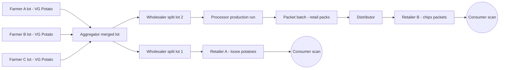
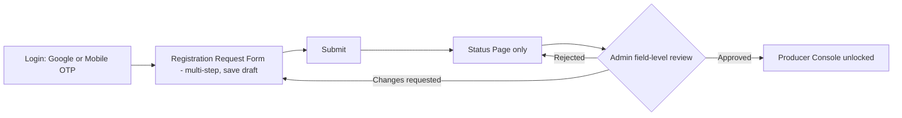
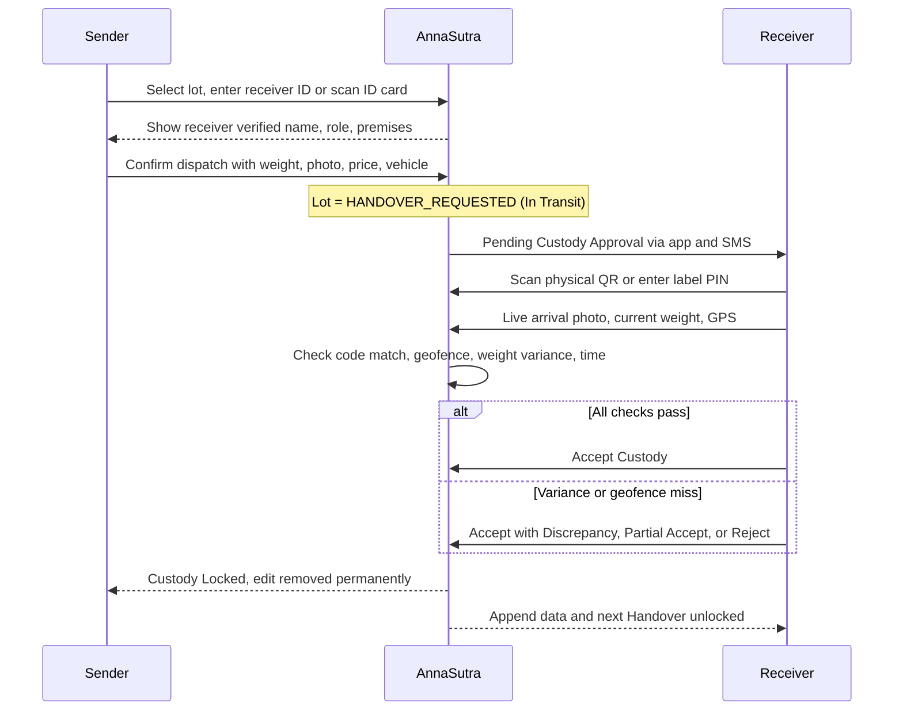
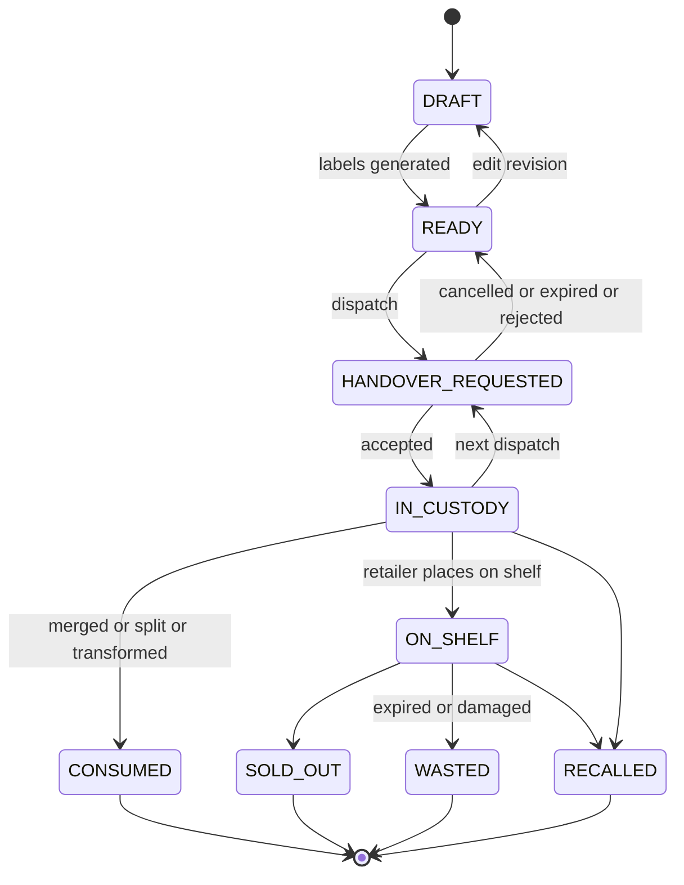
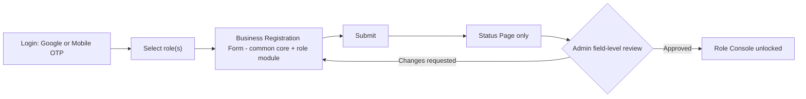
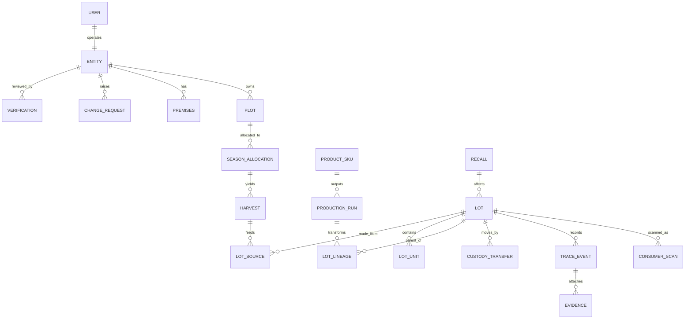

# AnnaSutra: Core Entity Console Architecture (Gold Standard — Locked)

> [!IMPORTANT]
> **Core Architecture Specification:** This is the locked source-of-truth blueprint from which all AnnaSutra entity consoles (Farmer, Aggregator, Processor/Manufacturer, Wholesaler, Distributor, Retailer, Consumer Scan, and Admin) will be built. All 22 architectural decisions in Section 15 are finalized.

---

## 0. The Concept in One Paragraph

AnnaSutra is a farm-to-fork trust ledger. A farmer logs in, sends one registration request, and gets the console only after the admin checks every document. Inside the console the farmer maps each plot on a map, splits land between crops season by season, records every harvest from a plot, and turns harvests into lots. Each lot gets a unique QR and barcode label. Every time a lot moves, both sides do a handshake: the sender dispatches, and the receiver must prove they physically have the lot (label scan, live photo, weight, GPS) before custody passes to them. Once that happens, the sender's record is locked forever. Lots can be merged (aggregator), split (wholesaler) or turned into new products (manufacturer, for example potatoes into chip packets), and each new lot always keeps a link back to the lots it came from. Quantities must balance at every step, so nobody can quietly add produce that has no traceable source. Nothing is ever deleted. Changes are only added on top, and each record is hash-chained so tampering shows. At the shop, the customer scans one code and sees a true story that protects everyone's privacy: where the food came from, who handled it, how fresh it is, and whether it is genuine. The admin sees the whole chain, all flagged problems, recalls, and scan analytics collected with consent.

---

## 1. Diamond Rules (non-negotiable design principles)

| # | Rule | What it means in the product |
|---|------|------------------------------|
| 1 | Verify before access | No console access, and no lot creation, until the admin approves the entity. |
| 2 | Append-only | Records are never deleted. An edit before handover saves a new revision, and the admin sees the full history. |
| 3 | Proof of possession | Custody changes only after a physical label scan or PIN, a live photo, the weight and GPS. |
| 4 | Mass balance | Total lot quantity cannot exceed the harvest. Processor output cannot exceed input × the conversion ratio. |
| 5 | Lineage is a graph | Lots can merge, split and transform, and parent links are never lost. |
| 6 | One step up, one step back | Every party can see where a lot came from and where it went (ISO 22005 principle). |
| 7 | Privacy by design | Data collection follows India's DPDP Act 2023. Public pages never show mobile numbers, exact plot boundaries or KYC data. |
| 8 | Standards-aligned | The event model follows GS1 EPCIS 2.0. Retail QR codes follow GS1 Digital Link. Lot labels use a Code128 barcode. |
| 9 | Rural-first | Works offline, supports multiple languages, runs on low-end Android, and uses large touch targets. |
| 10 | Premium UI | Uses one icon system (Lucide) and colour + icon + text status chips. No emojis anywhere: UI, labels, SMS or exports. |

---

## 2. Entities and Roles

### 2.1 Role list

| Role | Who | Status |
|------|-----|--------|
| Producer / Farmer | Individual farmer, dairy farmer, beekeeper, fish farmer | Existing |
| Aggregator / Collector | FPO, co-operative, village collection centre, commission agent | Existing |
| **Processor / Manufacturer** | Rice mill, dal mill, oil mill, dairy plant, chips or snack maker, packer | **New (approved)** |
| Wholesaler | Mandi trader, bulk buyer | Existing |
| Distributor | Regional or brand distributor, warehouse, cold storage operator | Existing |
| Retailer | Kirana, supermarket, online store | Existing |
| Consumer | Public user who scans a code. No login. | Existing (public page) |
| Admin | Sub-roles: Super Admin, Verifier, Support, Analyst (read-only) | Existing, sub-roles new |

### 2.2 Your Manufacturer doubt: my answer

**Yes, add a Processor / Manufacturer role. Do not merge it into Wholesaler or Distributor.** A wholesaler moves the *same* product. A manufacturer turns it into a *new* product with its own name, brand, pack size, manufacturing date, expiry date, FSSAI licence and often a GTIN barcode. That is a different kind of event (a Transformation), it carries different legal duties, and it needs different permissions.

**The Lay's example in AnnaSutra terms:** 40 farmer potato lots (12 tonnes) arrive at the plant. The processor creates a *Production Run* that uses those 40 lots and produces *Production Batch PB-xxxx*, which is 48,000 packets of 52 g. Packets carry a **batch-level QR** (one QR printed on every packet of that batch, not a unique QR per packet; this is cheap and is the industry norm). A customer who scans a packet sees: "Made from potatoes grown on 40 verified farms in Hooghly and Agra, harvested 12 to 18 Oct, processed 22 Oct." The system also checks mass balance: 12 t of potato at roughly a 4:1 ratio gives about 3 t of chips, so it can flag a batch that claims more output than its inputs allow.

### 2.3 Capability matrix

| Capability | Farmer | Aggregator | Processor | Wholesaler | Distributor | Retailer | Admin |
|---|---|---|---|---|---|---|---|
| Land, harvest, create lot from harvest | Yes | - | - | - | - | - | View |
| Dispatch / handover | Yes | Yes | Yes | Yes | Yes | - (sells to consumer) | View |
| Accept custody | - | Yes | Yes | Yes | Yes | Yes | View |
| Append data (after acceptance) | Before handover only (edit) | Yes | Yes | Yes | Yes | Yes | View |
| Merge lots | - | Yes | Yes | Yes | Yes | - | View |
| Split lots | Yes (before handover) | Yes | Yes | Yes | Yes | Yes | View |
| Transform (new product) | - | - | Yes | - | - | - | View |
| Place on shelf / mark sold out | - | - | - | - | - | Yes | View |
| Recall | - | - | Raise request | Raise request | Raise request | Raise request | Initiate |
| Request account deletion | Yes (Admin review) | Yes (Admin review) | Yes (Admin review) | Yes (Admin review) | Yes (Admin review) | Yes (Admin review) | Review & approve/reject |

### 2.4 Lineage example (why the chain is a graph, not a straight line)



---

## 3. Identity and Code System

### 3.1 Entity ID (Farmer ID, also used for every entity)

**Your format:** `YYYYMMHHMMSS + CountryCode + MobileNumber`

| Issue I found | Why it matters | Suggestion |
|---|---|---|
| The **day (DD)** is missing | `YYYYMM` jumps straight to the hour, which reads oddly and is not a sortable date | **Approved:** Use `YYYYMMDDHHMMSS + CC + Mobile` |
| The mobile number sits inside the ID | The ID appears on ID cards, labels and screenshots, so the farmer's phone number leaks (DPDP risk, spam and fraud calls) | Keep the full ID internal and on the admin side. Show a **masked** form in public views, for example `20261028-155226-91-98XXXXX210` |
| Mobile numbers change | The ID would then show the wrong number | **The ID is frozen at registration.** It never changes. The current mobile is stored separately. |

Example (registered 28 Oct 2026, 15:52:26, India, 9876543210):
- As written by you: `202610155226919876543210` (24 digits)
- With day added: `20261028155226919876543210` (26 digits)

### 3.2 Batch / Lot Code

**Your format:** `YYYYMMHHMMSS + CountryCode + MobileNumber + CropClassInitials`

| Issue | Suggestion |
|---|---|
| Two lots made in the same second (bulk generation) would get the same code | Add a **3-digit sequence**: `001` to `999` per second |
| A typing mistake when someone enters the code by hand is not caught | Add **1 check character** (ISO 7064 Mod 37,2) |
| Missing day | Same fix as the Entity ID |

**Proposed:** `YYYYMMDDHHMMSS + CC + Mobile + CropClass(2) + Seq(3) + Check(1)`
Printed as: `20261028160510-91-9876543210-FG-001-K` (32 characters)

The same pattern is used for lots that next parties create (merged, split or processed lots). The code carries *that* entity's mobile, and the system stores the parent links.

### 3.3 Product Code Taxonomy (your 10 categories, kept exactly)

| # | Category | Code | Representative commodities |
|---|---|---|---|
| 1 | Food Grains & Cereals | FG | Paddy/Rice, Wheat, Maize, Barley, Jowar, Bajra, Ragi (Millets / Shree Anna) |
| 2 | Pulses | PU | Tur (Arhar), Chana, Moong, Urad, Masoor, Rajma, Kabuli Chana |
| 3 | Oilseeds | OI | Mustard, Groundnut, Soybean, Sunflower, Sesame, Safflower, Castor |
| 4 | Fruits | FR | Mango, Banana, Apple, Guava, Pomegranate, Papaya, Citrus, Grapes, Litchi |
| 5 | Vegetables | VG | Potato, Onion, Tomato, Brinjal, Cauliflower, Cabbage, Okra, Green Peas |
| 6 | Spices | SP | Turmeric, Red Chilli, Cumin, Coriander, Cardamom, Black Pepper, Ginger, Garlic |
| 7 | Commercial Crops | CC | Sugarcane, Cotton, Jute, Tea, Coffee, Rubber, Coconut, Arecanut |
| 8 | Livestock, Dairy & Apiculture | LS | Raw Milk, Desi Ghee, Eggs, Raw Honey, Fish/Aquaculture, Wool |
| 9 | Special Crops | SC | Ashwagandha, Tulsi, Mushrooms, Saffron, Floriculture, Bamboo |
| 10 | Others | OT | Jaggery, Cold-Pressed Oils, Fodder, Vermicompost, Mixed Multi-Crop Lots |

**Below the category, as data (not part of the code):** Commodity (for example Potato), Variety (for example Kufri Jyoti), Grade. Admin maintains these in Master Data, so codes stay short while records stay rich.

### 3.4 What goes on the label

| Element | Purpose |
|---|---|
| **QR code** encoding a URL: `https://annasutra.in/l/{opaque-token}` | Customer and party scans. An opaque token means a photo of the label leaks no mobile number and codes cannot be guessed. |
| **Code128 barcode** of the lot code | For warehouse and POS barcode guns |
| Human-readable lot code | Manual entry fallback |
| **6-digit Verification PIN** | Proof-of-possession entry when a scan fails |
| Crop, variety, net weight, unit no. (for example 3/20), harvest date | Physical identification |
| AnnaSutra mark + Verified Farmer mark | Brand trust |

**Retail packets from processors:** use GS1 Digital Link `https://annasutra.in/01/{GTIN}/10/{BatchCode}` when the brand has a GTIN, otherwise `/l/{token}`.

> [!TIP]
> If the PIN is printed openly, anyone with a photo of the label can type it. Place the PIN on the inner fold of the tag or under a peel strip. A geofence check plus a live photo plus the weight then makes spoofing very hard.

### 3.5 Unit serialization (approved, Phase 2)
A lot is the parent, and each bag or crate is a child unit: `...-FG-001-K/U0001`. This allows partial handover (say 12 of 20 bags), per-bag scan counts and per-bag damage reports. Labels: one QR per unit plus one master label for the lot.

### 3.6 Label print formats
Thermal 50×25 mm, thermal 75×50 mm, A4 sticker sheet (24 per sheet), and PDF download. Bulk print by lot or by a range of units.

---

## 4. Producer / Farmer

### 4.1 Onboarding flow



**Registration statuses:** `DRAFT`, `SUBMITTED`, `UNDER_REVIEW`, `CHANGES_REQUESTED`, `APPROVED`, `REJECTED`, `SUSPENDED`

**Status page:** a vertical stepper with a badge for each form section (Approved / Needs fix / Pending), the admin's remark on each rejected field, a "Fix and Resubmit" button and a support contact. Nothing else is visible.

> [!IMPORTANT]
> The admin approves **section by section and field by field**, not as all-or-nothing. A farmer with one blurry document fixes just that document instead of filling the whole form again.

### 4.2 Registration form fields

| Section | Fields | Required |
|---|---|---|
| A. Personal | Full name (as on ID), Father/Spouse name, Gender, DOB, Live selfie photo, Verified mobile, Alternate mobile, Email, Preferred language | Name, DOB, Gender, Photo, Mobile |
| B. KYC | ID type (Aadhaar via DigiLocker, Voter ID, PAN, Kisan card), ID number (stored masked), Front/back upload | One ID |
| C. Address | State, District, Sub-district/Tehsil, Block, Village (LGD codes), Pincode, Home pin on map | All except map pin |
| D. Farmer registries | **AgriStack Farmer ID**, PM-KISAN ID, Kisan Credit Card no., Soil Health Card no. | Optional (AgriStack strongly recommended) |
| E. Land summary | Total land + unit (Acre / Hectare / Bigha / Guntha, auto-converted), Ownership (Owned / Leased / Shared / Community), Land record no. (Khasra / Survey / Khatauni), Land document upload | Total land, ownership |
| F. Farming profile | Practice (Conventional / Organic / Natural / In-conversion), Certifications (NPOP, PGS-India, GlobalG.A.P., others: number, validity, upload), Irrigation source, Years of farming, Main crops | Practice |
| G. Group membership | FPO / Co-op name, Member ID | Optional |
| H. Bank (future payments) | Account holder, Account no., IFSC, Passbook / cancelled cheque | Optional now |
| I. Consents | Terms, DPDP data consent, **Consumer visibility toggles** (show my first name / village / photo), OTP e-sign | Required |

### 4.2.1 Unique Farmer ID Issuance Policy (First-Time Registration)

- **Strict Pre-Approval Policy:** First-time producer registrations in status `DRAFT`, `SUBMITTED`, or `NEEDS_CHANGES` **MUST NOT** receive or display a Unique Farmer ID.
- **Application Reference:** While review is pending, the producer interface and admin review displays an Application Reference code (`APP-XXXXXXXX`).
- **Minting Upon Admin Approval:** The deterministic 24-digit Unique Farmer ID (`YYYYDDHHMMSS` + `91` + 10-digit mobile number) is minted and sealed into `EntityRoleDetails` exclusively at the moment of Admin approval (`approve_entity_registration`).

### 4.3 A. Profile (5-Step Registration Form Inspection & Data Updation)

The original 5-step registration data remains permanently accessible under **A. Profile** in the Producer Console for continuous inspection, self-service updates, and formal change requests:

1. **Step 1: Basic Info**
   - Applicant Name, Legal Organisation, Primary Phone, Email, Address Lines 1 & 2, Village/Town, District, State, Pincode.
   - *Self-Editable:* Alternate Phone, Email, Address Line 2, Preferred Language.
   - *Locked (Admin Review):* Legal First/Last Name, Primary Phone, Legal Jurisdiction.
2. **Step 2: Farm Plots & Cadastral Boundaries**
   - Registered farm parcels, survey numbers, acreage, and GeoJSON boundary geometry.
   - *Self-Editable:* Plot nickname, seasonal notes.
   - *Locked (Admin Review):* Total registered land acreage, cadastral survey numbers, plot boundary polygon re-mapping.
3. **Step 3: Cultivation Profile**
   - Primary and secondary commodities (e.g. Potato, Paddy, Turmeric), irrigation infrastructure, farming practice (Conventional, Organic NPOP, Natural Farming).
   - *Self-Editable:* Secondary seasonal crops, irrigation method, organic certification notes.
4. **Step 4: Identity & Bank Settlement**
   - Masked PAN (`•••• ••••`), voluntary Aadhaar last-4 digits, Bank name, masked Account number, IFSC, UPI handle.
   - *Strictly Locked (Admin Review):* All financial settlement details and statutory KYC credentials require a Change Request with documentary proof.
5. **Step 5: Consent, Change Requests & Account Review**
   - Immutable DPDP Act 2023 statutory consent timestamp and agreement terms.
   - Interactive tracking of all submitted Change Requests (`PENDING`, `APPROVED`, `REJECTED`).
   - Access to **Danger Zone: Entity Account Deletion Request**.

### 4.3 A. Profile

- **Header:** photo, name, `BadgeCheck` Verified badge, Entity ID (masked, with a copy button), member since.
- **Digital ID Card:** downloadable or printable card with a QR. Buyers scan this card to start a handover.
- **Field lock rules:**

| Change type | Fields |
|---|---|
| **Locked, needs a change request + admin approval** | Name, DOB, Gender, KYC, Profile photo (shown to consumers), Bank, Land records, Certifications, Primary mobile (OTP on old and new number + admin) |
| **Self-editable** | Alternate mobile, Email, Language, Notification preferences, Consumer visibility toggles |

- **Change Request flow:** old value next to new value, a reason, document upload, then status `PENDING`, `APPROVED` or `REJECTED`, plus a change history tab. The old value stays active until approval.

#### 4.3.1 Delete Entity Profile & Account Deletion Request (Approved)

- **UI Location & Visual Style:** At the bottom of the Profile tab, a dedicated red-accented container titled **"Danger Zone / Account Deletion"** (`UserX` / `Trash2`, outline in `#fecaca`, text in `#dc2626`).
- **Farmer Initiation Flow:**
  1. The Producer taps **"Request Account Deletion"**.
  2. An interactive **Account Deletion Request Modal** appears with full legal and operational disclosures.
  3. **Mandatory Reason for Deletion:** The farmer must select a structured reason from a dropdown, with optional remarks:
     - *Ceasing farming operations / retirement*
     - *Sale, transfer, or lease termination of agricultural land*
     - *Right to Erasure / Privacy Request under DPDP Act 2023*
     - *Duplicate or accidental registration*
     - *Other (mandatory explanation required)*
  4. **Active Custody & In-Transit Pre-flight Check:**
     - The system automatically audits open lots. If the producer has any lots in `HANDOVER_REQUESTED` (in transit, pending recipient physical handshake) or active open discrepancies, the request is **blocked**:
       > *"Cannot submit account deletion request while lots are in transit or pending handover. Please ensure all active lot handovers are completed or cancelled first."*
  5. **Owner 2FA OTP Authentication:**
     - A 6-digit OTP is sent to the Producer's verified primary registered mobile number.
     - Entering the valid OTP digitally signs the deletion request.
  6. **Status Transition to `DELETION_REQUESTED`:**
     - The entity status transitions from `APPROVED` to `DELETION_REQUESTED`.
     - Operations are frozen immediately: creating new plots, logging harvests, and creating/dispatching lots are disabled.
     - A persistent notification banner appears on the Producer Console:
       > *"Account Deletion Request submitted on [Date, Time]. Under review by Admin Authority. [Cancel Request]"*
     - The producer may cancel the request at any time prior to Admin approval.

- **Admin Decision & DPDP Act 2023 Execution:**
  - The request routes directly to the **Admin Verification Queue > Deletion Requests**.
  - **On Admin Approval:**
    - Entity status transitions to `DEACTIVATED`.
    - Active JWT tokens and login sessions are immediately revoked.
    - **DPDP Act 2023 Compliance & Cryptographic Integrity:** In compliance with DPDP 2023, personal identifying data (selfie photo, live phone number, bank details, Aadhaar/DigiLocker documents) is purged from active operational storage. However, adhering to **Diamond Rule 2 (Append-Only Ledger)**, historical transaction blocks, past custody handshakes, hash chains, and consumer provenance timelines are preserved immutably using masked, cryptographically sealed references (e.g. `[Deactivated Producer #20261028-155226-91-98XXXXX210]`). Downstream batches and consumer scan integrity are never broken.
  - **On Admin Rejection:**
    - The Admin must enter a justification (e.g. active traceability inquiry or recall liability).
    - Status reverts to `APPROVED` and the farmer is notified via SMS and in-app message.

### 4.4 B. Land Management

**Structure:** Land Holding (total declared area), then Plots (polygons), then Season Allocations (crop on part of a plot)

**Plots**
- Draw a polygon on a satellite map, or use **walk-the-boundary** mode (the phone records GPS while the farmer walks the field edge).
- Area is calculated automatically from the polygon. If the declared area and the measured area differ by more than 10%, a **mismatch flag** is raised.
- **Overlap detection:** the system flags any polygon that overlaps another farmer's plot (stops double registration and fraud).
- Per plot: name, land record no., ownership, soil type, irrigation, plot photo.
- Plot statuses: `PENDING_VERIFICATION`, `VERIFIED`, `REJECTED`.

**Season Allocation** (your "5 acres split across crops")
- Choose Season (Kharif / Rabi / Zaid + year), then Plot, then acres, then Crop Class, Commodity and Variety. Also record sowing date, expected harvest date, seed source / seed lot, and an optional sub-polygon.
- **Rule:** the sum of allocations cannot exceed the plot area in that season. The total across plots cannot exceed the total land.
- **Visual:** a donut chart, for example "5.0 ac total: FG 2.0, VG 1.5, PU 1.0, Unallocated 0.5".
- Allocations are stored per season, so history is never overwritten.

> [!TIP]
> Plot polygons also make AnnaSutra ready for the **EU Deforestation Regulation (EUDR)**, which requires plot geolocation for coffee, rubber, soy and cattle exports. That is a premium selling point later.

### 4.5 C. Harvest Records

| Field | Notes |
|---|---|
| Plot + Season Allocation | Crop fills in automatically from the allocation |
| Harvest date (or date range) | |
| Quantity + unit | kg / quintal / tonne / litre / dozen / count |
| Grade, Moisture % | Optional, varies by crop |
| Live photos | Camera only. GPS and time are added by the server. |
| Remarks | |

- **Yield sanity check:** quantity per acre is compared with the admin benchmark for that commodity. Outliers are flagged (stops "laundering" of untraceable produce).
- **Unlotted balance:** each harvest shows "42 q harvested, 36 q lotted, 6 q remaining". You cannot create more lots than you harvested.
- **Forms change by category:** LS (dairy, honey, eggs, fish) uses a *Production Record* (herd or hive or pond, collection date, shift AM/PM, fat/SNF for milk) instead of plot harvest.

### 4.6 D. Batch / Lot Creation

**Create Lot**

| Field | Notes |
|---|---|
| Source harvest(s) | One or more harvest records of the same commodity (OT allows mixed) |
| Category, Commodity, Variety, Grade | Filled from the harvest, editable |
| Net weight, Gross weight | |
| No. of units, Unit type, Weight per unit | Bag / crate / drum / can / box |
| Packaging material | Jute, PP, plastic crate, etc. |
| Asking price per kg | Visible only to the farmer, the buyer and the admin |
| Harvest date, On-farm storage | |
| Certifications, Lab report | Attach from profile or upload |
| Photos | Live camera |

- **Unlimited lots**, plus **Bulk Generate** (for example 10 lots of 50 kg each from one harvest).
- **Generate Labels:** QR + Code128 + PIN in the formats from 3.6.

**Handover (Dispatch)**
1. Select the lot (or some units).
2. Enter the next party's mobile / Entity ID, **or scan their Digital ID Card**.
3. The system shows the receiver's **verified name, role and premises** so the farmer can confirm the right buyer.
4. Capture the dispatch weight, a dispatch photo, the agreed price per kg, and optionally vehicle no., driver mobile and invoice / e-way bill no.
5. Dispatch. The lot becomes `HANDOVER_REQUESTED` (In Transit).
6. The request expires after a set time (default 48 h, set by admin). On expiry it goes back to `READY` and the farmer is notified.

**Edit rules**

| Lot state | Farmer can |
|---|---|
| `DRAFT`, `READY` | Edit (a new revision is saved), split, print labels, dispatch |
| `HANDOVER_REQUESTED` | Cancel the request only. Editing is frozen while in transit. |
| After acceptance | Nothing. The `Pencil` icon is permanently replaced by a `Lock` "Custody Locked" badge. |

**Buyer-initiated request:** the buyer scans the lot QR and sends "Request Custody". The farmer gets an Approve/Decline prompt. On approval the normal handshake runs.

### 4.7 Producer Console layout (compact)

```
+----------------------------------------------------------------------------------+
| [Logo]  Ramesh Kumar [BadgeCheck Verified]  ID 20261028-...-98XXXXX210  [Lang] [Bell] |
+--------------------------------------------------------------+-------------------+
| STATS (compact KPI tiles, left)                              | ACTION RAIL       |
| Total Land 5.0 ac | Allocated 4.5 ac | Active Crops 3        | [UserRound]       |
| Harvest (season) 42 q | Unlotted 6 q | Lots 18               |  Profile          |
| In Transit 2 | Custody Locked 14 | Pending Requests 1        | [LandPlot]        |
| Avg Farm-to-Shelf 6.2 d | Consumer Scans 1,284               |  Land Management  |
|                                                              | [Wheat]           |
|                                                              |  Harvest Records  |
|                                                              | [PackagePlus]     |
|                                                              |  Batch / Lot      |
+--------------------------------------------------------------+-------------------+
| LOT LEDGER  [Search] [Status] [Crop] [Season] [Export CSV/PDF]                    |
| Lot Code | Crop | Units | Net Wt | Price/kg | Status | Custodian | Days | Actions  |
+----------------------------------------------------------------------------------+
```

- Four **big buttons** on the right, each with an icon, a label and a small hint (for example "1 change request pending").
- Stats are tiles about 72 px tall. A click on a tile filters the ledger (for example a click on "In Transit" filters to in-transit lots).
- **Mobile:** the action rail becomes a 2×2 grid at the top, stats scroll horizontally, and the ledger becomes cards.
- The **Lot Ledger is one shared component**, used on both the Console Home and the Batch/Lot page, as you asked.

### 4.8 Lot Ledger (shared component)

| Column | Content |
|---|---|
| Lot Code | Grouped code + copy button + small QR preview on hover |
| Crop | Category chip (FG/VG...) + commodity + variety |
| Units / Size | for example 20 bags |
| Net Weight | Current weight (latest custodian's reading) |
| Price / kg | Farmer's sale price |
| Status | Chip: icon + text + colour |
| Current Custodian | Entity name + role chip |
| Days in Chain | Live counter. **Frozen at "Farm-to-Shelf X days" once a retailer accepts.** |
| Last Update | Relative time |
| Actions | Icons below |

**Row actions (icons only, tooltips on hover):** `Route` Track Lot, `Pencil` Edit / `Lock` Custody Locked, `Printer` Print Labels, `Send` Handover, `XCircle` Cancel Request, `MoreHorizontal` (Split, Duplicate, Revision History, Download Lot Certificate PDF)

**Status chips**

| Status | Icon | Colour |
|---|---|---|
| Draft | `FileEdit` | Slate |
| Ready | `QrCode` | Blue |
| In Transit (Handover Requested) | `Truck` | Amber |
| In Custody (next party) | `PackageCheck` | Teal |
| On Shelf | `Store` | Green |
| Sold Out | `CircleCheckBig` | Dark green |
| Discrepancy | `TriangleAlert` | Orange |
| Rejected / Returned | `Undo2` | Red |
| Recalled | `OctagonAlert` | Crimson |
| Consumed (merged / split / processed) | `GitMerge` | Violet |

### 4.9 Track Lot window

Opens as a full-screen modal with tabs:

1. **Journey:** a map (farm plot as the origin area, then each hop as a pin, joined by lines; solid for completed legs and dashed for in transit) next to a **vertical hop timeline**.
2. **Lineage:** a graph of merges, splits and transformations (upstream and downstream).
3. **Quantities:** a weight-at-each-hop chart with loss % per hop and overall.
4. **Evidence:** all photos, documents, lab reports and certificates.
5. **Consumer Scans:** count and city-level map (the farmer sees city level only).

**Hop card fields**

| Field | Example |
|---|---|
| Hop # + Role + Entity name + Verified badge | Hop 2, Wholesaler, Sharma Traders |
| Location | Azadpur Mandi, Delhi |
| Received at / Handed over at | 21 Oct 10:14 / 23 Oct 06:30 |
| Dwell time / Transit time from previous hop | 1 d 20 h / 9 h |
| Weight in / Weight out / Loss % | 1000 kg / 985 kg / 1.5% |
| Condition | Good, minor damage 2% |
| Storage | Cold room, 4 °C |
| Photos | Arrival + condition thumbnails |
| Proof Score | QR scan, live photo, geofence match, weight within tolerance (4/4) |
| Price / kg at this hop | Admin only. The farmer sees only their own sale price (approved). |

---

## 5. Custody Handshake Protocol



**Anti-spoofing checks**

| Check | Rule | On failure |
|---|---|---|
| Code match | Scanned QR / PIN must equal the lot (or units) in the request | Block |
| Live capture | Camera only, no gallery upload; server adds time + GPS | Block |
| Geofence | Receiver GPS within the radius of their registered premises (default 500 m, set by admin) | Allow + flag |
| Weight variance | Must be within commodity tolerance (for example 1 to 3%, set by admin) | Requires "Accept with Discrepancy" + reason; both sides notified |
| Time sanity | Device time vs server time, transit duration plausible | Flag |

**Outcomes:** Accept, Accept with Discrepancy, Partial Accept (some units; the rest go back to the sender), Reject (reason + photo; the lot goes back to the sender as `READY`).

**Offline mode:** a scan made without network is saved on the device with device time, GPS and a local signature, then synced later. It is marked "Captured offline at T1, synced at T2".

### 5.1 Multi-Lot Truck Dispatch & Rapid-Scan Acceptance (Approved)

When a sender dispatches many lots together on one vehicle (for example, an Aggregator sending 40 farmer lots on 1 truck to a Wholesaler or Processor), the operator must be able to complete the custody handshake in **under 2 minutes** without opening 40 separate forms:

1. **Single Truck Gate-Pass QR (Dispatch Manifest):**
   - The sender selects multiple lots in their Lot Ledger and clicks `Truck` **Dispatch Together on 1 Truck**.
   - They enter the receiver ID, vehicle number, driver mobile, e-way bill/invoice number, and total dispatch weight once.
   - AnnaSutra creates a **Shipment Manifest (`SHP-YYYYMMDDHHMMSS-xxx`)** and prints a single **Master Truck Gate-Pass QR** linking all selected lots.
2. **Rapid-Scan Camera Mode (Continuous Checkout Loop):**
   - At arrival, the receiver opens their **Pending Custody Inbox** and scans the **Truck Gate-Pass QR** (or taps `ScanLine` **Rapid Scan Arrival**).
   - The phone camera stays open continuously in a loop: as bags/crates are unloaded, the operator points the camera at each lot label (`Beep — 1/40 verified`, `Beep — 2/40 verified`...) without closing the camera screen.
   - Any missing or damaged lot can be unchecked on the spot (automatically triggering a **Partial Accept** for the verified lots while returning missing lots to the sender's custody).
   - Once scanning is complete, the receiver captures **1 live arrival photo** of the unloaded stack, enters the **total weighbridge/scale weight**, and taps **Accept All Verified Lots** in a single action.

**Lot state machine**



A discrepancy is a **flag** on the lot, not a separate state. Custody still moves, and the flag stays visible until the admin resolves it.

---

## 6. Next Party Consoles (Aggregator, Processor, Wholesaler, Distributor, Retailer)

> [!IMPORTANT]
> **Every business entity gets its own console**: Aggregator, Processor / Manufacturer, Wholesaler, Distributor and Retailer. They follow the same rule as farmers: Login, then one Registration Request Form, then a Status Page only, then admin field-level approval, then the Console. The only parties without a console are the **Consumer** (public scan page) and the **Admin** (separate Admin Console).

### 6.1 Registration flow for business entities



**Entity ID:** the same format as farmers, `YYYYMMDDHHMMSS + CC + Mobile` (the authorised signatory's mobile at registration). It is **frozen forever**, even if the owner or the mobile changes later.

**Multi-role (approved):** one business can hold several roles (for example an FPO that is both Aggregator and Processor). Each role module is filled and approved separately, and the console shows a **role switcher** in the top bar. All roles share one Entity ID, one team and one set of premises.

**Team users (approved):** the Owner adds staff with OTP login and permissions: Owner, Manager, Receiving Operator, Dispatch Operator, QC Inspector, Viewer. Every event records *which staff member* did it.

### 6.2 Common Core Form (every business role fills this)

| Section | Fields | Required |
|---|---|---|
| **A. Authorised Signatory** | Full name, Designation, Verified mobile, Email, Live selfie, ID proof (PAN / Aadhaar via DigiLocker, masked / Voter ID), **Authorisation letter or board resolution** (if not the proprietor) | All, except the letter for proprietors |
| **B. Business Identity** | Legal name, Trade / brand name, Constitution (Proprietorship / Partnership / LLP / Pvt Ltd / Public Ltd / Co-operative / FPO-FPC / Trust / Govt body), Registration no. (CIN / LLPIN / Co-op / FPC no.), Date of establishment, Business PAN, Logo (shown to consumers), Website | Legal name, Constitution, PAN |
| **C. Tax** | GSTIN + GST certificate (the state code must match the premises state), Udyam (MSME) no. | GSTIN (see Basic tier, 6.5) |
| **D. Food Licensing** | **FSSAI licence / registration no.**, type (Basic / State / Central), licensed categories, validity, upload. *FSSAI is issued per premises, so it is captured per premises in section E.* | Yes, for every food business |
| **E. Premises (one or more)** | Premises type (Collection centre / Warehouse / Cold storage / Factory / Mandi shop / Retail store / Office), Address with LGD codes, Pincode, **map pin + geofence radius**, photos (**front with signboard**, inside), ownership or rent proof, operating hours, contact person, FSSAI no. for this premises | At least 1 |
| **F. Facilities and Capacity** | Storage type (Ambient / Cold / Frozen / Controlled-atmosphere), capacity (MT), temperature range, grading or sorting equipment | Storage type, capacity |
| **G. Weighing Scale** | Scale type, capacity, **Legal Metrology verification / stamping certificate** + validity | Per 6.4 |
| **H. Commodities Handled** | Categories (FG, PU, OI...) + commodities, typical monthly volume, sourcing regions. Used for profile and analytics only; **receiving other categories is not restricted** (approved). | Yes |
| **I. Logistics** | Own vehicles (registration no., type, refrigerated yes/no) or transport partners | Optional |
| **J. Certifications** | ISO 22000 / FSSC 22000 / HACCP / BRCGS / NPOP organic (trader or processor) / APEDA RCMC / Halal / Kosher / GlobalG.A.P. CoC: number, validity, upload | Optional, **expiry reminders** |
| **K. Bank** | Account holder (must match the legal name), Account no., IFSC, cancelled cheque | Optional now, required before payments |
| **L. Team (Staff Users)** | Add members with OTP: Owner, Manager, Receiving Operator, Dispatch Operator, QC Inspector, Viewer | Optional at registration |
| **M. Consents and Declarations** | Terms, DPDP consent, public visibility (business name, city and logo are shown on the consumer page), data-accuracy declaration, OTP e-sign | Yes |

### 6.3 Role-specific Modules (added after the common core)

| Role | Extra fields captured |
|---|---|
| **Aggregator / Collector** (FPO, Co-op, collection centre, commission agent) | FPO / FPC registration no., no. of member farmers, member list upload (links to assisted onboarding), field agents (name + mobile), villages or catchment served, APMC / mandi licence, collection centres (as premises) |
| **Processor / Manufacturer** | Factory licence, **FSSAI manufacturing licence** (State / Central) with product categories, Pollution Control Board consent to operate (optional), **Product catalogue** (SKU name, brand, pack sizes, **GTIN + GS1 India membership no.**), **standard conversion ratio per product** (for example 4 kg potato to 1 kg chips, used for mass balance), production lines and capacity, QC lab (in-house or NABL-accredited partner), pack printing method (QR printed on the pack or as a sticker label), contract manufacturing (brand owner details if making for another brand) |
| **Wholesaler** | APMC / mandi licence, mandi name + shop no., e-NAM ID, commodities, typical buyer types |
| **Distributor** | Brands / principals distributed + **authorisation letters**, territory (districts / pincodes), warehouses (as premises), fleet |
| **Retailer (End Seller)** | Store type (Kirana / Supermarket / Hypermarket / Online / **HoReCa** / **Exporter**), Shop and Establishment licence, no. of stores (each store is a premises), store-front photo with signboard, sells loose produce (yes/no, enables shelf QR printing), POS system name (future integration). *Exporter adds: IEC no., APEDA RCMC, destination countries. HoReCa adds: outlet type.* |

### 6.4 What the admin verifies (field-level)

| Check | How |
|---|---|
| PAN matches the legal name | Document + name match |
| GSTIN is active, state matches the premises | GST portal lookup |
| FSSAI licence is valid for the premises and category | FoSCoS lookup |
| Premises is real | Map pin vs address, signboard photo, optional video call |
| Signatory is authorised | Authorisation letter / board resolution |
| Weighing scale is legal | Legal Metrology certificate (required for Aggregator, Processor, Wholesaler, Distributor; optional for Retailer) |
| Bank account matches the legal name | Penny-drop (when payments are enabled) |
| Distributor's brand rights | Authorisation letters |

Statuses are the same as farmers: `DRAFT`, `SUBMITTED`, `UNDER_REVIEW`, `CHANGES_REQUESTED`, `APPROVED`, `REJECTED`, `SUSPENDED`. **Expiring licences** (FSSAI, scale certificate, certifications) send reminders 30 days ahead. If a licence expires, the console goes to **read-only** until it is renewed.

### 6.5 Verification tiers (approved)

| Tier | Who | Requirements | Badge |
|---|---|---|---|
| **Basic Verified** | Small kirana, small village collector without GSTIN (below the GST threshold) | Signatory KYC + FSSAI basic registration + Shop licence or Udyam + premises photo + pin | `BadgeCheck` Basic |
| **Fully Verified** | Everyone else | Full common core + role module | `ShieldCheck` Verified Business |

### 6.6 Console per role (same layout: stats left, big buttons right, Lot Ledger below)

| Role | Stats (left) | Big Buttons (right) |
|---|---|---|
| **Aggregator** | Pending inbound, Stock in custody (kg by crop), Farmers sourced (month), Avg dwell days, Shrinkage %, Open discrepancies | `Inbox` Custody Inbox, `ScanLine` Scan QR, `GitMerge` Merge / Grade, `Send` Handover, `UsersRound` Farmer Network (assisted onboarding), `Building2` Profile and Premises |
| **Processor / Manufacturer** | Input stock (kg), Production runs (month), Avg conversion ratio vs standard, Output packs, Mass-balance alerts, Pending outbound | `Inbox` Custody Inbox, `ScanLine` Scan QR, `Factory` Production Run, `Boxes` Product Catalogue (SKU), `Send` Handover, `Building2` Profile and Premises |
| **Wholesaler** | Pending inbound, Stock in custody, Avg dwell days, Shrinkage %, Lots dispatched, Open discrepancies | `Inbox` Custody Inbox, `ScanLine` Scan QR, `Split` Split, `Send` Handover, `Building2` Profile and Premises |
| **Distributor** | Stock by brand / SKU, Pending outbound, Cold-chain alerts, Avg transit days, Retailers served | `Inbox` Custody Inbox, `ScanLine` Scan QR, `Split` Split, `Send` Handover, `Thermometer` Cold-chain Log, `Building2` Profile and Premises |
| **Retailer** | Pending inbound, On shelf, Avg Farm-to-Shelf days, Sold out / wasted (month), Consumer scans at my store | `Inbox` Custody Inbox, `ScanLine` Scan QR, `Store` Shelf and Sales, `Printer` Shelf QR, `Building2` Profile and Premises |

**Common stats (all roles):** Pending Inbound, In-Custody Stock, Pending Outbound, Avg Dwell Days, Shrinkage %, Open Discrepancies.

### 6.7 Append Data (your rule, enforced)

- Only the **current custodian**, only **after acceptance**, and only **by scanning the physical label** (or typing the PIN). This proves the person is standing next to the lot.
- Append types:

| Append type | Fields |
|---|---|
| Weight Check | Current weight, scale photo |
| Condition / Grade | Good / Minor damage / Major damage / Unfit, damage %, photos |
| Storage Event | Moved to (room / rack), temperature, humidity |
| Quality Test | Parameters, lab name, report upload |
| Repack | New packaging, new unit count |
| Note | Free text |

- Every append is an **unchangeable event**. A correction is a new event that points to the old one.

### 6.8 Role-specific functions

| Role | Special functions |
|---|---|
| **Aggregator** | Merge many farmer lots into one aggregated lot (new code, all parents linked). Grade or sort into grade lots (split). |
| **Processor** | **Production Run:** choose input lots and the quantity used from each, add non-farm ingredients (salt, oil: supplier + batch), recipe, expected vs actual conversion ratio (mass balance), output product (name, brand, pack size, GTIN optional), production batch code, mfg date, best-before, output count, print packet QR (batch level). |
| **Wholesaler / Distributor** | Split and dispatch to many buyers, cold-chain readings, transport details |
| **Retailer** | Accept, **Place on Shelf** (freezes the Farm-to-Shelf days), print a shelf QR for loose produce, mark Sold Out / Wasted / Returned with quantity |

### 6.9 Account & Entity Deletion Option for All Business Entities (Approved)

Every downstream business entity console (**Aggregator / FPO, Processor / Manufacturer, Wholesaler, Distributor, and Retailer**) must provide an identical **"Delete Entity Profile / Request Account Deletion"** option under **Profile and Premises** (`Building2`):

- **Role Authorization:** Only users with the `OWNER` sub-role (Section 15 Decision 15) may trigger a deletion request. Staff/sub-users (`MANAGER`, `RECEIVING`, `DISPATCH`, `QC`, `VIEWER`) cannot access this action.
- **Strict Zero-Active-Custody Pre-flight Checks:**
  - **Aggregator / Wholesaler / Distributor:** Must possess 0 active lots in custody. All inbound stock must either be fully dispatched, transferred, split/merged into zero residual balance, or marked closed.
  - **Processor / Manufacturer:** Must have no open or in-progress Production Runs. All produced batch lots must be handed over or marked closed.
  - **Retailer:** All shelf stock must be accounted for (marked `SOLD_OUT`, `WASTED`, or returned).
  - **Zero In-Transit Handovers:** No outgoing or incoming lots in `HANDOVER_REQUESTED` state.
  - If any active inventory or transit remains, the deletion modal is blocked with a detailed breakdown of items that must be resolved first.
- **Mandatory 2FA OTP Authentication:** The registered signatory's mobile number must verify an OTP to digitally authenticate the request.
- **Entity Freezing:** Upon submission, the business transitions to `DELETION_REQUESTED`. All operational capabilities (accepting inbound handovers, initiating dispatches, starting production runs, or printing retail QRs) are locked.
- **Admin Review & Anonymization:** Admin examines the request in the **Entity Deletion Queue**. Upon approval, business credentials are deactivated, commercial contact PII is expunged under DPDP Act 2023, while historical custody handovers and product transformation records remain cryptographically sealed and permanently intact.

---

## 7. Consumer Scan Page (public, no login, mobile-first)

| Block | Content |
|---|---|
| Authenticity banner | `ShieldCheck` Verified Genuine / `TriangleAlert` Unusual scan pattern / `OctagonAlert` Recalled, do not consume |
| Product | Name, variety, grade, category, pack size, harvest or mfg date, best-before |
| Origin | **Masked farmer card (approved):** farmer photo (only if the farmer consented), first name only + masked surname (for example "Ramesh K."), village / district, farming practice, certificates with "verify" links, origin map at **district level** (never the exact polygon). No surname, no Entity ID, no mobile, no address, no prices, no plot size or yield (business secrecy). |
| Journey | Timeline of hops: role, business name, city, date. **Farm-to-Shelf: 6 days.** Distance travelled. |
| Made From (processed goods) | "Made from potatoes from 40 verified farms", with a few sample farms |
| Quality and Safety | Lab test, residue test, cold chain maintained (yes/no) |
| Actions | Rate product, Report an issue (with photo), Share. "Thank the farmer" later. |

**Never shown publicly:** mobile numbers, full IDs, KYC, exact plot boundaries, bank details, per-hop prices (unless approved), GPS metadata inside photos (stripped before publishing).

**Counterfeit detection:** scans are counted per code. If the same packet code is scanned in faraway cities within a short time, or after the lot is marked Sold Out, the page shows a warning and the admin gets an alert.

---

## 8. Consumer Location and Scan Analytics (Admin)

> [!WARNING]
> Collecting a customer's exact GPS location silently and selling it breaks India's DPDP Act 2023 and Play Store / browser policies, and it could get the business penalised. The design below still gets you sellable location data, collected legally.

| Level | What | How |
|---|---|---|
| Always (no prompt) | City / pincode (approx. from IP), device type, time, product, lot, retailer | Server-side |
| Opt-in | **Precise GPS** | Browser location prompt with a clear purpose. Incentive: "See how far this food travelled to reach you." |
| Retention | Raw data for 12 months, then aggregated | Automatic job |
| Monetisation | Sell only **aggregated, anonymised insights**: demand heatmaps, freshness at purchase, regional preferences, scans per retailer | Never raw personal data |

**Admin scan dashboard:** heatmap, scans over time, top products and regions, repeat scans, opt-in rate, counterfeit alerts, distance from retailer to scan location.

---

## 9. Admin Console

| Module | Function |
|---|---|
| Verification Queue | Field-level approve/reject, document viewer, polygon review on satellite map, overlap alerts, SLA timer |
| Change Requests | Old vs new values, approve/reject, history |
| **Entity Deletion Requests** | Review submitted account deletion requests across all entity roles. Audits zero-custody compliance, reason, and owner OTP audit before final deactivation / PII erasure. |
| Entity Directory | All entities, filter by role / region / status, suspend / reactivate |
| **Chain Explorer** | Search any code to get the full graph upstream (to farms) and downstream (to shelves and scans) |
| **Recall Center** | Start a recall on any lot. The system finds every downstream lot, packet batch and retailer, notifies them, and the consumer page shows a red banner. It also traces back to the source farms. |
| **Anomaly Center** | All system flags (table below), assign, resolve, add notes |
| Consumer Analytics | Section 8 |
| Master Data | Taxonomy, commodities, varieties, units, weight tolerance per commodity, conversion ratios, yield benchmarks, geofence radius, handover expiry |
| Audit Log | Unchangeable log of who did what, when, from which device |
| Reports | CSV, PDF lot certificates, EPCIS 2.0 export |

**Anomaly rules**

| Rule | Trigger |
|---|---|
| Yield outlier | Harvest per acre above benchmark × 1.5 |
| Polygon overlap | Plot overlaps another entity's plot |
| Area mismatch | Declared vs measured area differs by more than 10% |
| Weight loss | Hop loss above commodity tolerance |
| Geofence miss | Acceptance away from registered premises |
| Long dwell | Perishable lot idle longer than X days |
| Mass balance breach | Lots exceed harvest, or processor output exceeds input × ratio |
| Duplicate scans | Pattern from section 7 |
| Shared device | Same device used by many entities (possible collusion) |
| Expired handovers | Repeated by the same pair of parties |

---

## 10. Data Model (event-sourced, EPCIS-aligned)

**Two layers:** *Master data* (who and what: entities, plots, products) and *Events* (what happened: append-only and hash-chained).



**TRACE_EVENT (core record):** id, lot_id, unit_ids, event_type, actor_entity_id, actor_user_id, device_id, gps, captured_at (device), received_at (server), offline_flag, payload (JSON), evidence_ids, **prev_hash, hash**

**EPCIS mapping (indicative)**

| AnnaSutra action | EPCIS event type | bizStep (indicative) |
|---|---|---|
| Lot created / labels generated | ObjectEvent (ADD) | commissioning |
| Dispatch | ObjectEvent | shipping |
| Accept custody | ObjectEvent | receiving |
| Append condition / weight | ObjectEvent | inspecting |
| Storage move | ObjectEvent | storing |
| Merge | AggregationEvent / TransformationEvent | packing |
| Split | TransformationEvent | - |
| Production run | TransformationEvent | commissioning (outputs) |
| Place on shelf | ObjectEvent | stocking / retail_selling |

**Tamper evidence:** each event stores the hash of the previous event for the same lot (a hash chain). Every day, a single root hash of all events is calculated and stored internally.

---

## 11. Premium UI System (no emojis)

- **Icons:** Lucide only, 1.75 stroke, sizes 16 / 20 / 24.
- **Status:** always icon + text + colour (accessible; never colour alone).
- **Density:** 40 px table rows, sticky headers, skeleton loaders, toast confirmations, empty-state illustrations (SVG, not emoji).
- **Farmer-friendly:** 48 px touch targets, Hindi + regional languages, numbers shown in the local format, voice hints later.
- **Maps:** satellite basemap, polygon draw / edit / snap tools, walk-the-boundary mode.
- **PWA:** installable, works offline for capture.
- **Accessibility:** WCAG 2.2 AA.

| Concept | Lucide icon |
|---|---|
| Profile | `UserRound` |
| Land | `LandPlot` |
| Harvest | `Wheat` |
| Create Lot | `PackagePlus` |
| Track | `Route` |
| Edit | `Pencil` |
| Custody Locked | `Lock` |
| In Transit | `Truck` |
| Accepted | `PackageCheck` |
| QR / Scan | `QrCode` / `ScanLine` |
| Verified | `BadgeCheck` |
| Pending | `Clock` |
| Discrepancy | `TriangleAlert` |
| Recall | `OctagonAlert` |
| Print | `Printer` |
| Handover | `Send` |
| Merge / Split | `GitMerge` / `Split` |
| Processor | `Factory` |
| Retailer | `Store` |
| Inbox | `Inbox` |
| Weight | `Weight` |
| Temperature | `Thermometer` |
| Photo | `Camera` |

---

## 12. Notifications

In-app + SMS (+ WhatsApp later), plain text only. Triggers: registration status, change request outcome, handover request, accepted / rejected / partial, discrepancy, request expiring, recall, anomaly assigned (admin).

---

## 13. Security and Compliance

- Role-based access + record-level ownership (an entity sees only its own lots plus the lots in its custody chain).
- KYC encrypted at rest. **Aadhaar is never stored in full** (masked, or fetched via DigiLocker).
- Photos are served through short-lived links. GPS metadata is removed from photos shown publicly.
- A consent ledger (who agreed to what, when, which version), for DPDP.
- **Right to Erasure / Account Deletion (DPDP Act 2023):** Entities can submit an account deletion request via their profile. PII (phone, bank, KYC photos) is scrubbed and anonymized from active operational storage upon Admin approval, while cryptographically signed event blocks, custody chains, and downstream lineage are preserved immutably to prevent ledger corruption.
- Rate limiting on the public scan page. Bot protection.
- Unchangeable audit log.

---

## 14. Phased Roadmap

| Phase | Scope |
|---|---|
| **1. Core trust loop** | Onboarding + field-level verification, Profile + change requests, Land (polygons, season allocation), Harvest, Lot + labels, Handshake, Append data, Merge / Split, Ledger + Track Lot, Consumer page, Admin verification + Chain Explorer + Audit log |
| **2. Industrial grade** | Processor role + Production Run, Recall Center, Anomaly engine, Consumer analytics + heatmap, Offline mode, Unit serialization |
| **3. Diamond** | Lab integrations, IoT temperature loggers, EPCIS export, AgriStack API, payments |

> [!IMPORTANT]
> Merge / Split must be in the **Phase 1 data model** even if the UI is basic. Adding a graph-based lineage later would mean rebuilding the core.

---

## 15. Final Architectural Decisions Ledger

| # | Decision | Outcome | Status |
|---|---|---|---|
| 1 | Add Processor / Manufacturer role | Separate role with Production Run (Transformation) | **Approved** |
| 2 | Add day (DD) to the ID and Lot formats | `YYYYMMDDHHMMSS + CC + Mobile` | **Approved** |
| 3 | Mobile number in public codes | Your format kept internally. QR holds an opaque token. Public views show a masked mobile. | **Approved** |
| 4 | Sequence + check character in the Lot code | `...+ CropClass(2) + Seq(3) + Check(1)` | **Approved** |
| 5 | Merge / Split lots (lineage graph) | Phase 1 | **Approved** |
| 6 | Per-bag / crate unit labels | Lot QR + per-unit child labels, Phase 2 (model ready in Phase 1) | **Approved** |
| 7 | Customer location | IP-based city always, precise GPS opt-in, sell aggregated data only | **Approved** |
| 8 | Transport details | Vehicle no. / driver mobile / e-way bill at dispatch. No Transporter role. | **Approved** |
| 9 | Assisted onboarding (FPO / field agent, with the farmer's OTP consent) | Enabled | **Approved** |
| 10 | Price visibility | Farmer sees own sale price. Downstream prices admin-only. Consumer sees farmer price only if the farmer opts in. | **Approved** |
| 11 | Input Log (pesticide / fertiliser + pre-harvest interval) | Not needed | **Dropped** |
| 12 | Public blockchain anchoring of the daily hash | Not needed (internal hash chain stays) | **Dropped** |
| 13 | Console for every business entity | Aggregator, Processor, Wholesaler, Distributor, Retailer each get a role console after admin approval | **Approved** |
| 14 | Multi-role businesses | One entity, many roles, role switcher | **Approved** |
| 15 | Team / staff sub-users | Owner, Manager, Receiving, Dispatch, QC, Viewer | **Approved** |
| 16 | Basic Verified tier (no GSTIN) | Allowed for small businesses | **Approved** |
| 17 | Legal Metrology scale certificate | Mandatory for Aggregator, Processor, Wholesaler, Distributor; optional for Retailer | **Approved** |
| 18 | Category restriction on receiving | No restriction | **Approved** |
| 19 | Exporter and HoReCa | Retailer (End Seller) sub-types for now | **Approved** |
| 20 | Farmer on consumer page | Photo if the farmer consents, masked details only (first name + surname initial, district) | **Approved** |
| 21 | Multi-Lot Truck Dispatch & Rapid-Scan Acceptance | Master Truck Gate-Pass QR + continuous camera loop to accept multi-lot shipments in one screen | **Approved** |
| 22 | Entity Profile Deletion Option (Farmer and all business entities) | Every entity console provides a "Delete Entity Profile / Request Account Deletion" option under Profile & Premises. Requires owner 2FA OTP + zero active in-transit lots, transitions entity to `DELETION_REQUESTED`, and requires Admin approval. Upon approval, personal PII is scrubbed under DPDP Act 2023 while preserving immutable historical ledger hash chains. | **Approved** |
