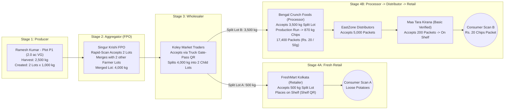

# AnnaSutra: End-to-End Practical Use Case Walkthrough

> [!NOTE]
> **Companion to:** [annasutra_entity_console_architecture.md](file:///C:/Users/Dr_Nee/.gemini/antigravity/brain/96d49d64-752f-4f3b-9611-a81e39e045dc/annasutra_entity_console_architecture.md)
> This document walks through **one complete, real-world journey** step by step—showing exact IDs, lot codes, screen states, custody handshakes, mass-balance rules, processor transformation (₹20 chips packet), and what the Consumer and Admin actually see.

---

## Scenario Overview: Hooghly Potatoes to Loose Retail & ₹20 Chips Packet

We follow **2,000 kg (20 quintals)** of *Kufri Jyoti* potatoes grown by **Ramesh Kumar** in Hooghly, West Bengal, as they move through the supply chain and split into two real-world paths:
- **Path A (Fresh Loose Produce):** 500 kg goes to a local supermarket in Kolkata and is sold as loose potatoes.
- **Path B (Processed Commercial Product):** 1,500 kg goes to a snack factory, is combined with other farmer lots in a **Production Run**, and becomes **₹20 Salted Potato Chips (50 g packets)** sold at a kirana store.



---

## Stage 1: Producer Onboarding, Land, Harvest & Lot Creation

### Step 1.1 — Registration & Admin Verification
1. **Ramesh Kumar** logs in with Mobile OTP (`+91 9830011223`) on **10 Oct 2026 at 09:15:30**.
2. AnnaSutra generates his permanent, frozen **Entity ID**:
   - **Internal ID:** `20261010091530919830011223`
   - **Masked Display ID:** `20261010-091530-91-98XXXXX223`
3. Ramesh submits his **Registration Request Form**:
   - Live selfie, Aadhaar via DigiLocker (stored masked `XXXX-XXXX-4821`), Village *Bora*, Block *Singur*, District *Hooghly* (LGD code `328104`), AgriStack ID, total declared land **5.0 Acres** (Khatian No. `441/2`), PGS-India Natural Farming certificate, and consumer visibility consent (**Photo: Yes**, **Masked Name: Yes**).
4. **Until Admin Approval:** Ramesh only sees the **Verification Status Page** with a vertical stepper (`[Clock] Under Review`).
5. **Admin Action:** The Verifier checks the Khatian document and KYC field-by-field and marks all sections `[BadgeCheck] Approved`. Ramesh's **Producer Console** unlocks.

### Step 1.2 — Land Management (`[LandPlot]`)
Ramesh declares **5.0 Acres** total land and maps 3 plots on the satellite map for **Rabi 2026**:

| Plot ID | Polygon Area (Auto-Measured) | Crop Category | Commodity & Variety | Allocated Area | Overlap / Area Check |
|---|---|---|---|---|---|
| `PLOT-01` | 2.02 Acres | `VG` (Vegetables) | Potato (*Kufri Jyoti*) | **2.0 Acres** | `[BadgeCheck]` Within 10% tolerance, 0 overlaps |
| `PLOT-02` | 1.98 Acres | `FG` (Food Grains) | Paddy (*Swarna*) | **2.0 Acres** | `[BadgeCheck]` Within 10% tolerance, 0 overlaps |
| `PLOT-03` | 0.51 Acres | `PU` (Pulses) | Masoor Dal | **0.5 Acres** | `[BadgeCheck]` Within 10% tolerance, 0 overlaps |
| *Unallocated* | — | — | Fallow / Homestead | **0.5 Acres** | Total = **5.0 / 5.0 Acres** |

### Step 1.3 — Harvest Record (`[Wheat]`)
On **18 Oct 2026**, Ramesh harvests `PLOT-01`:
- **Selected Allocation:** `PLOT-01` → `VG` → Potato (*Kufri Jyoti*) — 2.0 Acres
- **Harvested Quantity:** `2,500 kg` (25 Quintals) — *Admin benchmark for Hooghly potato is up to 10,000 kg/acre, so 1,250 kg/acre passes the yield sanity check.*
- **Live Photo:** Captured on-field (`[Camera]` GPS `22.8124° N, 88.2310° E`, server-timestamped).
- **Harvest Ledger Balance:** `2,500 kg Harvested | 0 kg Lotted | 2,500 kg Unlotted Remaining`.

### Step 1.4 — Batch / Lot Creation (`[PackagePlus]`)
At **11:20:05 on 18 Oct 2026**, Ramesh creates **2 Lots of 1,000 kg each** (20 jute bags × 50 kg per lot) from his 2,500 kg harvest using **Bulk Generate**:

| Field | Lot 1 | Lot 2 |
|---|---|---|
| **Internal Lot Code** | `20261018112005919830011223VG001R` | `20261018112005919830011223VG002T` |
| **Formatted Code on Label** | `20261018112005-91-9830011223-VG-001-R` | `20261018112005-91-9830011223-VG-002-T` |
| **QR Payload (Opaque URL)** | `https://annasutra.in/l/as_9f82k1m4p0` | `https://annasutra.in/l/as_3x71v9q2w8` |
| **6-Digit Peel-Off PIN** | `482-910` | `739-204` |
| **Units & Net Weight** | 20 Jute Bags × 50 kg = **1,000 kg** | 20 Jute Bags × 50 kg = **1,000 kg** |
| **Asking Price / kg** | ₹14.00 / kg | ₹14.00 / kg |
| **Status** | `[QrCode] READY` (Editable `[Pencil]`) | `[QrCode] READY` (Editable `[Pencil]`) |

- **Harvest Balance Auto-Updates:** `2,500 kg Harvested | 2,000 kg Lotted | 500 kg Unlotted Remaining`. (If Ramesh tries to create another 600 kg lot, the system blocks it: *Exceeds remaining harvest balance by 100 kg*).

### Step 1.5 — Ramesh's Compact Producer Console Screen
```
+---------------------------------------------------------------------------------------+
| [AnnaSutra]  Ramesh Kumar [BadgeCheck Verified]  ID: 20261010-...-98XXXXX223   [Bell] |
+-------------------------------------------------------------------+-------------------+
| PRODUCER STATS (Click any tile to filter ledger)                  | ACTION RAIL       |
| Total Land: 5.0 ac   | Allocated: 4.5 ac   | Active Crops: 3      | [UserRound]       |
| Season Harvest: 25 q | Unlotted Bal: 5 q   | Total Lots: 2        |  Profile          |
| In Transit: 0        | Custody Locked: 0   | Consumer Scans: 0    | [LandPlot]        |
|                                                                   |  Land Management  |
|                                                                   | [Wheat]           |
|                                                                   |  Harvest Records  |
|                                                                   | [PackagePlus]     |
|                                                                   |  Batch / Lot      |
+-------------------------------------------------------------------+-------------------+
| COMPACT LOT LEDGER   [Search] [Filter: All] [Crop: VG] [Export CSV/PDF]               |
| Lot Code                | Crop         | Units   | Net Wt   | Price  | Status  | Act  |
| ...-98XXXXX223-VG-001-R | [VG] Potato  | 20 Bags | 1,000 kg | Rs.14  | [READY] | [Pencil][Route][Printer][Send] |
| ...-98XXXXX223-VG-002-T | [VG] Potato  | 20 Bags | 1,000 kg | Rs.14  | [READY] | [Pencil][Route][Printer][Send] |
+---------------------------------------------------------------------------------------+
```

---

## Stage 2: Handover to Aggregator (FPO) & Lot Merging

### Step 2.1 — Dispatch by Farmer
1. Ramesh selects **Lot 1** and **Lot 2** (total 2,000 kg) and taps `[Send] Handover`.
2. He scans the Digital ID Card of **Singur Krishi FPO** (Role: **Aggregator**, Entity ID `20260901100000-91-94330XXXXX`).
3. AnnaSutra displays: `Singur Krishi FPO [ShieldCheck Verified Business] — Singur Collection Centre, Hooghly`.
4. Ramesh enters agreed price `₹14.50 / kg`, captures 1 live loading photo, enters Tata Ace vehicle number `WB-15-C-4412`, and confirms dispatch.
5. **State Change:** Both lots move to `[Truck] HANDOVER_REQUESTED (In Transit)`. Ramesh's `[Pencil]` edit icon is frozen while in transit.

### Step 2.2 — Anti-Spoofing Acceptance by Aggregator (Rapid-Scan Mode)
When the Tata Ace reaches **Singur Krishi FPO Collection Centre**:
1. The FPO Receiving Operator opens `[Inbox] Pending Custody Inbox` and taps `[ScanLine] Rapid Scan Arrival`.
2. With the camera open continuously, he scans the QR on Lot 1 (`Beep — 1/2 verified`) and Lot 2 (`Beep — 2/2 verified`).
3. He captures a live arrival photo on the certified platform scale and enters total weight:
   - Lot 1 arrival weight: `998 kg` (0.2% moisture loss — within the 2% potato tolerance).
   - Lot 2 arrival weight: `997 kg` (0.3% moisture loss — within tolerance).
4. **System Checks:**
   - QR token match: `PASS`
   - Live camera photo: `PASS`
   - Geofence check: Operator GPS is `42 metres` from Singur FPO's registered pin (within 500 m radius): `PASS`
   - Weight variance: `0.25%` (within 2.0% limit): `PASS`
5. Operator taps **Accept Custody**.
6. **Automatic State Transition:**
   - On Ramesh's console, the `[Pencil]` icon on Lot 1 and Lot 2 is **permanently replaced by `[Lock] Custody Locked`**.
   - Active custody transfers to **Singur Krishi FPO**.

### Step 2.3 — Aggregator Merges 4 Farmer Lots & Dispatches with a Truck Gate-Pass QR
Singur Krishi FPO also received 2,005 kg of Grade-A *Kufri Jyoti* potatoes from two other verified farmers in Singur (Anil D. and Subhash M.).
1. In the Aggregator Console, the manager clicks `[GitMerge] Merge Lots`, selects the 4 farmer lots (`998 kg + 997 kg + 1,002 kg + 1,003 kg = 4,000 kg`), grades them as **Grade A Sorted**, and creates **1 Merged Lot**:
   - **Merged Lot Code:** `20261019141022-91-9433055100-VG-001-C` (`4,000 kg`, 80 bags × 50 kg).
   - **Parent Lineage Recorded:** All 4 farmer lots move to `[GitMerge] CONSUMED` and link as parents to `...-VG-001-C`.
2. Next, the FPO dispatches this 80-bag merged lot (4,000 kg) on a 6-wheel truck (`WB-23-E-9081`) to **Koley Market Traders** (Role: **Wholesaler**, Kolkata) and prints a **Truck Gate-Pass QR (`SHP-20261019160010-01`)**.

---

## Stage 3: Wholesaler Accepts & Splits into Two Commercial Paths

### Step 3.1 — Wholesaler Accepts Custody at Kolkata Mandi
1. At 05:30 AM on **20 Oct 2026**, the truck reaches **Koley Market Traders** in Kolkata.
2. The wholesaler scans the **Truck Gate-Pass QR**, scans the merged lot label, takes a live arrival photo at Shop #14, and logs arrival weight **`3,980 kg`** (20 kg transit shrinkage = 0.5%, within tolerance).
3. Custody locks for the FPO and transfers to **Koley Market Traders**.

### Step 3.2 — Wholesaler Appends Cold-Room Data & Splits the Lot
1. At 06:15 AM, the wholesaler scans the lot QR (`[ScanLine] Append Data`) and logs:
   - **Condition:** `Good (0.5% skin scuffing)`
   - **Storage Event:** `Moved to Cold Bay #2 (12°C, 85% RH)`
2. At 10:00 AM, the wholesaler gets two orders and clicks `[Split] Split Lot` on the `3,980 kg` lot:
   - **Child Split Lot A (`...-VG-001-M`, `500 kg`, 10 bags):** Sold to **FreshMart Supermarket** (Retailer, Salt Lake, Kolkata) for fresh loose retail sale.
   - **Child Split Lot B (`...-VG-002-P`, `3,480 kg`, 70 bags):** Sold to **Bengal Crunch Foods Pvt. Ltd.** (Processor / Manufacturer, Sankrail Food Park, Howrah) to manufacture potato chips.
   - **Mass Balance Check:** `500 kg + 3,480 kg = 3,980 kg` (0 kg unaccounted). The parent lot moves to `[GitMerge] CONSUMED`.

---

## Stage 4A (Branch 1): Fresh Retailer Shelf & Consumer Scan

1. **FreshMart Supermarket (Retailer)** receives **Split Lot A (`500 kg`)**, scans the physical bag QR, logs live photo + arrival weight `499 kg`, and clicks **Accept Custody**.
2. FreshMart clicks `[Store] Place on Shelf` and prints a **Display Bin Shelf QR** for the loose potato counter.
3. **Farm-to-Shelf Counter Freezes:** Harvested `18 Oct` → Placed on retail shelf `20 Oct` = **`2 Days Farm-to-Shelf`**.
4. When a shopper in Salt Lake scans the **Display Bin Shelf QR**, they see the **Fresh Produce Consumer Page** (showing Masked Farmer **Ramesh K.** + **Anil D.** + **Subhash M.** from Hooghly District, **2 Days Farm-to-Shelf**, and the 4-hop timeline).

---

## Stage 4B (Branch 2): Processor Turns Potatoes into ₹20 Chips Packets

### Step 4B.1 — Processor Accepts Raw Potatoes
1. **Bengal Crunch Foods Pvt. Ltd.** (Role: **Processor / Manufacturer**, FSSAI Central Manufacturing Licence `10021031000492`, GS1 Prefix `890612345`) receives **Split Lot B (`3,480 kg`)** at Sankrail Food Park.
2. Their QC Operator scans the physical QR at the factory weighbridge, enters arrival weight `3,475 kg`, uploads the dry-matter & reducing-sugar QC test report (`Dry Matter: 21.4% — Passed`), and accepts custody.

### Step 4B.2 — Processor Runs a "Production Run" (`[Factory]` Transformation)
On **21 Oct 2026**, the plant manager opens `[Factory] Production Run` in the Processor Console:

| Parameter | Value Recorded in Production Run `PR-20261021-04` |
|---|---|
| **Input Farm Lot(s)** | Split Lot B (`...-VG-002-P`) — **3,475 kg** raw *Kufri Jyoti* potatoes consumed (`100%`) |
| **Non-Farm Ingredients** | Refined Rice Bran Oil (Batch `RBO-882`, Supplier: Emami Agrotech) + Iodised Salt (Batch `SLT-119`) |
| **Target SKU** | **Bengal Crunch Classic Salted Potato Chips — ₹20 Pack (50 g Net Weight)** (`GTIN: 08906123450018`) |
| **Standard Conversion Ratio** | `4.0 kg raw potato -> 1.0 kg finished chips` (Max allowed output with ±5% tolerance = `912 kg`) |
| **Actual Output Recorded** | **870 kg finished chips = 17,400 Packets × 50 g** |
| **Mass Balance Check** | `[BadgeCheck] PASS` (`3,475 kg input / 870 kg output = 3.994:1 ratio`) |
| **Output Production Batch Lot** | `20261021173000-91-9831144500-VG-001-X` (Mfg: `21 Oct 2026`, Best Before: `21 Feb 2027`) |
| **Packet QR (GS1 Digital Link)** | `https://annasutra.in/01/08906123450018/10/20261021173000VG001X` (printed on all 17,400 packets of this batch) |

> [!TIP]
> **Why Mass Balance Matters Here:** If Bengal Crunch Foods tried to print QR codes for **30,000 packets (1,500 kg of chips)** from only **3,475 kg of traced potatoes**, AnnaSutra would immediately block or flag the batch (`[TriangleAlert] Mass Balance Breach: Output exceeds 4:1 conversion limit by 588 kg`), stopping unverified potatoes from being mixed in under a verified label.

### Step 4B.3 — Distributor to Kirana Store (`Basic Verified` Retailer)
1. **Bengal Crunch Foods** splits out **200 cartons (10,000 packets)** of Batch `...-VG-001-X` and dispatches them to **EastZone Distributors** (Kolkata), who accepts custody via QR + photo + weight.
2. **EastZone Distributors** splits out **4 cartons (200 packets, 10 kg net)** and delivers them to **Maa Tara Kirana Store** in Gariahat, Kolkata (a small shop onboarded under the **`[BadgeCheck] Basic Verified`** tier using Shop Establishment Licence + FSSAI Basic Registration, no GSTIN needed).
3. **Maa Tara Kirana** scans the carton QR, takes a live photo in the shop, accepts custody, and taps `[Store] Place on Shelf` on **23 Oct 2026** (**Farm-to-Shelf = 5 Days from harvest**).

---

## Stage 5: What the Customer Sees When Scanning the ₹20 Chips Packet

A customer buys a **₹20 Bengal Crunch Salted Chips** packet at **Maa Tara Kirana** on **25 Oct 2026** and scans the QR code on the back of the wrapper (`https://annasutra.in/01/08906123450018/10/20261021173000VG001X`).

### Customer Mobile Screen (No Login Required)
```
+-----------------------------------------------------------------------+
| [ShieldCheck] VERIFIED GENUINE BY ANNASUTRA                           |
| Batch scan count: 14 scans across Kolkata (Normal retail pattern)     |
+-----------------------------------------------------------------------+
| BENGAL CRUNCH — CLASSIC SALTED POTATO CHIPS (50g | MRP Rs. 20)        |
| Batch: ...-VG-001-X  |  Mfg: 21 Oct 2026  |  Best Before: 21 Feb 2027 |
| [Clock] Farm Harvest to Retail Shelf: 5 Days                          |
+-----------------------------------------------------------------------+
| WHERE YOUR POTATOES WERE GROWN (MASKED FOR FARMER PRIVACY)            |
| Grown by 3 Verified Farmers in Hooghly District, West Bengal          |
|                                                                       |
|  [Photo]  Ramesh K.      [BadgeCheck] Verified Farmer                 |
|           Hooghly District, WB | PGS-India Natural Farming [Verify]   |
|  [Photo]  Anil D.        [BadgeCheck] Verified Farmer                 |
|           Hooghly District, WB | Conventional                         |
|  [Photo]  Subhash M.     [BadgeCheck] Verified Farmer                 |
|           Hooghly District, WB | PGS-India Natural Farming [Verify]   |
|                                                                       |
|  [Map] District-level Pin: Hooghly, West Bengal (Exact plot hidden)   |
+-----------------------------------------------------------------------+
| COMPLETE SUPPLY CHAIN JOURNEY (5 VERIFIED HOPS)                       |
| 1. [Wheat]    Harvested on Verified Farms — Hooghly, WB (18 Oct)      |
| 2. [GitMerge] Graded & Aggregated — Singur Krishi FPO, Hooghly (19 Oct)|
| 3. [Truck]    Cold-Stored & Traded — Koley Market Traders, Kol (20 Oct)|
| 4. [Factory]  Processed & Packed — Bengal Crunch Foods, Howrah (21 Oct)|
|                FSSAI Lic: 10021031000492 | QC Lab Test: Passed [View]  |
| 5. [Store]    Retail Shelf — Maa Tara Kirana, Gariahat, Kol (23 Oct)  |
+-----------------------------------------------------------------------+
| [MapPin] Want to see how many km your snack travelled from the farm?  |
|          [Share Precise Location (Opt-In)]   [Rate Product]  [Report] |
+-----------------------------------------------------------------------+
```

- **If the customer taps `[Share Precise Location (Opt-In)]`:** The browser requests GPS permission, shows *"Your chips travelled 48.6 km from Hooghly farms to Gariahat!"*, and logs an opt-in GPS point in the Admin Analytics table.
- **If the customer does not tap it:** AnnaSutra still legally logs `City: Kolkata (from IP), Time: 25 Oct 18:42, SKU: Bengal Crunch 50g, Retailer: Maa Tara Kirana`.

---

## Stage 6: What Ramesh (Farmer) & Admin See in "Track Lot"

### 6.1 Ramesh Opens `[Route] Track Lot` on His Producer Console
When Ramesh clicks `[Route] Track Lot` on `...-VG-001-R`, a modal opens showing:
- **Journey Map & 5-Hop Timeline:** Shows his lot moving from Hooghly → Singur FPO → Koley Market → split into FreshMart (500 kg) and Bengal Crunch Foods (3,480 kg) → EastZone Distributors → Maa Tara Kirana.
- **Days to Shelf:** `2 Days (Fresh Retail)` and `5 Days (Processed Retail)`.
- **Price Secrecy Enforced:** Ramesh sees his own sale price (`₹14.50/kg`), while downstream prices between the FPO, Wholesaler, Processor, and Retailer are hidden (`Admin Only`).
- **Consumer Scans:** `"Your potatoes have been scanned by 39 consumers in Kolkata!"`

### 6.2 Admin Opens "Chain Explorer" & "Recall Center"
In the **Admin Console**, the Super Admin searches `20261018112005-91-9830011223-VG-001-R` and sees:
1. **Full Unmasked Graph:** Every entity's full ID, phone number, exact plot polygon, per-hop price (`₹14.50 → ₹16.00 → ₹18.50 → ₹20/pack`), weight loss at every hop (`0.2% → 0.5% → 3.994:1 conversion`), every live photo, and the SHA-256 hash chain verifying zero database edits.
2. **One-Click Surgical Recall Test:** If a lab later finds a contamination issue in **Bengal Crunch Batch `...-VG-001-X`**, the Admin clicks `[OctagonAlert] Initiate Recall` on that batch:
   - AnnaSutra traces downstream in milliseconds to **EastZone Distributors** and **Maa Tara Kirana** (sending urgent SMS + in-app alerts to pull the batch from shelves) and flips the **Consumer Scan Banner** for that batch to crimson `[OctagonAlert] RECALLED — DO NOT CONSUME`.
   - Meanwhile, **FreshMart Supermarket's** 500 kg of fresh potatoes (Branch A) is unaffected because the contamination occurred during processing at Hop 4B, not on the farm.
