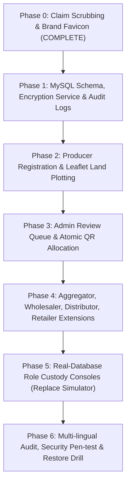

# AnnaSutra: Phase 0 Verification & Implementation Master Plan (Phases 1–6)

**Date:** 14 October 2026  
**Status:** Phase 0 Complete & Verified; STOP 1 & STOP 2 Architectural Proposal  
**Target Database:** MySQL 8.0 on Aiven (`utf8mb4`)  
**Deployment Platform:** Vercel Serverless (`backend/config/wsgi.py`, Python 3.12)  
**Author:** Antigravity (Pair Programming with Human Reviewer)  

---

## Part 1: Phase 0 Claim Cleanup & Brand Icon Deployment Report

In strict compliance with **Ground Rule 2** ("Phase 0 is mandatory and comes before any feature work. No real personal data may be collected until it is done"), all unverifiable, invented, or government-affiliated claims have been purged from the AnnaSutra platform.

### 1.1 Brand Emblem & Multi-Platform Favicon Deployed
From the user-provided high-resolution emblem image:
- **Web Favicon & Icons:**
  - `static/publicview/images/favicon.ico` (multi-resolution 16×16, 32×32, 48×48)
  - `static/publicview/images/favicon.png` (512×512)
  - `static/publicview/images/favicon-32x32.png` (32×32)
  - `static/publicview/images/favicon-16x16.png` (16×16)
  - `static/publicview/images/apple-touch-icon.png` (180×180)
  - `static/publicview/images/app_icon.png` (512×512)
  - `staticfiles/publicview/images/...` (mirrored for production static serving)
- **Direct Route:** Added `path("favicon.ico", serve_static_asset, ...)` in `backend/config/urls.py` so standard browser requests resolve cleanly with HTTP 200.
- **HTML Headers:** `<link rel="icon">` and `<link rel="apple-touch-icon">` tags embedded across all public templates (`landing.html`, `lot_summary.html`, `lot_not_found.html`).
- **Mobile PWA:** Deployed `mobile/web/favicon.png` (192×192) and `mobile/assets/images/app_icon.png` (512×512).

### 1.2 Claims & False Affiliation Scrubbing Summary

| Element / Area | Prior Unverified Claim | Scrubbed & Replaced With | Verification Result |
|---|---|---|---|
| **Platform Affiliation & Footer** | "Developed & Maintained by C-DAC, Ministry of Electronics & IT (MeitY), Government of India" + C-DAC Emblem | "AnnaSutra is an independent project. It is not a government service." + AnnaSutra Independent Initiative Emblem | Verified clean in EN, HI, BN |
| **Site Branding & Title** | "National Agri-Produce Traceability Platform" / "National Sovereign Value Chain" | "AnnaSutra: produce traceability (pilot)" / "PRODUCE TRACEABILITY PILOT" | Verified clean in EN, HI, BN |
| **Invented Counters** | 1,42,850+ kg tracked; 2,480+ registered farmers; 99.8% Grade A; 48,900+ scans | Replaced with pilot baseline values (0 Kg Tracked, 0 Producers, Agmarknet Planned) | Verified clean in EN, HI, BN |
| **Telemetry Ticker** | "LIVE CUSTODY TICKER" with simulated APMC transactions | "LIVE SIMULATION (DEMO DATA • NOT REAL TRANSACTIONS)" | Labeled prominently |
| **Entity Dashboard Simulator** | Simulated nodes appearing as live production | Added warning banner: `DEMO DATA — Simulated Demonstration (Not real transactions)` | Labeled prominently |
| **Data Protection Claim** | "DPDP Act 2023 Certified" | "Designed with data-protection principles. Not certified." | Aligned with statutory notice |
| **Helplines** | Kisan Call Centre `1800-180-1551`, Consumer Helpline `1915`, `1800-425-CDAC` | Project contacts: `support@annasutra.in` and `grievance@annasutra.in (72h SLA)` | 1800/1915 purged completely |
| **Grievance Office Address** | C-DAC Knowledge Park, Bengaluru | AnnaSutra Digital Project Secretariat, Support & Grievance Wing | Address claims removed |
| **C-DAC Mandate Modal** | C-DAC Government Mandate | "AnnaSutra Project Architecture & Principles (Independent Initiative)" | Verified clean in EN, HI, BN |

### 1.3 Test Verification
- Created test suite `backend/tests/test_phase0_claims.py`:
  - `test_favicon_endpoint`: Verified HTTP 200 and image payload.
  - `test_landing_page_claims_scrubbed`: Validated presence of pilot disclaimer and absence of all C-DAC, MeitY, 1800, 1915, and invented metric strings.
  - `test_public_lot_view_claims_scrubbed`: Validated public lot summary and 404 pages.
- Results: **3 passed in 1.68s**, Ruff linter clean, Django system checks clean.

---

## Part 2: Repository Inspection (Ground Rule 1)

1. **Backend Framework:** Django 5.1.15 + Django REST Framework 3.15.2 running on Python 3.12.
2. **Database:**
   - **Production:** MySQL 8.0 on Aiven (`utf8mb4`), accessed via PyMySQL with TLS and strict SQL mode.
   - **Local Testing:** Test runner configured with isolated SQLite in-memory fallback for local offline test execution.
   - **Migrations:** DDL uses `apply_schema()` in `backend/apps/organisations/migrations/0001_initial.py`.
3. **Hosting & Serverless Runtime:**
   - Vercel Serverless Functions (`backend/config/wsgi.py` mapped to `/(.*)`).
   - Execution constraints: Stateless serverless lambdas (ephemeral filesystem; file uploads must not reside on local disk).
4. **Front-End Architecture:**
   - Server-rendered lightweight HTML/CSS/Vanilla JS with GSAP animations in `backend/apps/publicview/templates/publicview/`.
   - Top 2 navigation bars and curved footer are synchronized across all templates.
   - Zero heavyweight JS frameworks on public pages for sub-second consumer QR scans.
5. **Mobile Architecture:**
   - Flutter multi-platform application (`mobile/`) supporting Android APK and Web PWA.

---

## Part 3: STOP 1 & STOP 2 Architecture Proposal

### 3.1 Sensitive Data Encryption Design (STOP 2 Review)

In compliance with **Section 6** of the Handover Guide:
1. **Aadhaar Protection:**
   - `AADHAAR_MODE = "last4"`.
   - The user inputs 12 digits for verification regex check `^[2-9]{1}[0-9]{11}$`.
   - **Only the last 4 digits are saved** to `entity_sensitive.aadhaar_last4`. The raw number is discarded immediately in memory and never logged, stored, or transmitted.
2. **AES-256-GCM Application-Level Encryption:**
   - Fields encrypted: PAN (`pan_enc`), Bank Account Number (`account_no_enc`), IFSC (`ifsc_enc`), Bank Account Holder Name (`bank_holder_enc`), UPI ID (`upi_enc`), Plot Coordinates GeoJSON (`geojson_enc`), Facility Location (`location_enc`).
   - Algorithm: AES-256-GCM with authenticated 128-bit tag and unique 96-bit random IV (nonce) per encryption call:
     $$\text{Ciphertext} = \text{AES-GCM-Encrypt}(K_{\text{enc}}, \text{nonce}, \text{plaintext}, \text{AAD}=\text{entity\_id})$$
   - Key storage: Root encryption key derived from environment variable `ANNASUTRA_ENCRYPTION_KEY_V1`. The `enc_key_id` (e.g. `k1-2026`) is stored alongside the record to enable zero-downtime key rotation.
3. **PAN HMAC Blind Index:**
   - To enforce PAN uniqueness and check duplicates without decrypting the entire database:
     $$\text{pan\_hmac} = \text{HMAC-SHA256}(K_{\text{blind\_index}}, \text{normalized\_pan})$$
   - $K_{\text{blind\_index}}$ is a distinct secret separate from $K_{\text{enc}}$.
4. **Masked Display & Reveal Audit Trail:**
   - Masked formats: PAN `ABCDE****F`, Account `XXXXXX1234`, UPI `ab***@bank`.
   - Admins only see masked values by default.
   - Revealing unmasked data requires a mandatory typed business reason and appends an immutable record to `sensitive_access_log`:
     ```sql
     INSERT INTO sensitive_access_log (entity_id, actor_id, field_name, reason, at)
     VALUES (?, ?, ?, ?, CURRENT_TIMESTAMP);
     ```

---

### 3.2 Roadmap: Phases 1 to 6



#### Phase 1: Database Models, Encryption Helper & Audit Logs
- **Schema Implementation:**
  - Create tables: `entity_profile`, `entity_sensitive`, `entity_plot`, `entity_facility`, `entity_role_details`, `entity_document`, `verification_review`, `profile_change_log`, `sensitive_access_log`, `consent_record`, `qr_block`, `qr_label`.
  - Add append-only triggers preventing `UPDATE` and `DELETE` on log tables.
- **Crypto Utility Service:**
  - `apps.identity.services.crypto.EncryptionService` handling AES-256-GCM, nonce packaging, and HMAC-SHA-256 blind indexing.
- **Deliverables:** Automated unit tests verifying ciphertext storage, key rotation, and append-only trigger blockage.

#### Phase 2: Producer Registration Wizard & Leaflet Plot Mapping
- **Interactive Multi-Step Wizard:**
  - Step 1: Personal & Organization details (Name, Village, District, State, PIN).
  - Step 2: Land details & interactive Leaflet + Leaflet-Geoman map polygon drawing. Auto-calculates area in acres via Turf.js ($1 \text{ acre} = 4046.8564 \text{ m}^2$) and validates polygon bounds (within India, no self-intersection).
  - Step 3: Sensitive identity & bank details (masked input, client format validation, AES-256-GCM encrypted persistence).
  - Step 4: Photo capture (strips EXIF metadata, resizes to max 512px).
  - Step 5: Multi-lingual statutory consent notice checkbox (`notice_version="2026.1"`, English, Hindi, Bengali).
- **Draft & Submit Mechanism:**
  - `PUT /api/v1/me/profile` (save draft without blocking).
  - `POST /api/v1/me/profile/submit` (atomic server-side validation).

#### Phase 3: Admin Verification Queue & Atomic QR Allocation
- **Admin Review Console:**
  - Review queue showing `SUBMITTED` entities.
  - Verification actions: `APPROVED`, `REJECTED`, `NEEDS_CHANGES`, `SUSPENDED`.
- **Atomic Approval Transaction (Section 9):**
  - Generates immutable entity code `{ROLE}-{STATE}-{SEQ6}` (e.g. `PR-WB-000001`).
  - Creates the first QR block (default 50 labels for Producers).
  - Generates 13-character Crockford Base32 serials (12 entropy chars + 1 check character, no ambiguous characters `I, L, O, U`).
  - Printable A4 sticker sheet generator (PDF).

#### Phase 4: Downstream Supply Chain Roles Registration
- Extend wizard for:
  - **Aggregator:** Mandi APMC licence, storage capacity (kg), weighing scale calibration certificate.
  - **Wholesaler:** Market stall, FSSAI number, cold storage capacity and temperature specs.
  - **Distributor:** Fleet list (refrigerated yes/no, registration number, payload kg).
  - **Retailer:** Kirana / Supermarket type, shelf QR standee quantity.

#### Phase 5: Role Custody Consoles Backed by Live Database
- Replace the client-side simulator with authenticated, role-confined consoles displaying real query metrics from `entity_profile`, `lot`, `handover`, and `qr_label`.
- All empty states show 0 with onboarding prompts.

#### Phase 6: Final Hardening, Penetration Testing & Accessibility
- Automated cross-entity authorization tests (verifying an entity cannot read or alter another entity's plots, documents, or labels).
- Full audit of English, Hindi, and Bengali translations across all modal dialogs.
- Backup & restore drill verification report.

---

## Part 4: Open Questions for the Reviewer

1. **Cloud Object Storage:** For uploaded documents and profile photos, do you have an existing S3/Cloudflare R2 bucket credential, or should we configure a local media storage fallback for initial pilot tests?
2. **Approval to Proceed:** Please confirm approval of this Phase 0 report and the Part 3 architecture plan to begin **Phase 1** implementation.
